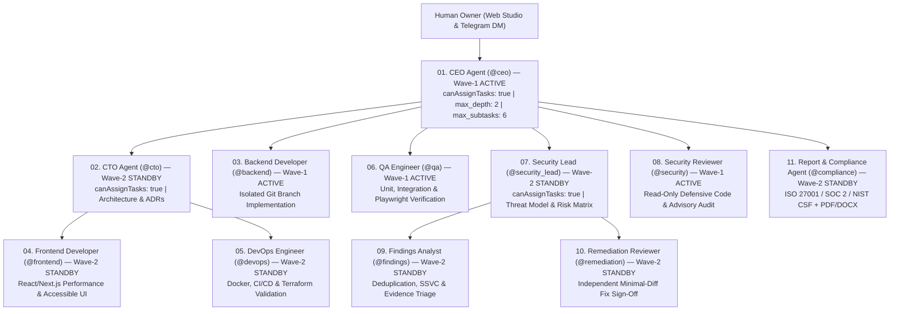

# ALLINAGENT — 11 Specialized Corporate AI Agents

`ALLINAGENT` operates a complete **11-employee Autonomous AI Engineering, Quality Assurance, Defensive Security & Compliance Organization**. Every agent is governed canonically in **Paperclip** (`allinagent-paperclip` + `allinagent-postgres`), executes inside an isolated non-root **Hermes named profile** (`<HERMES_HOME>/profiles/pc*`) sharing a single CPython `3.14` runtime (`allinagent-hermes`), and appears live at a deterministic department workstation in both the **3D WebGL Virtual Office** and **2D Pixel Office** (`allinagent-office`).

Related documentation:
- [`ARCHITECTURE.md`](./ARCHITECTURE.md) — Multi-container topology, `hermes-exec` broker, and CLI shim
- [`SKILLS.md`](./SKILLS.md) — Per-agent specialization across all 33 pinned GitHub skill packages
- [`TELEGRAM.md`](./TELEGRAM.md) — Controlling, chatting with, and convening all 11 agents via Telegram
- [`SECURITY.md`](./SECURITY.md) — Filesystem, secret, and toolset isolation boundaries

---

## 1. Complete 11-Agent Organizational Roster

All 11 agents are defined in `apps/control-center/control_center/org_provisioner.py` and `agents/organization-roster.template.json`:

| # | Role Slug | Display Name | `@handle` | Isolated Profile | Paperclip Role | Department | Default Tier | Enforced Toolsets | Reports To |
| :---: | :--- | :--- | :--- | :--- | :--- | :--- | :--- | :--- | :--- |
| `01` | `ceo_agent` | **CEO Agent** | `@ceo` | `pcceoagent` | `ceo` | Executive Office (`EXEC`) | **Wave-1 (`ACTIVE`)** | `file,terminal,skills` | *Board / Owner (`null`)* |
| `02` | `cto_agent` | **CTO Agent** | `@cto` | `pcctoagent` | `cto` | Executive / Architecture (`EXEC`) | Wave-2 (`STANDBY`) | `file,terminal,skills` | `ceo_agent` |
| `03` | `backend_developer` | **Backend Developer** | `@backend` | `pcbackenddeveloper` | `engineer` | Engineering (`ENG`) | **Wave-1 (`ACTIVE`)** | `file,terminal,skills` | `ceo_agent` |
| `04` | `frontend_developer` | **Frontend Developer** | `@frontend` | `pcfrontenddeveloper` | `designer` | Engineering / Frontend (`ENG`) | Wave-2 (`STANDBY`) | `file,terminal,skills` | `cto_agent` |
| `05` | `devops_engineer` | **DevOps Engineer** | `@devops` | `pcdevopsengineer` | `devops` | Engineering / DevOps (`ENG`) | Wave-2 (`STANDBY`) | `file,terminal,skills` | `cto_agent` |
| `06` | `qa_engineer` | **QA Engineer** | `@qa` | `pcqaengineer` | `qa` | QA Laboratory (`QA LAB`) | **Wave-1 (`ACTIVE`)** | `file,terminal,skills` | `ceo_agent` |
| `07` | `security_lead` | **Security Lead** | `@security_lead` | `pcsecuritylead` | `security` | Security Operations (`SOC`) | Wave-2 (`STANDBY`) | `file,skills` *(read-only)* | `ceo_agent` |
| `08` | `security_reviewer` | **Security Reviewer** | `@security` | `pcsecurityreviewer` | `security` | Security Operations (`SOC`) | **Wave-1 (`ACTIVE`)** | `file,skills` *(read-only)* | `ceo_agent` |
| `09` | `findings_analyst` | **Findings Analyst** | `@findings` | `pcfindingsanalyst` | `researcher` | Security Operations (`SOC`) | Wave-2 (`STANDBY`) | `file,skills` *(read-only)* | `security_lead` |
| `10` | `remediation_reviewer` | **Remediation Reviewer** | `@remediation` | `pcremediationreviewer` | `security` | Security Operations (`SOC`) | Wave-2 (`STANDBY`) | `file,skills` *(read-only)* | `security_lead` |
| `11` | `compliance_reporter` | **Report & Compliance Agent** | `@compliance` | `pccompliancereporter` | `pm` | Compliance Office (`COMP`) | Wave-2 (`STANDBY`) | `file,terminal,skills` | `ceo_agent` |

---

## 2. Organizational Hierarchy & Delegation Governance



### Bounded Delegation & Permission Invariants

1. **Task Assignment Authority (`canAssignTasks`):** Only leadership roles — **CEO Agent** (`ceo_agent`), **CTO Agent** (`cto_agent`), and **Security Lead** (`security_lead`) — hold `canAssignTasks: true` in Paperclip. Individual contributors execute assigned issues and report structured evidence back to their parent issue.
2. **Zero Unbounded Self-Replication:** Every agent is provisioned with `canCreateAgents: false` and `canCreateSkills: false`. Agents cannot create rogue sub-agents or install unverified remote skills at runtime.
3. **Bounded Fan-Out (`config/resource-limits.json`):** Multi-agent decomposition enforces `max_delegation_depth: 2` and `max_subtasks_per_parent: 6`, serialized safely through `HEAVY_WORKER_CONCURRENCY=1` on `2 vCPU / 8 GB RAM` hosts.
4. **Separation of Duties:**
   - **CEO** synthesizes plans and delegates; it never mutates application source branches directly.
   - **CTO** authors Architecture Decision Records (ADRs) and independent design reviews; it never bypasses QA/Security gates.
   - **Remediation Reviewer** operates strictly as an independent verifier (`RESOLVED` vs `REWORK_REQUIRED`) and never authors and self-approves its own code changes.

---

## 3. Role Specifications, Turn Budgets & Expected Outputs

| # | Agent | Timeout / Max Turns | Workspace Scope | Primary Objective & Deliverable Contract |
| :---: | :--- | :---: | :--- | :--- |
| `01` | **CEO Agent** (`@ceo`) | `240s` / `20` turns | `WORKSPACES_DIR` | Decomposes Owner goals into bounded parent/child Paperclip tasks, coordinates specialist handoffs, and produces executive completion reports. |
| `02` | **CTO Agent** (`@cto`) | `240s` / `18` turns | `WORKSPACES_DIR` | Defines system architecture, API/data contracts, DORA/scaling assessments, and produces ADRs + engineering review verdicts. |
| `03` | **Backend Developer** (`@backend`) | `420s` / `25` turns | `WORKSPACES_DIR` | Implements backend/API features, bug fixes, and security remediations on isolated Git branches/worktrees (`create_isolated_git_worktree`) with unit test exit codes. Detects target stack (e.g., PHP/Laravel vs Node/TS vs Python) before scaffolding. |
| `04` | **Frontend Developer** (`@frontend`) | `240s` / `20` turns | `WORKSPACES_DIR` | Builds accessible, responsive UI components, eliminates React/Next.js request waterfalls, and reports frontend test verdicts. |
| `05` | **DevOps Engineer** (`@devops`) | `240s` / `18` turns | `WORKSPACES_DIR` | Validates Dockerfiles, CI/CD workflows, static Terraform/OpenTofu HCL modules, and non-destructive runtime diagnostics (never running `terraform apply` without Owner approval). |
| `06` | **QA Engineer** (`@qa`) | `240s` / `20` turns | `WORKSPACES_DIR` | Executes unit, integration, API, and isolated headless Playwright E2E suites; outputs pass/fail counts, exit codes, and regression verdicts. |
| `07` | **Security Lead** (`@security_lead`) | `180s` / `15` turns | `WORKSPACES_DIR` | Governs defensive security architecture, threat modeling, risk registers, and scope compliance (`Risk Prioritization Matrix`). |
| `08` | **Security Reviewer** (`@security`) | `180s` / `15` turns | `WORKSPACES_DIR` | Performs read-only defensive source code & dependency advisory audits (`CONFIRMED` / `FALSE_POSITIVE` / `VERIFIED` with CWE rationale; never fabricates CVE IDs). |
| `09` | **Findings Analyst** (`@findings`) | `180s` / `12` turns | `REPORTS_DIR` | Deduplicates, normalizes severity, correlates sanitized VulnClaw evidence, and ranks remediation priority (`Normalized Findings Summary`). |
| `10` | **Remediation Reviewer** (`@remediation`) | `180s` / `12` turns | `WORKSPACES_DIR` | Inspects patch diffs for root-cause elimination, minimal-change scope, and regression coverage (`RESOLVED` or `REWORK_REQUIRED`). |
| `11` | **Report & Compliance Agent** (`@compliance`) | `180s` / `12` turns | `REPORTS_DIR` | Maps technical readiness & control overlap across ISO 27001, SOC 2, and NIST CSF (with non-legal-certification disclaimer) and generates validated `.pdf` & `.docx` deliverables. |

---

## 4. Wave-1 Active vs. Wave-2 On-Demand Standby Lifecycle

To maintain a **`~415–512 MiB` idle memory footprint** while keeping all 11 specialists ready for full-company workflows, `ALLINAGENT` provisions agents in two operational waves:

- **Wave-1 (`ACTIVE` / Paperclip `idle` at boot — 4 Core Agents):**
  1. `01` **CEO Agent** (`ceo_agent`) — Executive intake & delegation
  2. `03` **Backend Developer** (`backend_developer`) — Core software engineering
  3. `06` **QA Engineer** (`qa_engineer`) — Automated regression & verification
  4. `08` **Security Reviewer** (`security_reviewer`) — Continuous read-only defensive review
- **Wave-2 (`STANDBY` / Paperclip `paused` at boot — 7 Specialist Agents):**
  - `02` **CTO Agent**, `04` **Frontend Developer**, `05` **DevOps Engineer**, `07` **Security Lead**, `09` **Findings Analyst**, `10` **Remediation Reviewer**, and `11` **Report & Compliance Agent**.

### On-Demand Wake & Standby Transitions
- **Automatic / Direct Wake:** Addressing any Wave-2 agent directly (via Telegram `/pilih`, `/ke`, `@handle`, 11-agent `/meeting`, or Studio Employee Chat) or waking via `/bangunkan <1..11|semua>` resumes the agent cleanly.
- **Returning to Wave-1 Baseline:** Running `/standar-wave1` (or clicking `🔄 Formasi Standar Wave-1` in the `CEO / TASKS` Telegram submenu, or passing `--reset-activation-tiers` to `org_provisioner.py`) gracefully pauses the 7 Wave-2 specialists and restores the 4 Wave-1 core agents to `idle`.
- **Emergency Drain:** `/stop-semua` aborts in-flight worker runs via `AbortController` / `DELETE /v1/exec/<id>` and transitions all 11 agents to `STANDBY`.

---

## 5. Strict Toolset Boundaries (`file,terminal,skills` vs. Read-Only `file,skills`)

Every agent's Paperclip `adapterConfig.toolsets` and worker `role-manifest.json` enforce explicit capability separation:

| Capability Tier | Assigned Agents | Permitted Hermes Toolsets | Security Rationale |
| :--- | :--- | :--- | :--- |
| **Execution & Artifact Tier (`7` Agents)** | `ceo_agent`, `cto_agent`, `backend_developer`, `frontend_developer`, `devops_engineer`, `qa_engineer`, `compliance_reporter` | `file,terminal,skills` | Required to run unit/Playwright tests, inspect Git branches/worktrees, execute deterministic skill helper scripts (`strategy_analyzer.py`, `api_linter.py`, `compliance-os`), and render `.pdf`/`.docx` reports inside `REPORTS_DIR`. Mutating git/workspace edits are serialized via `workspace_exclusive_lock` (`O_CREAT \| O_EXCL`). |
| **Read-Only Defensive SOC Tier (`4` Agents)** | `security_lead`, `security_reviewer`, `findings_analyst`, `remediation_reviewer` | `file,skills` | **`terminal` is intentionally disabled.** Security and triage agents inspect source code, diffs, and sanitized `findings.db` artifacts strictly read-only and load reviewed defensive methodologies via `skill_view`. Even if untrusted repository comments contain prompt-injection strings, read-only SOC agents have zero shell execution capability. |

---

## 6. Isolated `pc*` Hermes Profiles (`0 MB` Duplicate Virtualenvs)

Inside `allinagent-hermes` (`components/hermes/entrypoint.sh` & `apps/control-center/control_center/hermes_worker_factory.py`), all 11 corporate agents share **one** CPython `3.14` `uv` virtual environment (`/opt/hermes-venv`) while maintaining strict per-agent filesystem and credential isolation under `<HERMES_HOME>/profiles/<profile_id>`:

```text
/var/lib/allinagent/hermes/                 (Owner Gateway root — chmod 0700, UID 10001:10001)
├── .env                                    (Contains TELEGRAM_BOT_TOKEN — NEVER readable by worker profiles)
├── state.db                                (Owner DM session database)
├── plugins/unified-company-control/        (User-space 59-command Telegram plugin)
└── profiles/                               (chmod 0700)
    ├── pcceoagent/                         (chmod 0700)
    │   ├── .no-bundled-skills              ("1" — blocks syncing owner skills into worker profile)
    │   ├── .env                            (chmod 0600 — ONLY worker-llm.env + agent-scoped PAPERCLIP_API_KEY)
    │   ├── .paperclip_key_meta.json        (Tracks bound agent_id & Paperclip key_id)
    │   ├── config.yaml                     (approvals: smart, unattended_mode: deny, persistent_shell: false)
    │   ├── SOUL.md                         (Role boundary, prohibited actions & progressive skill routing)
    │   ├── state.db                        (Isolated per-agent conversation & tool-call SQLite DB)
    │   ├── memories/MEMORY.md              (Isolated role memory)
    │   ├── sessions/                       (Isolated session transcripts)
    │   └── skills/                         (Role-scoped symlinks + .usage.json with locked: true)
    ├── pcctoagent/
    └── ... (pcbackenddeveloper .. pccompliancereporter)
```

Key isolation guarantees:
- **Zero `TELEGRAM_BOT_TOKEN` Exposure:** `provision_worker_home()` populates `<profile>/.env` exclusively from `data/secrets/worker-llm.env` plus a per-agent Paperclip API token minted via `bind_agent_paperclip_key()`.
- **Strict Environment Passthrough Whitelist:** Worker `config.yaml` restricts `client_env_passthrough` to `PAPERCLIP_API_URL`, `PAPERCLIP_RUN_ID`, `PAPERCLIP_TASK_ID`, `PAPERCLIP_AGENT_ID`, `PAPERCLIP_COMPANY_ID`, `PAPERCLIP_WAKE_REASON`, and `PAPERCLIP_WAKE_COMMENT_ID`, and `env_passthrough` solely to `PAPERCLIP_API_KEY`.
- **Fail-Closed Unattended Approvals:** Worker profiles enforce `cron_mode: deny`, `single_query_mode: deny`, and `unattended_mode: deny` with `computer_use.autostart: false`.

---

## 7. Dynamic UUID Resolution & Spatial Virtual Office Mapping

`ALLINAGENT` contains **zero hardcoded company or agent UUIDs** in source code, skills, or documentation.

### How Dynamic UUID Resolution Works
1. **Track A — Fresh Public Installation (`track_a_fresh_install`):**
   - During `./allinagent setup`, `org_provisioner.py` creates the primary company (`Unified AI Engineering & Operations`) and all 11 agents in Paperclip (`allinagent-paperclip`).
   - Paperclip mints fresh canonical v4 UUIDs at database insertion time and records `"role_slug"` and `"hermes_profile"` inside each agent's `metadata`.
   - `org_provisioner.py` writes the runtime lookup map to `config/organization-roster.json` (which is strictly git-ignored and blocked from commits by `scripts/audit-public-release.py`).
2. **Track B — Private State Migration (`track_b_preserved_uuids`):**
   - When migrating an existing operational database (`DATABASE-MIGRATION.md`), `_match_existing_agent()` matches existing Paperclip rows by prior roster ID, `metadata.role_slug`, or canonical agent display name — preserving 100% of historical Company and Agent UUIDs, Kanban task foreign keys, and run histories while rebinding container filesystem paths.
3. **Runtime Lookup Across Office Bridge, Web UI & Telegram:**
   - `office-bridge/contracts/agent-identity.js` (`mapPaperclipAgentIdentity`) and the Telegram controllers dynamically query Paperclip's live `/api/companies/<company_id>/agents` roster and resolve agents by:
     - Numeric roster index (`1..11`)
     - Canonical `@handle` (`@ceo`, `@cto`, `@backend`, `@frontend`, `@devops`, `@qa`, `@security_lead`, `@security`, `@findings`, `@remediation`, `@compliance`)
     - `role_slug` (`ceo_agent` .. `compliance_reporter`) or display name (`CEO Agent` .. `Report & Compliance Agent`)

### Deterministic 3D & 2D Virtual Office Coordinates

Regardless of the dynamically minted UUID, `ROLE_VISUAL_CATALOG` in `office-bridge/contracts/agent-identity.js` maps every corporate role deterministically to its 3D/2D department room, desk coordinates, avatar profile, and badge:

| # | Agent | Visual Profile | Office Room (`departmentId`) | Workstation Slot (`officeLocationId`) | Desk `(x, y, facing)` | Badge |
| :---: | :--- | :--- | :--- | :--- | :---: | :---: |
| `01` | **CEO Agent** | `vp-ceo-01` | `executive` (Executive Office) | `dept-executive-desk-1` | `(220, 190, 0°)` | 👑 |
| `02` | **CTO Agent** | `vp-cto-02` | `executive` (Executive Office) | `dept-executive-desk-2` | `(340, 190, 0°)` | 🏛️ |
| `03` | **Backend Developer** | `vp-backend-03` | `engineering` (Engineering Dept) | `dept-engineering-desk-1` | `(480, 340, 0°)` | ⚙️ |
| `04` | **Frontend Developer** | `vp-frontend-04` | `engineering` (Engineering Dept) | `dept-engineering-desk-2` | `(600, 340, 0°)` | 🎨 |
| `05` | **DevOps Engineer** | `vp-devops-05` | `engineering` (Engineering Dept) | `dept-engineering-desk-3` | `(720, 340, 0°)` | 🚀 |
| `06` | **QA Engineer** | `vp-qa-06` | `qa_lab` (QA Laboratory) | `dept-qa-station-1` | `(1410, 300, 180°)` | 🧪 |
| `07` | **Security Lead** | `vp-seclead-07` | `soc` (Security Operations Center) | `dept-soc-desk-1` | `(820, 210, 0°)` | 🛡️ |
| `08` | **Security Reviewer** | `vp-secreview-08` | `soc` (Security Operations Center) | `dept-soc-desk-2` | `(940, 210, 0°)` | 🔍 |
| `09` | **Findings Analyst** | `vp-findings-09` | `soc` (Security Operations Center) | `dept-soc-desk-3` | `(820, 330, 180°)` | 📊 |
| `10` | **Remediation Reviewer** | `vp-remreview-10` | `soc` (Security Operations Center) | `dept-soc-desk-4` | `(940, 330, 180°)` | ✅ |
| `11` | **Report & Compliance Agent** | `vp-compliance-11` | `compliance` (Compliance Office) | `dept-compliance-desk-1` | `(260, 540, 90°)` | 📋 |

*(Three shared collaboration zones — `meeting_room` at `(145, 118)`, `ops_center` at `(960, 680)`, and `lobby` at `(320, 880)` — complete the 8-zone corporate floorplan.)*
