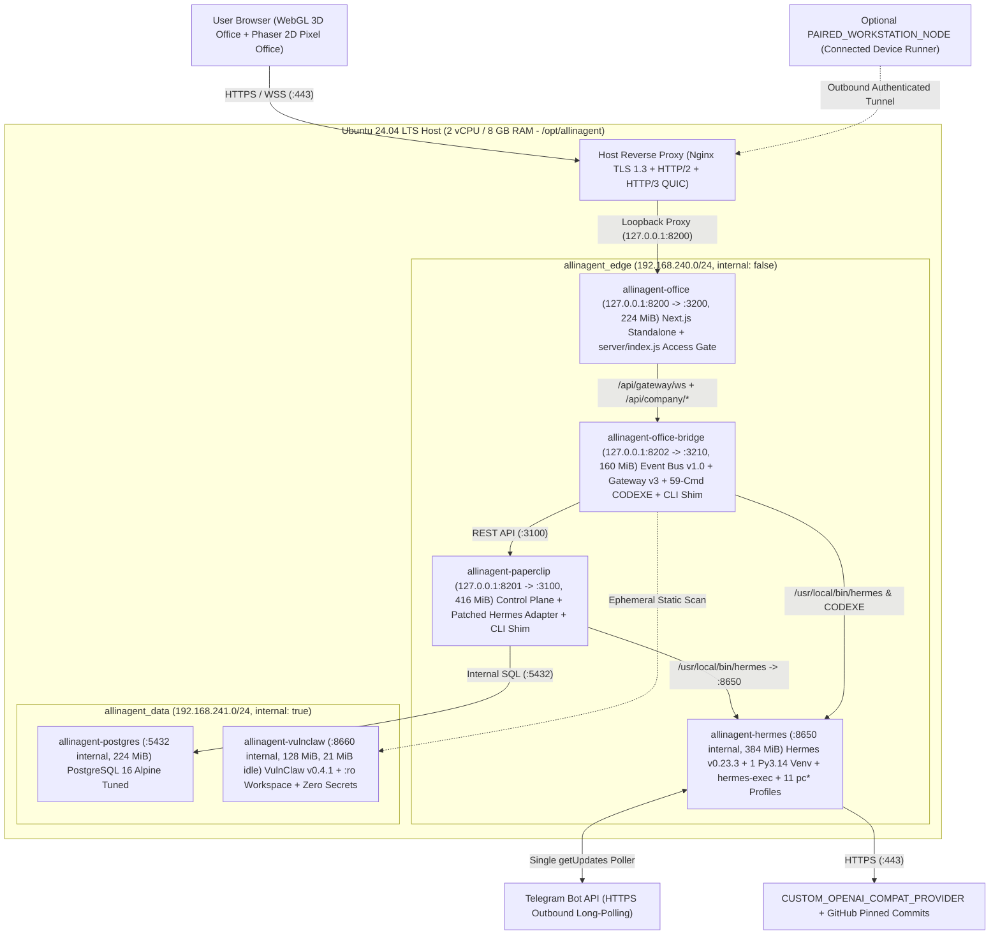
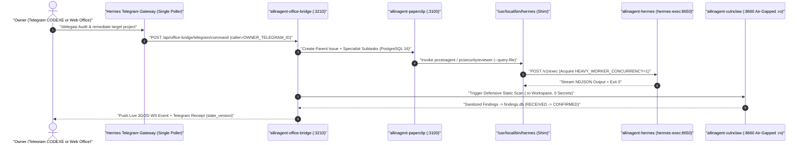

# ALLINAGENT — System Architecture

`ALLINAGENT` is an open-source, self-hosted **Autonomous AI Engineering & Defensive Security Company** uniting an organizational control plane (**Paperclip**), a shared multi-agent execution runtime (**Hermes Agent `v0.23.3`**), an interactive browser-rendered **3D WebGL & 2D Pixel Virtual Office** (**Hermes3D**), an on-demand defensive static-analysis security worker (**VulnClaw `v0.4.1`**), **33 SHA-pinned role skill packages** across **11 specialized AI employees**, and a **59-command Telegram CODEXE Control Center** behind a single, resource-capped Docker Compose stack (`<= 1,536 MiB` total cgroup ceiling on a `2 vCPU / 8 GB RAM` Ubuntu LTS server).

---

## 1. Core Architectural Invariants

1. **Single Organizational Source of Truth (`allinagent-paperclip` + `allinagent-postgres`):** Company hierarchy, projects, Kanban issues, parent-child delegations, governance approvals, and corporate/per-agent budgets live canonically in Paperclip backed by PostgreSQL 16.
2. **Single Shared Agent Runtime (`allinagent-hermes`):** Exactly **one** Hermes `v0.23.3` codebase and **one** Python `3.14` `uv` virtual environment serve all 11 isolated `pc*` agent profiles (`Wave-1` warm profiles: `ceo`, `backend`, `qa`, `security-reviewer`) and the single Telegram Bot Gateway poller — eliminating multi-gigabyte Python/toolchain duplication.
3. **Zero-Duplication Remote CLI Shim (`/usr/local/bin/hermes`):** Node.js containers (`paperclip` and `office-bridge`) never bundle Python or Hermes; a lightweight Node stdlib CLI shim (`components/hermes/hermes-cli-shim.mjs`) forwards worker runs over authenticated internal HTTP/NDJSON to `allinagent-hermes:8650`, where a global semaphore enforces `HEAVY_WORKER_CONCURRENCY=1`.
4. **100% Client-Rendered 3D & 2D Office (`allinagent-office`):** All `Three.js` WebGL 3D scenes and `Phaser` 2D pixel animations render in the user's browser GPU with **zero server GPU usage**.
5. **Defense-in-Depth Isolation (`allinagent-vulnclaw` & Two-Tier Networks):** Both PostgreSQL (`:5432`) and `allinagent-vulnclaw` (`:8660`, `128 MiB` cap, `~21 MiB` idle RSS without a `profiles:` gate) run on the air-gapped `internal: true` network (`allinagent_data`) with **zero internet egress** and **zero host ports**; security scans execute in ephemeral child subprocesses inside a secret-less, read-only (`:ro`) container with `cap_drop: ["ALL"]` and **zero Docker socket exposure**.
6. **License-Clean Reproducible Supply Chain (`~11.5 MiB` Git Repo):** Upstream projects are pinned by immutable 40-char commit SHAs (`components.lock.json`) with declarative patches (`patches/`), non-OSI `vendor/multiavatar.js` is permanently removed (`0` files in repo), and the `33` role skills (`skills/manifests/skills.lock.json`) are strictly partitioned into `20` OSI-permissive skills (`MIT` / `Apache-2.0`) and `13` `FETCH_FROM_UPSTREAM_ONLY` skills (`10` `borghei/Claude-Skills` `MIT-Commons-Clause-1.0` + `1` `vercel-labs/agent-skills` `NOASSERTION` + `2` `anthropics/skills` `docx` & `pdf` bundling third-party OOXML `.xsd` schemas, with Nous Research MIT `microsoft-office` & `pdf` as `--strict-oss` / `--offline` fallbacks).

---

## 2. System Topology



---

## 3. Service Planes & Component Architecture

### 3.1 Control Plane (`allinagent-paperclip` + `allinagent-postgres`)

- **`allinagent-paperclip` (`:3100` internal -> `127.0.0.1:8201` loopback, `mem_limit: 416m`):**
  - Runs the locked static production build `paperclipai@2026.1117.0` (`NODE_OPTIONS="--max-old-space-size=300"`, `deploy/docker/paperclip.Dockerfile`).
  - Strips optional vendor CLI binaries (`@openai/codex-*`, `@anthropic-ai/claude-agent-sdk-*`, `opencode-*`, `@embedded-postgres/*`, and foreign-architecture `paperclip-runnerd` binaries), reducing image bloat by `~1.80 GB`.
  - Applies declarative patch series (`patches/paperclip/patch-manifest.json`):
    1. **`0001-hermes-adapter-query-file-cleanup.patch` (`execute.js`):** Materializes large multi-agent prompts (`> 6,000` chars or Windows hosts) to temporary files (`--query-file`) with guaranteed `finally { fs.unlink }` cleanup.
    2. **`0002-hermes-adapter-skills-reconcile.patch` (`skills.js`):** Recognizes `--` namespaced skill links (`<skill>--<hash>`) into reviewed skill directories as managed origins and safely falls back to copy materialization on `EPERM`/`ENOSYS`.
    3. **`0003-hermes-gateway-internal-hosts.patch`:** Permits trusted internal container DNS hostnames for Paperclip-to-Hermes adapter execution.
    4. **`0004-db-low-memory-connection-pool.patch`:** Bounds PostgreSQL connection pooling for constrained `2 vCPU / 8 GB RAM` hosts.
- **`allinagent-postgres` (`:5432` internal on `allinagent_data`, `0` host ports, `mem_limit: 224m`):**
  - Runs `postgres:16-alpine` with `deploy/docker/postgresql-lowmem.conf` tuned for `2 vCPU / 8 GB RAM` (`shared_buffers=56MB`, `effective_cache_size=160MB`, `work_mem=4MB`, `maintenance_work_mem=32MB`, `wal_buffers=2MB`, `max_connections=35`, `checkpoint_completion_target=0.9`, `random_page_cost=1.1`).

### 3.2 Shared Execution Runtime (`allinagent-hermes`) & CLI Shim

- **Single Runtime Stack (`mem_limit: 384m`, `cpus: "0.85"`, `deploy/docker/hermes.Dockerfile`):**
  - **1 Hermes `v0.23.3` Source Tree (`/opt/hermes/src`):** Bootstrapped via `components/hermes/bootstrap_hermes_source.py` at commit `eb49b8920a25ffa7bb2fadf548fe819221ca79d7` (stripped of `apps/desktop`, `website`, `tests`, `evals`, `nix`, and `.git` -> `< 75 MiB`) + `patches/hermes-agent/0001-error-classifier-integrator.patch` (`"model_not_available_for_integrator"` classification).
  - **1 Shared Python `3.14` `uv` Venv (`/opt/hermes/venv`):** Shared across the Gateway, `hermes_exec_daemon.py`, all 11 corporate agents, and PDF/DOCX/compliance generators (`0 B` duplicate virtualenvs).
- **Internal `hermes-exec` Broker (`allinagent-hermes:8650`):**
  - Authenticated internal daemon (`components/hermes/hermes_exec_daemon.py`, `X-Internal-Exec-Token` constant-time HMAC verification) enforcing **`HEAVY_WORKER_CONCURRENCY=1`** while allowing fast read-only metadata probes (`--version`, `--help`) to bypass heavy execution queues.
- **Lightweight Remote CLI Shim (`/usr/local/bin/hermes`):**
  - Pure Node stdlib shim (`components/hermes/hermes-cli-shim.mjs`) installed inside `allinagent-paperclip` and `allinagent-office-bridge`. Translates standard `hermes chat --profile <pc*> --query-file <file>` calls + allowlisted `PAPERCLIP_*` environment variables into streaming HTTP/NDJSON requests to `http://hermes:8650`, forwarding `SIGTERM`/`SIGINT` cancellations cleanly.
- **Single Telegram Gateway Poller:**
  - Runs `hermes --profile default gateway run` inside `allinagent-hermes` via `components/hermes/entrypoint.sh` only when valid `TELEGRAM_BOT_TOKEN` and `OWNER_TELEGRAM_ID` credentials are configured (fail-closed), loading `unified-company-control` (`integrations/telegram/unified-company-control/`) with a strict single-poller lock so `409 Conflict` never occurs.
- **11 Isolated Non-Root `pc*` Profiles (`/data/hermes/profiles/pc*`):**
  - Runs as non-root `UID 10001:10001` with `0700` directory permissions (`0600` files) and `.no-bundled-skills` (**hyphenated** marker matching `tools/skills_sync.py`).
  - Worker profiles strip `TELEGRAM_BOT_TOKEN`, `OWNER_TELEGRAM_ID`, `ALLINAGENT_INTERNAL_TOKEN`, and `DATABASE_URL` from child environments, share read-only `models_dev_cache.json` and reviewed skill symlinks, and isolate per-agent `SOUL.md`, `AGENTS.md`, `config.yaml`, `state.db`, `memories/`, and `sessions/`.

### 3.3 Air-Gapped Defensive Security Worker (`allinagent-vulnclaw`)

- Packages unmodified upstream `Netw0rkNoob/VulnClaw` `v0.4.1` (`0b34878f84b089b21fcf85ecd445315f14df0672`) with a minimal defensive static-analysis Python stack (`mem_limit: 128m`, `cpus: "0.50"`, `deploy/docker/vulnclaw.Dockerfile`), governed by `config/vulnclaw.defensive.yaml` and `components/vulnclaw/`.
- Runs on the air-gapped **`allinagent_data` (`internal: true`)** network **without internet egress** and **without a `profiles:` gate**, maintaining **`~21 MiB` idle RSS** (`0` background LLM loops) while spawning short-lived child scan subprocesses strictly on demand and returning 100% of AST/scan buffers upon exit.
- **Hardened Sandbox Guarantees:**
  - Target source workspace mounted **read-only (`:ro`)**.
  - Container root filesystem set to **`read_only: true`** (`tmpfs: /tmp:size=64m,noexec,nosuid`).
  - **`cap_drop: ["ALL"]`** and **`security_opt: ["no-new-privileges:true"]`**.
  - **Zero secrets** (`0` API/bot/admin keys) and **zero Docker socket (`/var/run/docker.sock` never mounted)**.
  - Outputs sanitized candidate findings to `apps/control-center/` (`findings.db`), which neutralizes prompt-injection payloads and tracks each finding across a 10-state defensive lifecycle (`RECEIVED` -> `IMPORTED` -> `UNDER_REVIEW` -> `CONFIRMED`/`FALSE_POSITIVE` -> `REMEDIATION_REQUIRED` -> `IN_PROGRESS` -> `READY_FOR_VERIFICATION` -> `RESOLVED`/`ACCEPTED_RISK`).

### 3.4 Browser-Rendered Visualization (`allinagent-office`)

- Built from `apps/hermes3d` via Next.js `output: "standalone"` (`productionBrowserSourceMaps: false`, `NODE_OPTIONS="--max-old-space-size=128"`, `mem_limit: 224m`, `deploy/docker/office.Dockerfile`) with zero external Google Fonts fetches and `src/lib/avatars/vendor/multiavatar.js` permanently removed, served through custom **`server/index.js`**.
- **Preserved Server Capabilities:**
  - **`/login` Access Gate (`server/access-gate.js`):** Protects all HTTP and WebSocket routes with `STUDIO_ACCESS_TOKEN`, issuing a 30-day `studio_access` `HttpOnly` session cookie.
  - **`/api/gateway/ws`:** Bidirectional WebSocket upgrade proxy (Gateway Protocol v3).
  - **`/api/company/events/ws`:** Authenticated WebSocket proxy injecting internal `Bearer <bridgeToken>` upstream to `allinagent-office-bridge` without exposing internal tokens to the browser.
  - **`/api/company/[...slug]`:** Sanitized REST proxy to `allinagent-office-bridge`.
- **Dual Visual Modes (Zero Server GPU):**
  - **3D Virtual Office (`Hermes3D` / `Three.js` WebGL):** Interactive 3D headquarters with workstation navigation, 11-agent conference room standups, and the 6-tab `EnterpriseOfficeOverlay`.
  - **2D Pixel Office (`Phaser` HTML5 Canvas):** Gather-style top-down retro pixel office synchronized in real time with the same 11-agent state machine.

### 3.5 Integration, Event Bus & CODEXE Layer (`allinagent-office-bridge`)

- First-party Node.js 22 service (`apps/office-bridge/server.js`, `NODE_OPTIONS="--max-old-space-size=112"`, `mem_limit: 160m`, `deploy/docker/office-bridge.Dockerfile`) discovering peer containers via Docker DNS (`paperclip:3100`, `hermes:8650`, `office:3200`).
- **Core Subsystems:**
  1. **Normalized Event Bus v1.0 (`/api/events/ws`):** Monotonic sequence event stream (`500`-event in-memory ring + `recent-events.jsonl` persistence) fed by 3-second Paperclip delta synchronization.
  2. **Gateway Protocol v3 (`/ws`):** Live agent presence, standup orchestration, employee chat turns, and layout persistence.
  3. **59-Command Telegram CODEXE Suite (`/api/office-bridge/telegram/command`):** `59` deterministic slash commands organized into `13` interactive `uac:sub:*` inline-keyboard submenus, protected by fail-closed `<OWNER_TELEGRAM_ID>` authorization, idempotency keys, `AbortController` job cancellation, and `state_version` execution receipts.
  4. **Skill Telemetry & Read-Only Inspector (`adapters/agent-skills-bridge.js`):** Surfaces verified `skills.lock.json`, Sentry `skill-scanner` results, and per-agent `.usage.json` telemetry while prohibiting arbitrary remote skill execution/installation from UI or chat.
  5. **PDF/DOCX Report Serving:** Streams executive and compliance reports generated by `pccompliancereporter` from `/data/reports/` with strict path-traversal and secret-redaction guards.

---

## 4. The 11 Corporate AI Agents & 33-Skill Supply Chain

**Wave-1 Warm Agent Profiles (`4` Active by Default):** `ceo`, `backend`, `qa`, `security-reviewer`.
**Wave-2 Standby Agent Profiles (`7` Woken On Demand):** `cto`, `frontend`, `devops`, `security-lead`, `findings`, `remediation`, `compliance`.

| # | Directory | Role Slug | Handle | Isolated Profile | Default Tier | Toolsets | Pinned GitHub Role Skills |
| :---: | :--- | :--- | :--- | :--- | :--- | :--- | :--- |
| `01` | `agents/ceo` | `ceo_agent` | `@ceo` | `pcceoagent` | **`Wave-1 ACTIVE`** | `file,terminal,skills` | `ceo-advisor`, `c-level-skills` |
| `02` | `agents/cto` | `cto_agent` | `@cto` | `pcctoagent` | `Wave-2 STANDBY` | `file,terminal,skills` | `cto-review`, `senior-architect`, `cto-advisor` |
| `03` | `agents/backend` | `backend_developer` | `@backend` | `pcbackenddeveloper` | **`Wave-1 ACTIVE`** | `file,terminal,skills` | `senior-backend`, `api-design-reviewer`, `senior-architect` |
| `04` | `agents/frontend` | `frontend_developer` | `@frontend` | `pcfrontenddeveloper` | `Wave-2 STANDBY` | `file,terminal,skills` | `react-best-practices`, `frontend-design` |
| `05` | `agents/devops` | `devops_engineer` | `@devops` | `pcdevopsengineer` | `Wave-2 STANDBY` | `file,terminal,skills` | `senior-devops`, `terraform-skill`, `ci-cd-pipeline-builder` |
| `06` | `agents/qa` | `qa_engineer` | `@qa` | `pcqaengineer` | **`Wave-1 ACTIVE`** | `file,terminal,skills` | `pw`, `pw-generate`, `pw-review`, `senior-qa`, `pw-fix`, `pw-coverage`, `pw-report` |
| `07` | `agents/security-lead` | `security_lead` | `@security_lead` | `pcsecuritylead` | `Wave-2 STANDBY` | `file,skills` | `ciso-advisor`, `threat-model` *(ref)* |
| `08` | `agents/security-reviewer` | `security_reviewer` | `@security` | `pcsecurityreviewer` | **`Wave-1 ACTIVE`** | `file,skills` | `security-audit`, `senior-security`, `secondsky-cybersecurity-ref` *(ref)* |
| `09` | `agents/findings` | `findings_analyst` | `@findings` | `pcfindingsanalyst` | `Wave-2 STANDBY` | `file,skills` | `security-audit`, `anthropic-triage` *(ref)*, `cve-triage` *(exp)* |
| `10` | `agents/remediation` | `remediation_reviewer` | `@remediation` | `pcremediationreviewer` | `Wave-2 STANDBY` | `file,skills` | `focused-fix`, `security-vuln-remediation`, `anthropic-patch` *(ref)* |
| `11` | `agents/compliance` | `compliance_reporter` | `@compliance` | `pccompliancereporter` | `Wave-2 STANDBY` | `file,terminal,skills` | `compliance-os`, `docx`, `pdf` *(Nous MIT `microsoft-office` & `pdf` in `--strict-oss`/`--offline`)* |

- **Supply-Chain & License Gate (`skills/install_agent_skills.py` & `skills/manifests/skills.lock.json`):**
  - **`20` OSI-Permissive Redistributable Skills (`MIT` / `Apache-2.0`):** Classified `ALLOW_WITH_ATTRIBUTION_OR_FETCH` (`getsentry/skills` `1`, `alirezarezvani/claude-skills` `11`, `anthropics/skills` `frontend-design` `1`, `anthropics/defending-code-reference-harness` `3`, `antonbabenko/terraform-skill` `1`, `stacklok/toolhive-studio` `1`, `fedius01/cve-triage` `1`, `secondsky/claude-skills` `1`).
  - **`13` `FETCH_FROM_UPSTREAM_ONLY` Skills (`0` Files Bundled in Git or GHCR):**
    - `10` `borghei/Claude-Skills` skills under `MIT-Commons-Clause-1.0`
    - `1` `vercel-labs/agent-skills` skill (`react-best-practices`) under `NOASSERTION`
    - `2` `anthropics/skills` skills (`docx` & `pdf`) bundling third-party OOXML `.xsd` schemas — with **Nous Research MIT `microsoft-office` & `pdf`** (`NousResearch/hermes-agent`) documented and wired as `--strict-oss` / `--offline` fallbacks.
  - Every skill is fetched by exact 40-char commit SHA, verified against SHA-256 package digests in `skills/manifests/skills.lock.json`, scanned by Sentry `skill-scanner`, stripped of offensive/autonomous harness files, and linked read-only into reviewed skill directories.

---

## 5. Execution & Lifecycle Flows



---

## 6. Deployment Modes

1. **`Standard Production` (`compose.yaml` + `compose.production.yaml`):**
   Target: `>= 2 vCPU / 8 GB RAM` Linux VPS (`/opt/allinagent`). Runs all 5 core containers (`1,408 MiB` cgroup sum) + air-gapped `allinagent-vulnclaw` (`128 MiB` cap, `~21 MiB` idle RSS on `allinagent_data` `internal: true` without a `profiles:` gate -> `1,536 MiB` hard stack ceiling), pulling prebuilt GHCR images behind Host Nginx HTTPS/WSS.
2. **`Local / Contributor Docker` (`compose.yaml`):**
   Target: Contributor Linux, macOS, or Windows Docker Desktop host (`>= 8 GB RAM`). Builds local multi-stage images from `deploy/docker/*.Dockerfile` and mounts `./workspaces/sample-project` for immediate verification.
3. **`Strict-OSS / Offline Air-Gapped Mode` (`--strict-oss` / `--offline`):**
   Target: Regulated enterprise or offline environments. Installs only the `20` OSI-permissive skill packages and substitutes Nous Research MIT `microsoft-office` & `pdf` skills without fetching `FETCH_FROM_UPSTREAM_ONLY` repositories.
4. **`Connected Device` (`integrations/connected-device/`):**
   Target: Cloud `Standard Production` + optional paired local workstation (`windows_runner_agent.py` bound to `127.0.0.1:8670` over SSH `-R` or WireGuard/Tailscale), authenticated via HMAC-SHA256 + 60s timestamp + nonce replay guard and jailed to `AUTHORIZED_WINDOWS_ROOTS`.

---

## 7. Network Isolation, Ports, Storage & Cgroup Budgets

### 7.1 Two-Tier Docker Networks & Loopback Ports
- **`allinagent_edge` (`192.168.240.0/24`, `internal: false`):** Hosts `office`, `office-bridge`, `paperclip`, and `hermes`. Avoids `172.16.0.0/12` Docker bridge collisions (`172.17/16`, `172.18/16`, `172.20.0–8/24`).
- **`allinagent_data` (`192.168.241.0/24`, `internal: true`):** Air-gapped internal subnet isolating `postgres` (`:5432`) and `vulnclaw` (`:8660`, no `profiles:` gate, `~21 MiB` idle RSS) with **zero internet egress** and **zero host ports**, reachable internally by `paperclip`, `office-bridge`, and `hermes`.
- **Host Loopback Bindings (`0` public `0.0.0.0` Docker ports):**
  - `127.0.0.1:8200` -> `allinagent-office:3200` (proxied by Host Nginx `443` TLS; if HTTP/3 QUIC is enabled on a host with an existing `default_server`, declare `listen 443 quic;` **without `reuseport`**).
  - `127.0.0.1:8201` -> `allinagent-paperclip:3100` (localhost admin/health probe).
  - `127.0.0.1:8202` -> `allinagent-office-bridge:3210` (localhost diagnostics & Connected Device tunnel endpoint).

### 7.2 Resource Cgroup Budget (`<= 1,536 MiB` Total Ceiling — Aligned with `compose.production.yaml`)

| Compose Service | Container | Role | Networks | Loopback Port | Hard `mem_limit` | CPU Limit | Steady RSS Target |
| :--- | :--- | :--- | :--- | :--- | ---: | ---: | ---: |
| `postgres` | `allinagent-postgres` | PostgreSQL 16 Alpine | `allinagent_data` | *Internal only* | **`224 MiB` (`224m`)** | `0.45` | `60–130 MiB` |
| `paperclip` | `allinagent-paperclip` | Control Plane + Shim | `edge`, `data` | `127.0.0.1:8201` | **`416 MiB` (`416m`)** | `0.75` | `155–280 MiB` |
| `hermes` | `allinagent-hermes` | Shared Py3.14 + `hermes-exec` + Gateway | `edge`, `data` | *Internal `:8650`* | **`384 MiB` (`384m`)** | `0.85` | `95–310 MiB` |
| `office-bridge` | `allinagent-office-bridge` | Event Bus + CODEXE + Shim | `edge`, `data` | `127.0.0.1:8202` | **`160 MiB` (`160m`)** | `0.40` | `55–110 MiB` |
| `office` | `allinagent-office` | Next.js Standalone `Hermes3D` + `2D` | `allinagent_edge` | `127.0.0.1:8200` | **`224 MiB` (`224m`)** | `0.50` | `65–145 MiB` |
| **Core 5 Subtotal** | *5 Core Containers* | — | — | — | **`1,408 MiB`** | — | **`~395–975 MiB`** |
| `vulnclaw` | `allinagent-vulnclaw` | Air-Gapped `:ro` Static Scanner | `allinagent_data` (`internal: true`) | *Internal `:8660` (no `profiles:`)* | **`128 MiB` (`128m`)** | `0.50` | `21 MiB` *(idle)* / `<= 105 MiB` *(scan)* |
| **TOTAL STACK CEILING** | *All 6 Services* | — | — | — | **`1,536 MiB`** | `<= 0.85`/ctr | **`~415 MiB` idle / `<= 1,080 MiB` active** |

### 7.3 Prune-Safe Host Persistence (`/opt/allinagent`)
All stateful directories use explicit host bind mounts under `/opt/allinagent/data/{postgres,paperclip,hermes,office-data,findings,reports,skills}`, `/opt/allinagent/logs`, and `/opt/allinagent/backups` (`chmod 0750`) paired with `restart: unless-stopped` and `json-file` log rotation (`10m x 3`), protecting operational data from automated host `docker prune` cron jobs.

---

## 8. Repository Structure (`~11.5 MiB` Clean Source)

```text
ALLINAGENT/
├── ARCHITECTURE.md                         # Canonical public architecture specification
├── LICENSE-INVENTORY.json                  # Machine-readable SPDX inventory (20 permissive + 13 fetch-only skills)
├── THIRD-PARTY-NOTICES.md                  # Upstream open-source attributions & SPDX notices
├── components.lock.json                    # Immutable 40-char SHA pins for Hermes, Paperclip, VulnClaw, Hermes3D
├── compose.yaml                            # Base multi-container Docker Compose topology
├── compose.production.yaml                 # Hardened 2-vCPU / 8-GB production overlay (<= 1,536 MiB cgroup ceiling)
├── allinagent / allinagent.ps1 / .cmd      # Cross-platform unified CLI entrypoints
├── apps/
│   ├── hermes3d/                           # Reconciled 3D WebGL + 2D Pixel Office + Enterprise Overlay + server/index.js
│   ├── office-bridge/                      # Event Bus v1.0, Gateway v3, 59-cmd CODEXE, Skill Telemetry & contracts/paths.js
│   └── control-center/                     # Python orchestration, FindingsStore, Workflow Engine, Org Provisioner & paths.py
├── components/
│   ├── hermes/                             # bootstrap_hermes_source.py, hermes_exec_daemon.py, hermes-cli-shim.mjs, entrypoint.sh
│   ├── paperclip/                          # Locked paperclipai@2026.1117.0 runtime bootstrap & adapter patch runner
│   └── vulnclaw/                           # Defensive-only static analysis runner & requirements
├── integrations/
│   ├── telegram/                           # 59-cmd command_catalog.json, telegram_onboarding.py & unified-company-control plugin
│   └── connected-device/                   # capability_discovery.py & optional HMAC-jailed windows_runner_agent.py
├── agents/                                 # 11 corporate personas (ceo, cto, backend, frontend, devops, qa, security-*, compliance)
├── skills/
│   ├── manifests/                          # skills.lock.json (33 skills) & skill-security-results.json
│   ├── policies/                           # skill-policy.json (SPDX & Sentry skill-scanner rules)
│   └── install_agent_skills.py             # SHA-verified GitHub skill installer (--strict-oss / --offline MIT fallbacks)
├── patches/
│   ├── hermes-agent/                       # 0001-error-classifier-integrator.patch (+1 line)
│   └── paperclip/                          # 0001..0004 adapter, internal-host & low-mem DB pool patches + patch-manifest.json
├── deploy/
│   ├── docker/                             # hermes, paperclip, office-bridge, office & vulnclaw Dockerfiles + postgresql-lowmem.conf
│   ├── linux/                              # Ubuntu 24.04 LTS installer & systemd maintenance units
│   ├── proxy/                              # Host Nginx TLS 1.3 + HTTP/3 QUIC reverse-proxy templates
│   └── windows/                            # Optional Windows Docker / workstation helper scripts
├── config/                                 # resource-limits.json & vulnclaw.defensive.yaml
├── workspaces/sample-project/              # MIT synthetic polyglot microservice & VulnClaw benchmark fixture
├── scripts/                                # allinagent_cli.py, generate-sbom.py, audit-public-release.py & migration/
├── docs/                                   # Phase architecture records & operator runbooks
└── tests/                                  # End-to-end parity, security & multi-agent verification suites
```
