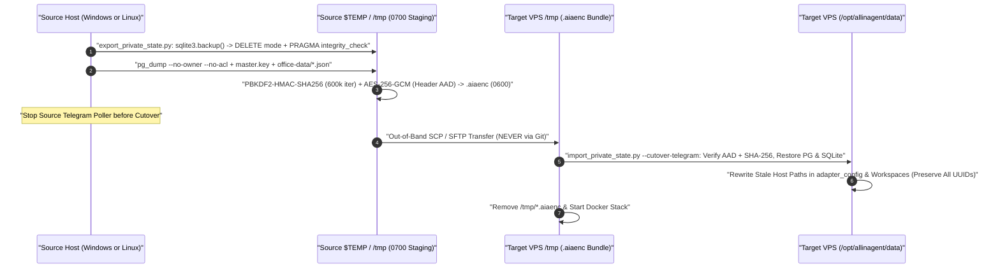

# ALLINAGENT — Database Architecture & Dual-Track State Migration

`ALLINAGENT` separates **public open-source code & schemas** from **private operational runtime data** through a strict **Dual-Track Provisioning & Migration Architecture**:

- **Track A (`track_a_fresh_install`) — Clean Public Schema Initialization:** Default for every public GitHub clone, CI test, and new user deployment (`./allinagent setup`). Provisions an empty PostgreSQL 16 schema, fresh SQLite databases, and newly minted v4 Company + 11 Agent UUIDs with **zero private history**.
- **Track B (`track_b_preserved_uuids`) — AES-256-GCM Encrypted WAL-Safe Private State Migration:** Optional operator toolkit (`scripts/migration/export_private_state.py` & `scripts/migration/import_private_state.py`) for migrating live private operational state from an existing workstation or server to an Ubuntu LTS production VPS (`/opt/allinagent`) with **100% UUID continuity**, **zero SQLite WAL corruption**, **zero Git working-tree leakage**, and **single-poller Telegram cutover protection**.

Authoritative implementation files:
- [`scripts/migration/export_private_state.py`](./scripts/migration/export_private_state.py) — Online WAL-safe SQLite backup, `pg_dump`, and `AES-256-GCM` bundle exporter
- [`scripts/migration/import_private_state.py`](./scripts/migration/import_private_state.py) — Authenticated decryption, integrity verification, path rewriter, and Telegram cutover guard
- [`apps/control-center/control_center/org_provisioner.py`](./apps/control-center/control_center/org_provisioner.py) — Dual-track Paperclip organization provisioner & path rebinder

---

## 1. Persistent Data Stores Inventory

All operational data resides under `${ALLINAGENT_DATA_DIR}` (`/opt/allinagent/data` in production, host-bind-mounted so `docker volume prune` never touches it) and is strictly excluded from Git (`.gitignore` + `scripts/audit-public-release.py`):

| Store / Path | Engine / Format | Container Owner | Contents & Role |
| :--- | :--- | :---: | :--- |
| `data/postgres/` | PostgreSQL `16-alpine` | `70:70` (`0700`) | Canonical Paperclip relational database: companies, 11 agents, projects, Kanban issues, subtask trees, heartbeat runs, budget policies & approvals. |
| `data/paperclip/` | File + `master.key` | `1000:1000` (`0750`) | Paperclip instance home (`master.key`, company skills store `__versions__`, attachments). |
| `data/hermes/state.db` | SQLite 3 | `10001:10001` (`0700`) | Owner Telegram Gateway conversation & session ledger. |
| `data/hermes/profiles/pc*/state.db` | SQLite 3 (`×11`) | `10001:10001` (`0700`) | Isolated conversation, tool-call, and `skill_view` telemetry DBs for each of the 11 corporate agents (`pcceoagent` .. `pccompliancereporter`), alongside `memories/MEMORY.md` & `SOUL.md`. |
| `data/findings/findings.db` *(or `data/vulnclaw/`)* | SQLite 3 | `10001` / `10002` | Fingerprinted defensive security findings across the 10-state triage lifecycle (`RECEIVED` .. `RESOLVED`/`ACCEPTED_RISK`). |
| `data/workflow-ledger.db` | SQLite 3 | `10001:10001` | 13-stage multi-agent workflow orchestration ledger. |
| `data/office-data/` | JSON / JSONL | `1000:1000` (`0750`) | `meetings.json`, `standup-store.json`, `company-layout.json`, `analytics-budgets.json`, `target-folders.json`, `telegram-control-state.json`, `telegram-security-ledger.json`, `chat-history/*.json`, and `event-history/recent-events.jsonl`. |
| `data/studio-state/hermes3d/` | JSON (`0600`) | `1000:1000` (`0750`) | Web Virtual Office Gateway connection profile & UI preferences (`settings.json`). |

---

## 2. Track A — Clean Public Schema Provisioning (`./allinagent setup`)

Every new user installing `ALLINAGENT` runs Track A automatically:

```bash
./allinagent setup
```

1. **Directory & CSPRNG Secret Scaffolding:** Creates `${ALLINAGENT_DATA_DIR}` subdirectories with container-matched POSIX UIDs (`70`, `1000`, `10001`, `10002`) and writes `0600` CSPRNG secrets (`POSTGRES_PASSWORD`, `STUDIO_ACCESS_TOKEN`, `OFFICE_BRIDGE_TOKEN`, `HERMES_EXEC_SHARED_SECRET`, `BETTER_AUTH_SECRET`, `PAPERCLIP_AGENT_JWT_SECRET`, `PAPERCLIP_TOOL_ACTION_SIGNING_SECRET`).
2. **PostgreSQL 16 Initialization:** Starts `allinagent-postgres` on the air-gapped `allinagent_data` network; `allinagent-paperclip` runs Drizzle/SQL schema migrations automatically on first boot.
3. **Dynamic 11-Agent Provisioning (`track_a_fresh_install`):** `org_provisioner.py` creates the `Unified AI Engineering & Operations` company and all 11 corporate agents, mints fresh v4 UUIDs, seeds the 11 `0700` `profiles/pc*` homes, installs Sentry-gated role skills, and writes the local runtime lookup map to `config/organization-roster.json`.

---

## 3. Track B — Encrypted WAL-Safe Private State Migration



### 3.1 Cryptographic & Data-Integrity Contract (`AIASTATE` v1 Envelope)

1. **Out-of-Repository Staging Guard (`assert_outside_git_repo`):** Both `export_private_state.py` and `import_private_state.py` raise `PermissionError` if the staging path or `.aiaenc` bundle path resides inside any Git working tree. All staging happens exclusively in `$TEMP` / `/tmp` (`0700` directories, `0600` files) and is cleaned in a `finally:` block.
2. **Online WAL-Safe SQLite Snapshots (Zero Raw `-wal`/`-shm` Copies):**
   Copying live SQLite files with `cp` while WAL frames are uncommitted corrupts databases. `export_private_state.py` opens each SQLite database (`state.db`, 11 `profiles/pc*/state.db`, `findings.db`, `workflow-ledger.db`) using Python's `sqlite3.Connection.backup()` API into staging, normalizes `PRAGMA journal_mode=DELETE`, verifies `PRAGMA integrity_check == 'ok'`, and records exact per-table row counts in `manifest.json`.
3. **Authenticated Envelope Encryption (`AES-256-GCM` + `PBKDF2-HMAC-SHA256`):**
   - **Magic Header:** `b"AIASTATE"` + 1-byte version (`1`) + 4-byte big-endian JSON header length.
   - **Key Derivation:** `PBKDF2HMAC(SHA-256, length=32, iterations=600_000)` with a 256-bit (`32`-byte) CSPRNG salt and a passphrase of `>= 12` characters.
   - **AEAD Cipher:** `AESGCM` (`256`-bit key, `96`-bit CSPRNG nonce) encrypting the deterministic `.tar.gz` archive while binding `prefix + header_bytes` (`cipher`, `kdf_iterations`, `salt_b64`, `nonce_b64`, `payload_sha256`) as **Authenticated Associated Data (AAD)**. Any bit flip in either header or ciphertext fails GCM authentication immediately before extraction.

### 3.2 Step-by-Step Track B Operator Procedure

#### Step 1: Run Consistency Pre-Flight (`--dry-run`) on the Source Host
```bash
python3 scripts/migration/export_private_state.py \
  --source-root /path/to/source/platform \
  --allow-missing-optional-dbs \
  --dry-run
```
Verify `"ok": true` and `"all_sqlite_integrity_ok": true` in the JSON summary.

#### Step 2: Export the Encrypted `.aiaenc` Bundle to `$TEMP` / `/tmp`
```bash
export ALLINAGENT_MIGRATION_PASSPHRASE="<strong-random-passphrase-min-12-chars>"

python3 scripts/migration/export_private_state.py \
  --source-root /path/to/source/platform \
  --allow-missing-optional-dbs \
  --output /tmp/allinagent-migration.aiaenc
```

#### Step 3: Transfer Out-of-Band & Stop Source Telegram Poller
1. Stop the source host's Hermes Telegram Gateway poller so two hosts never poll the same `TELEGRAM_BOT_TOKEN` simultaneously.
2. Copy `/tmp/allinagent-migration.aiaenc` directly to `/tmp/` on the target Ubuntu VPS via `scp` (`chmod 0600`).
3. On the target VPS (`/opt/allinagent`), run `./allinagent setup --config-only` (if `.env` is not yet initialized), start **only** PostgreSQL (`docker compose -f compose.yaml -f compose.production.yaml up -d postgres`), and ensure application containers (`hermes`, `paperclip`, `office-bridge`, `office`) are stopped.

#### Step 4: Validate (`--dry-run`) & Import on the Target VPS
```bash
export ALLINAGENT_MIGRATION_PASSPHRASE="<strong-random-passphrase-min-12-chars>"

# 1. Dry-run decrypt & verify SHA-256 + SQLite integrity in /tmp without touching /opt/allinagent/data
python3 /opt/allinagent/scripts/migration/import_private_state.py \
  --bundle /tmp/allinagent-migration.aiaenc \
  --target-root /opt/allinagent \
  --dry-run

# 2. Execute full import, path rebinding & Telegram single-poller cutover
python3 /opt/allinagent/scripts/migration/import_private_state.py \
  --bundle /tmp/allinagent-migration.aiaenc \
  --target-root /opt/allinagent \
  --target-hermes-root /var/lib/allinagent/hermes \
  --target-workspaces-root /var/lib/allinagent/workspaces \
  --postgres-mode docker \
  --cutover-telegram
```

> **Single-Poller Cutover Guard (`.telegram_cutover_lock`):** If live Telegram state is imported without `--cutover-telegram` (or if `--source-poller-active` is flagged), `import_private_state.py` writes `.telegram_cutover_lock` and exits with code `2` so the target Gateway cannot accidentally cause `HTTP 409 Conflict` against a still-running source bot.

#### Step 5: Shred Temporary Bundle, Boot Stack & Reconcile Paths
```bash
# Remove temporary encrypted bundle from /tmp
shred -u /tmp/allinagent-migration.aiaenc 2>/dev/null || rm -f /tmp/allinagent-migration.aiaenc
unset ALLINAGENT_MIGRATION_PASSPHRASE

# Start full production stack and verify all 6 services + preserved UUIDs
cd /opt/allinagent
./allinagent --production up
./allinagent --production health
```

When `org_provisioner.py` runs against the migrated database, it detects `track_mode: "track_b_preserved_uuids"`, preserves the existing Company UUID and all 11 Agent UUIDs, and rebinds any residual workstation drive paths in `adapterConfig` (`cwd`, `instructionsFilePath`, `hermesCommand`, `env.HERMES_HOME`) and Paperclip project workspaces (`_rebind_migrated_project_workspaces`) to the container paths.
