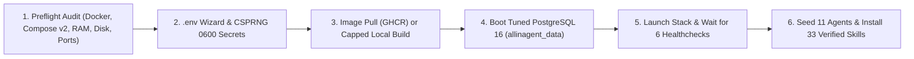

# ALLINAGENT — Installation Guide

This guide covers system requirements, prebuilt vs. source builds, first-run provisioning, directory permissions, 11-agent organizational seeding, SHA-pinned skill installation, and post-install verification across Linux, Windows, and macOS.

---

## 1. System & Software Requirements

### Hardware Profiles

| Deployment Tier | CPU | Physical RAM | Free Disk | Recommended Compose Invocation | LLM Execution Strategy |
| :--- | :--- | :--- | :--- | :--- | :--- |
| **Constrained / Shared Cloud VPS** | `2 vCPU` | `8 GB RAM` (`>= 1.8 GB` `MemAvailable`) | `>= 12 GB` (`>= 24 GB` recommended on multi-tenant hosts) | `./allinagent --production setup` (`compose.yaml` + `compose.production.yaml`) | **External API required** (`<= 1,536 MiB` stack cgroup ceiling) |
| **Standard Workstation / Dedicated Server** | `4+ vCPU` | `16+ GB RAM` | `>= 25 GB` | `./allinagent --local setup` (`compose.yaml`) | External API or optional local Ollama / vLLM |

### Host Software Prerequisites

1. **Git** (`>= 2.34`)
2. **Python** (`>= 3.10`, standard library only — `./allinagent` uses zero third-party `pip` packages on the host)
3. **Docker Engine** (`>= 24.0`) + **Docker Compose v2 plugin** (`docker compose version` `>= 2.20.0`)
   - Standalone `docker-compose` v1 (hyphenated) is **not** supported and is rejected by `./allinagent doctor`.
   - On Linux, ensure **cgroup v2** is active (`stat -fc %T /sys/fs/cgroup/` returns `cgroup2fs`) for accurate `mem_limit` and `memswap_limit` enforcement.

---

## 2. Installing Host Dependencies (Fresh Ubuntu 22.04 / 24.04 LTS)

```bash
sudo apt-get update
sudo apt-get install -y ca-certificates curl git python3 gnupg

# Install official Docker Engine & Compose v2 plugin if not already installed
if ! command -v docker >/dev/null 2>&1; then
  curl -fsSL https://get.docker.com | sudo sh
fi

docker --version
docker compose version
```

For Windows Docker Desktop / WSL2 and native Windows helpers, see [WINDOWS.md](./WINDOWS.md). For Linux kernel, cgroup, and systemd specifics, see [LINUX.md](./LINUX.md).

---

## 3. Repository Layout & Persistent Storage

Clone ALLINAGENT into `/opt/allinagent` (recommended for Linux production servers) or any user-writable directory on workstations:

```bash
# Production server path (auto-enables compose.production.yaml profile)
sudo git clone https://github.com/Vistapra/ALLINAGENT.git /opt/allinagent
cd /opt/allinagent
sudo chmod +x ./allinagent
```

### Repository & Data Directory Structure

```text
ALLINAGENT/
├── allinagent                        # POSIX CLI entrypoint (Linux / macOS)
├── allinagent.ps1                    # PowerShell CLI entrypoint (Windows)
├── allinagent.cmd                    # CMD wrapper (Windows)
├── compose.yaml                      # Base 6-service orchestration stack
├── compose.production.yaml           # 2-vCPU / 8-GB RAM cgroup & loopback production overlay
├── components.lock.json              # Immutable 40-char upstream SHA & npm version lockfile
├── apps/
│   ├── hermes3d/                     # Browser-rendered 3D WebGL & 2D Pixel Virtual Office (:3200)
│   ├── office-bridge/                # Event Bus v1.0, Gateway v3 & 59-cmd CODEXE bridge (:3210)
│   └── control-center/               # Python org provisioner, worker factory, skill & findings engines
├── components/
│   ├── hermes/                       # Shared Hermes v0.23.3 bootstrap, exec daemon (:8650) & CLI shim
│   ├── paperclip/                    # Paperclip v2026.1117.0 bloat pruner & Hermes adapter patcher
│   └── vulnclaw/                     # Isolated defensive-only VulnClaw v0.4.1 worker (:8660)
├── agents/                           # 11 corporate agent role definitions & Hermes Gateway plugin
├── skills/                           # SHA-256 skill manifests, security scan ledger & license policies
├── patches/                          # Auditable upstream diffs (hermes-agent & paperclip)
├── config/                           # Resource budgets (resource-limits.json) & defensive YAML policy
├── deploy/
│   ├── docker/                       # Multi-stage hardened Dockerfiles + postgresql-lowmem.conf
│   ├── linux/                        # Systemd autostart, daily maintenance timer & installer
│   ├── proxy/                        # Hardened Nginx TLS/HTTP3 template & SSH loopback tunnel scripts
│   └── windows/                      # Task Scheduler, watchdog, credential rotation & companion scripts
├── scripts/                          # Unified CLI implementation, SBOM generator & release auditor
├── workspaces/                       # Sandboxed project root (includes MIT `sample-project` fixture)
└── data/                             # Created at setup time (gitignored, host bind-mounted)
    ├── postgres/                     # PostgreSQL 16 data directory (UID 70, mode 0700)
    ├── paperclip/                    # Paperclip runtime home (UID 1000, mode 0750)
    ├── hermes/                       # Shared Hermes state + 11 `0700` `pc*` profiles (UID 10001)
    ├── office-data/                  # Layout preferences, event history & audit logs (UID 1000)
    ├── studio-state/hermes3d/        # Seeded Gateway connection settings (UID 1000, mode 0600)
    ├── vulnclaw/                     # Defensive static-scan scratch & config (UID 10002, zero secrets)
    ├── secrets/                      # Scoped container auth files (`0600`, never mounted in vulnclaw)
    ├── maintenance/                  # Update state.json, maintenance.lock & rollback snapshots
    ├── backups/                      # Pre-update compressed pg_dump archives (`0700`, keeps latest 7)
    └── workspaces/                   # Default runtime container workspace mount
```

> [!NOTE]
> When executed inside `/opt/allinagent` on Linux (or when `--production` / `ALLINAGENT_PROFILE=production` is set), `./allinagent` automatically layers `compose.production.yaml` over `compose.yaml` and defaults `ALLINAGENT_DATA_DIR` to `/opt/allinagent/data`.

---

## 4. Step-by-Step Installation Workflow (`./allinagent setup`)

Running `./allinagent setup` executes a deterministic 6-stage pipeline:



### Stage-by-Stage Options

| Flag | Purpose |
| :--- | :--- |
| `-y`, `--yes` | Non-interactive setup using existing `.env`, environment variables, and safe defaults |
| `--production` | Force `compose.production.yaml` (`<= 1,536 MiB` cgroup budget, `memswap_limit == mem_limit`) |
| `--local` | Use base `compose.yaml` without strict 2-vCPU / 8-GB container memory caps |
| `--build` | Build all 5 custom service images locally from `deploy/docker/*.Dockerfile` |
| `--skip-pull` | Skip image pull/build when images are already present in local `docker images` |
| `--config-only` | Generate `.env`, CSPRNG secrets (`data/secrets/*`), and directory permissions without starting Docker |
| `--rotate-secrets` | Regenerate internal CSPRNG secrets (`STUDIO_ACCESS_TOKEN`, `OFFICE_BRIDGE_TOKEN`, JWT/DB keys) |
| `--skip-provision` | Skip post-boot 11-agent Paperclip organization provisioning |
| `--skip-skills` | Skip post-boot GitHub skill fetching and verification |
| `--data-dir <path>` | Override `ALLINAGENT_DATA_DIR` persistent host bind-mount root |
| `--health-timeout <sec>` | Maximum wait time for all 6 container healthchecks (default: `90` seconds) |

### Example 1: Standard Prebuilt Installation

```bash
sudo ./allinagent --production setup
```

### Example 2: Local Multi-Stage Build from Source

If you are building directly from a fresh Git checkout without pulling prebuilt registry images:

```bash
sudo ./allinagent --production setup --build
```

> [!WARNING]
> **Never run raw unconstrained `docker compose build` on a 2-vCPU / 8-GB VPS.** Always use `./allinagent setup --build` or `./allinagent up --build`: on hosts with `<= 9,000 MiB` RAM, the CLI automatically builds sequentially using `docker buildx build --load --memory=1280m --cpus=1.0` so Next.js/Webpack compilation cannot starve existing host workloads.

### Example 3: Generate Configuration & Secrets First (`--config-only`)

If you prefer to review `.env` manually before starting containers:

```bash
./allinagent setup --config-only --yes
chmod 600 .env
nano .env
# Edit LLM_BASE_URL, LLM_MODEL, CUSTOM_API_KEY, and optional TELEGRAM_* settings
./allinagent setup --yes
```

---

## 5. Mounting External Code Repositories (`/workspaces`)

By default, containers mount `${ALLINAGENT_WORKSPACES_DIR}` (default `./data/workspaces` or `/opt/allinagent/data/workspaces`). You can copy repositories into that folder or point `ALLINAGENT_WORKSPACES_DIR` in `.env` at a dedicated project directory (for example, `ALLINAGENT_WORKSPACES_DIR=/opt/allinagent/workspaces` to expose `workspaces/sample-project` directly).

To mount additional host directories cleanly without editing tracked Compose files, create an untracked `compose.override.yaml` (or pass extra `-f` files):

```yaml
services:
  hermes:
    volumes:
      - /srv/repos/billing-api:/var/lib/allinagent/workspaces/billing-api:rw
  paperclip:
    volumes:
      - /srv/repos/billing-api:/var/lib/allinagent/workspaces/billing-api:rw
  office-bridge:
    volumes:
      - /srv/repos/billing-api:/var/lib/allinagent/workspaces/billing-api:rw
  vulnclaw:
    volumes:
      # Defensive security worker ALWAYS mounts source repositories read-only (:ro)
      - /srv/repos/billing-api:/workspaces/billing-api:ro
```

---

## 6. Post-Installation Verification

Run both `doctor` and `health` to confirm every security invariant and container probe passes:

```bash
./allinagent doctor
./allinagent health
```

Expected healthy output:

```text
[ALLINAGENT Health] Overall: HEALTHY (<ISO-8601-UTC>)
  - postgres      : [PASS] internal-only (allinagent_data)
  - hermes        : [PASS] internal-only (:8650)
  - vulnclaw      : [PASS] internal-only (:8660, air-gapped)
  - paperclip     : [PASS] http://127.0.0.1:8201/api/health
  - office-bridge : [PASS] http://127.0.0.1:8202/health
  - office        : [PASS] http://127.0.0.1:8200/api/health
```

---

## 7. Uninstalling or Resetting

- **Stop & remove containers while keeping all databases, memories, and secrets intact:**
  ```bash
  ./allinagent down
  ```
- **Full clean reset (permanently deletes PostgreSQL data, agent memories, and local secrets):**
  ```bash
  ./allinagent down
  sudo rm -rf ./data ./.env
  ```
