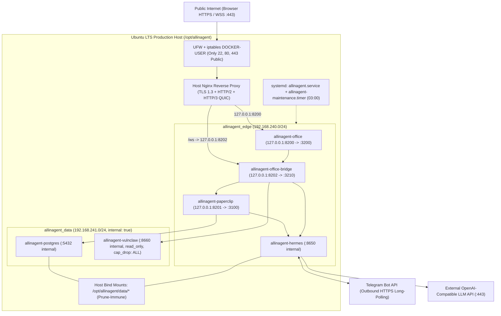

# ALLINAGENT — Production Deployment Guide

This runbook covers deploying **ALLINAGENT** 24/7 on a production Ubuntu/Debian server (including dense multi-tenant **2 vCPU / 8 GB RAM** VPS environments), configuring TLS 1.3 + HTTP/2 + HTTP/3 QUIC via Nginx, enabling boot autostart and coordinated daily maintenance via `systemd`, backing up PostgreSQL, and executing zero-data-loss updates with automatic rollback.

---

## 1. Production Architecture & Security Posture



### Production Security Guarantees

1. **Zero Public Container Ports:** `compose.production.yaml` binds only `127.0.0.1:8200`, `127.0.0.1:8201`, and `127.0.0.1:8202`. `postgres` (`:5432`), `hermes` (`:8650`), and `vulnclaw` (`:8660`) publish **zero** host ports — eliminating port collisions with existing host MySQL (`:3306`), PostgreSQL (`:5432`), or Redis (`:6379`) services.
2. **Air-Gapped Data Network (`allinagent_data`):** `192.168.241.0/24` is configured with `internal: true` (no internet egress and no cross-bridge visibility to other Docker stacks on `172.17.0.0/16`–`172.20.0.0/16`).
3. **Prune-Immune Host Bind Mounts:** All persistent state resides under `/opt/allinagent/data/` with `restart: unless-stopped` on every container, ensuring automated nightly `docker container/image/volume prune` cron jobs never delete active services or state.
4. **Hard Cgroup v2 Memory Ceiling (`1,536 MiB` Steady):** `memswap_limit` equals `mem_limit` on every container so misbehaving workers fail fast rather than pushing a multi-tenant VPS into swap thrashing.
5. **No Docker Socket Exposure:** `/var/run/docker.sock` is **never** mounted into any ALLINAGENT container.

---

## 2. Production Server Deployment (`/opt/allinagent`)

### Step 1: Clone & Provision in `/opt/allinagent`

```bash
sudo mkdir -p /opt/allinagent
sudo git clone https://github.com/Vistapra/ALLINAGENT.git /opt/allinagent
cd /opt/allinagent
sudo chmod 0750 /opt/allinagent
sudo chmod +x ./allinagent
```

### Step 2: Configure Environment & Launch Production Stack

Run the interactive setup wizard (or pass environment variables with `--yes`):

```bash
sudo ./allinagent --production setup
```

Verify `.env` permissions (`0600`), CSPRNG secrets, loopback-only port bindings, and all 6 container healthchecks:

```bash
sudo ./allinagent --production doctor
sudo ./allinagent --production health
```

> [!IMPORTANT]
> **Off-Host Image Builds Recommended on 2-vCPU Servers:** Whenever possible, pull prebuilt release images from GHCR (`./allinagent --production setup` attempts `docker compose pull` first). If building on a 2-vCPU / 8-GB VPS (`--build`), `./allinagent` enforces `--memory=1280m --cpus=1.0` per image build step.

---

## 3. Domain, TLS Certificates & Hardened Nginx Reverse Proxy

ALLINAGENT ships a production-hardened Nginx reverse-proxy template ([deploy/proxy/nginx-allinagent.conf.template](./deploy/proxy/nginx-allinagent.conf.template)) and atomic installer ([deploy/proxy/install-nginx.sh](./deploy/proxy/install-nginx.sh)).

### Step 1: Point DNS & Obtain Let's Encrypt TLS Certificate

Create an `A` (and optional `AAAA`) DNS record for `office.example.com` pointing to your server's public IP, then obtain a certificate using Certbot:

```bash
sudo apt-get install -y nginx certbot python3-certbot-nginx
sudo certbot certonly --webroot -w /var/www/html -d office.example.com
```

*(Alternatively, if using Cloudflare Origin CA or custom enterprise certificates, place your certificate and private key in `/etc/ssl/allinagent/` with mode `0600`.)*

### Step 2: Install & Validate the Nginx Vhost

```bash
cd /opt/allinagent
sudo ./deploy/proxy/install-nginx.sh office.example.com
```

Or with custom TLS certificate paths:

```bash
sudo ./deploy/proxy/install-nginx.sh \
  office.example.com \
  /etc/letsencrypt/live/office.example.com/fullchain.pem \
  /etc/letsencrypt/live/office.example.com/privkey.pem
```

What `install-nginx.sh` configures and verifies automatically:
- Renders `/etc/nginx/sites-available/allinagent.conf` using a strict `envsubst` variable allowlist (`ALLINAGENT_DOMAIN`, `ALLINAGENT_OFFICE_PORT`, `ALLINAGENT_BRIDGE_PORT`, `ALLINAGENT_TLS_CERT`, `ALLINAGENT_TLS_KEY`).
- Proxies `/`, `/api/*`, `/api/gateway/ws`, and `/api/company/events/ws` to `127.0.0.1:8200` (`allinagent-office`) and `/ws` to `127.0.0.1:8202` (`allinagent-office-bridge`) with 3600s WebSocket timeouts, rate limiting (`25r/s` web, `10r/s` API), HSTS, and dotfile blocking.
- **Never exposes** PostgreSQL (`:5432`), Hermes (`:8650`), VulnClaw (`:8660`), or Paperclip (`127.0.0.1:8201`) to the public internet.
- Runs `nginx -t` before reloading and **automatically rolls back** to your previous vhost backup if validation fails.

> [!CAUTION]
> **Critical Nginx HTTP/3 QUIC Rule on Multi-Site Hosts:**
> Nginx allows `reuseport` on **only one** `listen 443 quic` directive per IP/port across the entire host (typically already claimed by `/etc/nginx/sites-enabled/default.conf`). `nginx-allinagent.conf.template` intentionally declares `listen 443 quic;` and `listen [::]:443 quic;` **without `reuseport`**. Never add `reuseport` to secondary vhosts, or `nginx -t` will fail with duplicate listen options. If running Nginx `< 1.25.0` without `ngx_http_v3_module`, comment out lines `66–68` (`listen 443 quic` / `Alt-Svc`) before running `install-nginx.sh`.

### Zero-Domain Alternative: Encrypted SSH Loopback Tunnel

If you do not want to expose any public HTTPS domain at all, skip Nginx and connect over SSH port forwarding from your workstation:

```bash
./deploy/proxy/ssh-tunnel-access.sh ubuntu@203.0.113.10
# Then open http://127.0.0.1:8200/office in your local browser
```

---

## 4. Firewall Hardening (`UFW`)

Keep inbound ports minimal. All ALLINAGENT traffic enters over `443/tcp` (and `443/udp` if HTTP/3 QUIC is enabled) or `22/tcp` (SSH):

```bash
sudo ufw allow 22/tcp
sudo ufw allow 80/tcp
sudo ufw allow 443/tcp
sudo ufw allow 443/udp   # Optional: HTTP/3 QUIC
sudo ufw status verbose
```

Do **not** open `8200`, `8201`, `8202`, `3100`, `3200`, `3210`, `5432`, `8650`, or `8660` in UFW.

---

## 5. Systemd Boot Autostart & Daily 03:00 Coordinated Maintenance

Install the included `systemd` units using [deploy/linux/install-systemd.sh](./deploy/linux/install-systemd.sh):

```bash
cd /opt/allinagent
sudo ./deploy/linux/install-systemd.sh
```

This installs and enables three units (automatically substituting `TIMEZONE` from `/opt/allinagent/.env`):

| Unit | Schedule / Trigger | Behavior |
| :--- | :--- | :--- |
| `allinagent.service` | Boot (`After=docker.service network-online.target`) | Runs `/opt/allinagent/allinagent --production up` on boot and `--production stop` on clean host shutdown |
| `allinagent-maintenance.timer` | Daily `03:00:00 <TIMEZONE>` (`Persistent=true`, `RandomizedDelaySec=120`) | Triggers coordinated daily maintenance; catches up missed windows if the server was offline at `03:00` |
| `allinagent-maintenance.service` | Triggered by timer (`CPUQuota=75%`, `MemoryMax=512M`, `Nice=10`) | Executes `/opt/allinagent/allinagent --production update --scheduled-maintenance --yes` |

Check systemd status and next scheduled maintenance window:

```bash
sudo systemctl status allinagent.service
sudo systemctl list-timers allinagent-maintenance.timer
sudo journalctl -u allinagent-maintenance.service -n 50 --no-pager
```

---

## 6. Safe Coordinated Updates, Backups & Automatic Rollback

Running `sudo ./allinagent --production update` (manually or via `allinagent-maintenance.timer`) follows a strict zero-disruption protocol:

1. **Lock Check (`data/maintenance/maintenance.lock`):** Defers cleanly if another maintenance run (`< 90m` old) is active.
2. **Active-Work Deferral:** Queries Office Bridge (`/health` `active_runs`) and Paperclip (`/api/companies/<id>/heartbeat-runs` `queued`/`running`). If any AI employee is actively executing a task, the update **defers (`DEFERRED`)** rather than killing in-flight work (override only with `--force`).
3. **Release & Quarantine Check:** Checks the target release tag/manifest (`--check-only` previews without applying) and skips any version previously quarantined due to a failed healthcheck.
4. **Image Snapshot & Pre-Update Database Backup:**
   - Tags all running container image digests under `allinagent-rollback/<service>:previous` and records `data/maintenance/rollback-snapshot.json`.
   - Streams a compressed `pg_dump` backup to `/opt/allinagent/data/backups/paperclip-pre-update-<UTC>.sql.gz` (`chmod 0600`), retaining the **7 most recent** archives automatically.
5. **Pull, Recreate & Health Gate:** Pulls the target version, recreates changed containers, and waits up to `--health-timeout 90` seconds for all 6 service healthchecks to pass.
6. **Automatic Rollback on Failure:** If `docker compose up` or any post-update healthcheck fails, `./allinagent update` automatically retags `allinagent-rollback/*:previous`, restores the previous `ALLINAGENT_VERSION` in `.env`, brings the known-good stack back up, and records the broken tag in `quarantined_candidates` inside `data/maintenance/state.json`.

### Manual Backup & Restore Commands

```bash
# Create an on-demand compressed PostgreSQL backup
sudo docker compose -f /opt/allinagent/compose.yaml -f /opt/allinagent/compose.production.yaml \
  exec -T postgres pg_dump -U paperclip -d paperclip | gzip > /opt/allinagent/data/backups/manual-$(date -u +%Y%m%dT%H%M%SZ).sql.gz
sudo chmod 0600 /opt/allinagent/data/backups/manual-*.sql.gz

# Restore a compressed PostgreSQL backup into a running postgres container
gunzip -c /opt/allinagent/data/backups/<BACKUP_FILE>.sql.gz | \
  sudo docker compose -f /opt/allinagent/compose.yaml -f /opt/allinagent/compose.production.yaml \
  exec -T postgres psql -U paperclip -d paperclip
```

---

## 7. Production Monitoring & Log Management

- **Log Rotation:** Every service in `compose.yaml` and `compose.production.yaml` enforces `json-file` logging with `max-size: "10m"` and `max-file: "3"` (`<= 180 MiB` maximum disk footprint across all 6 containers).
- **Live Resource Inspection:**
  ```bash
  sudo docker stats --no-stream $(sudo docker ps --filter "name=allinagent-" -q)
  sudo ./allinagent --production status --json
  ```
- **Latest Health Telemetry Snapshot:** Written atomically to `/opt/allinagent/data/last-health-snapshot.json` whenever `./allinagent health` runs.
