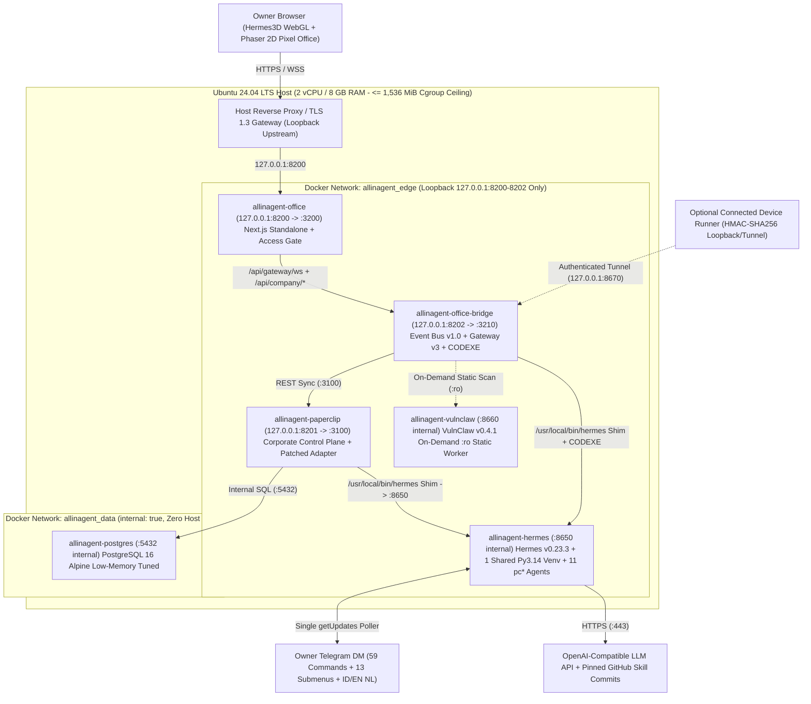

# ALLINAGENT

**Unified, Self-Hosted Autonomous AI Engineering & Defensive Security Company in a Single Stack**

[](./LICENSE)
[](./RELEASE-NOTES.md)
[](./PERFORMANCE.md)
[](#4-complete-30-capability-preservation-matrix-feat-01--feat-30)
[](https://github.com/Vistapra/ALLINAGENT)

**ALLINAGENT** (`https://github.com/Vistapra/ALLINAGENT`) is an open-source (`MIT`), production-hardened autonomous AI software engineering and defensive security company designed to run 24/7 inside a **`<= 1,536 MiB` (`1.50 GiB`) hard cgroup v2 memory ceiling** on a standard **2-vCPU / 8 GB RAM Ubuntu 24.04 LTS VPS** (or locally on Linux, macOS, and Windows) with **zero server GPU required**.

It unifies best-in-class open-source agentic infrastructure behind a fail-closed, loopback-isolated (`127.0.0.1:8200–8202`) Docker Compose stack:

- **Hermes Agent (`v0.23.3`)** — Single shared Python 3.14 execution runtime (`hermes-exec` priority broker + `< 8 KB` remote CLI shim) powering all worker profiles with zero virtualenv duplication.
- **Paperclip (`2026.1117.0`)** — Canonical corporate control plane backed by tuned **PostgreSQL 16** for organizational hierarchy, multi-project Kanban issues, parent-child delegation, budgets, and governance approvals.
- **VulnClaw (`v0.4.1` Defensive On-Demand)** — Ephemeral, secret-less, read-only (`:ro`) static security analyzer (`21.02 MiB` idle RSS, zero offensive/MCP modules, zero background LLM loops) feeding a 10-state SQLite findings ledger.
- **Hermes3D WebGL Office + 2D Pixel Office** — 100% browser-rendered `Three.js` 3D headquarters and Gather-style `Phaser` 2D pixel office synchronized in real time with a 6-tab Enterprise Command Center Overlay.
- **Unified Office Bridge** — Real-time Normalized Event Bus v1.0 (`/api/events/ws`), Gateway Protocol v3 (`/ws`), skill telemetry inspector, and authenticated REST/WS synchronization hub.
- **Telegram Control Center (CODEXE)** — **59 deterministic slash commands**, **13 interactive inline submenus**, and **Bahasa Indonesia + English natural-language routing** gated strictly to `<OWNER_TELEGRAM_ID>` via a single `getUpdates` poller.
- **11 Specialized Corporate AI Agents** — Executive, engineering, QA, defensive SOC, remediation, and compliance personas (`Wave-1` warm active + `Wave-2` on-demand standby) running in isolated `0700` non-root homes.
- **33 SHA-Pinned Agent Skill Packages** — Immutable 40-character Git commit pins verified by SHA-256 checksums, gated by **Sentry `skill-scanner`** + recursive Python AST analysis, and governed by `FETCH_FROM_UPSTREAM_ONLY` license isolation.
- **PDF & DOCX Compliance Reporting** — Automated technical readiness mapping across ISO 27001, SOC 2, and NIST CSF with verified `.pdf` and `.docx` executive deliverables.

---

## 1. One-Command Quickstart

Clone the repository and run the unified CLI (`./allinagent` on Linux/macOS, `.\allinagent.ps1` on Windows PowerShell):

```bash
git clone https://github.com/Vistapra/ALLINAGENT.git && cd ALLINAGENT && ./allinagent setup && ./allinagent up && ./allinagent health
```

### Windows PowerShell Equivalent

```powershell
git clone https://github.com/Vistapra/ALLINAGENT.git
Set-Location .\ALLINAGENT
.\allinagent.ps1 setup
.\allinagent.ps1 up
.\allinagent.ps1 health
```

### Non-Interactive Server Provisioning

```bash
LLM_BASE_URL="https://api.openai.com/v1" \
LLM_MODEL="gpt-4o-mini" \
CUSTOM_API_KEY="<YOUR_API_KEY>" \
OWNER_TELEGRAM_ID="<OWNER_TELEGRAM_ID>" \
TELEGRAM_BOT_TOKEN="<TELEGRAM_BOT_TOKEN>" \
./allinagent --production setup --yes
```

Once healthy, sign in to the Virtual Office at **`http://127.0.0.1:8200/office`** using the auto-generated `<STUDIO_ACCESS_TOKEN>` stored in your owner-only (`0600`) `.env` file, or tunnel securely from a remote VPS (`./deploy/proxy/ssh-tunnel-access.sh <VPS_USER>@<VPS_HOST>`). See [QUICKSTART.md](./QUICKSTART.md) for full details.

---

## 2. System Architecture



---

## 3. The 11 Corporate AI Agents & Resource Profile

### 3.1 Corporate Roster (`Wave-1` Warm Active + `Wave-2` On-Demand Standby)

| # | Agent Persona | Handle | Isolated Profile | Default Tier | Toolsets | Primary & Specialist Pinned Skills |
| :---: | :--- | :--- | :--- | :--- | :--- | :--- |
| `01` | **CEO Agent** | `@ceo` | `pcceoagent` | `Wave-1 ACTIVE` | `file,terminal,skills` | `ceo-advisor`, `c-level-skills` |
| `02` | **CTO Agent** | `@cto` | `pcctoagent` | `Wave-2 STANDBY` | `file,terminal,skills` | `cto-review`, `senior-architect`, `cto-advisor` |
| `03` | **Backend Developer** | `@backend` | `pcbackenddeveloper` | `Wave-1 ACTIVE` | `file,terminal,skills` | `senior-backend`, `api-design-reviewer`, `senior-architect` |
| `04` | **Frontend Developer** | `@frontend` | `pcfrontenddeveloper` | `Wave-2 STANDBY` | `file,terminal,skills` | `react-best-practices`, `frontend-design` |
| `05` | **DevOps Engineer** | `@devops` | `pcdevopsengineer` | `Wave-2 STANDBY` | `file,terminal,skills` | `senior-devops`, `terraform-skill`, `ci-cd-pipeline-builder` |
| `06` | **QA Engineer** | `@qa` | `pcqaengineer` | `Wave-1 ACTIVE` | `file,terminal,skills` | `pw`, `pw-generate`, `pw-review`, `senior-qa`, `pw-fix`, `pw-coverage`, `pw-report` |
| `07` | **Security Lead** | `@security_lead` | `pcsecuritylead` | `Wave-2 STANDBY` | `file,skills` *(read-only)* | `ciso-advisor`, `threat-model` *(reference)* |
| `08` | **Security Reviewer** | `@security` | `pcsecurityreviewer` | `Wave-1 ACTIVE` | `file,skills` *(read-only)* | `security-audit`, `senior-security`, `secondsky-cybersecurity-ref` *(reference)* |
| `09` | **Findings Analyst** | `@findings` | `pcfindingsanalyst` | `Wave-2 STANDBY` | `file,skills` *(read-only)* | `security-audit`, `anthropic-triage` *(reference)*, `cve-triage` *(experimental)* |
| `10` | **Remediation Reviewer** | `@remediation` | `pcremediationreviewer` | `Wave-2 STANDBY` | `file,skills` *(read-only)* | `focused-fix`, `security-vuln-remediation`, `anthropic-patch` *(reference)* |
| `11` | **Compliance Reporter** | `@compliance` | `pccompliancereporter` | `Wave-2 STANDBY` | `file,terminal,skills` | `compliance-os`, `docx`, `pdf` |

### 3.2 Production Resource Envelope (`2 vCPU / 8 GB RAM` Ubuntu 24.04 LTS VPS)

- **Hard Cgroup Ceiling:** **`<= 1,536 MiB` (`1.50 GiB`)** across all 6 containers (`memswap_limit == mem_limit` to prevent swap storms), preserving `>= 1.85 GiB` untouched host RAM headroom on multi-tenant servers.
- **Measured Working Set:** **`~415 MiB` idle RSS** (`21.02 MiB` idle on `vulnclaw` worker) and **`<= 1,070 MiB` sustained active RSS** under `HEAVY_WORKER_CONCURRENCY=1` priority serialization.
- **Loopback-Only Host Exposure:** `127.0.0.1:8200` (`office`), `127.0.0.1:8201` (`paperclip`), and `127.0.0.1:8202` (`office-bridge`). `postgres`, `hermes`, and `vulnclaw` expose **`0` host ports**.
- **Repository Hygiene:** Transformed from a `10.36 GiB` (`461,174`-file) legacy multi-root workspace into a **`< 15 MiB` clean Git repository** (`> 99.8%` footprint reduction with `100%` capability preservation).

---

## 4. Complete 30-Capability Preservation Matrix (`FEAT-01` .. `FEAT-30`)

Every single capability of the platform is preserved, container-hardened, and verified end-to-end:

| ID | Capability | Production Implementation & Path | Container / Runtime Plane | Status |
| :--- | :--- | :--- | :--- | :---: |
| `FEAT-01` | **Hermes Agent (`v0.23.3`)** | Pinned `eb49b8920a` + integrator classifier patch + `hermes_exec_daemon.py` (`components/hermes/`) | `allinagent-hermes` (`:8650` internal) | `VERIFIED` |
| `FEAT-02` | **Paperclip (`2026.1117.0`)** | Locked `paperclipai@2026.1117.0` + 4 deterministic adapter/DB patches + bloat pruner (`components/paperclip/`) | `allinagent-paperclip` + `allinagent-postgres` | `VERIFIED` |
| `FEAT-03` | **VulnClaw (`v0.4.1` Defensive)** | Ephemeral `L1`/`L2` static scanner (`21.02 MiB` idle RSS, `:ro` workspace, `cap_drop: ALL`) (`components/vulnclaw/`) | `allinagent-vulnclaw` (`:8660` internal) | `VERIFIED` |
| `FEAT-04` | **Hermes3D WebGL Office** | `Three.js` 3D headquarters, custom `server/index.js` Access Gate, 6-tab Command Center (`apps/hermes3d/`) | `allinagent-office` (`127.0.0.1:8200`) | `VERIFIED` |
| `FEAT-05` | **2D Pixel Office** | Gather-style `Phaser` HTML5 Canvas office with live 11-agent sync & 3D/2D instant toggle (`apps/hermes3d/`) | `allinagent-office` (Browser GPU) | `VERIFIED` |
| `FEAT-06` | **Unified Office Bridge** | Event Bus v1.0 (`/api/events/ws`), Gateway Protocol v3 (`/ws`), REST/WS state hub (`apps/office-bridge/`) | `allinagent-office-bridge` (`127.0.0.1:8202`) | `VERIFIED` |
| `FEAT-07` | **Telegram CODEXE (59 Commands)** | 59 slash commands, 13 `uac:sub:*` submenus, ID/EN NL routing, DM-only `<OWNER_TELEGRAM_ID>` gate (`integrations/telegram/`) | `allinagent-hermes` + `allinagent-office-bridge` | `VERIFIED` |
| `FEAT-08` | **11 Corporate AI Agents** | 11 isolated `0700` non-root `pc*` profiles with dynamic `role_slug` resolution & scoped toolsets (`agents/`) | `allinagent-paperclip` + `allinagent-hermes` | `VERIFIED` |
| `FEAT-09` | **33 Agent Skill Packages** | Role-scoped `PRIMARY`, `SPECIALIST`, `ON_DEMAND`, `REFERENCE_ONLY`, & `EXPERIMENTAL` skills (`skills/manifests/`) | `allinagent-hermes` (`reviewed/` symlinks) | `VERIFIED` |
| `FEAT-10` | **Paperclip Skills Store** | Company skills store import + patched `--` namespaced skill symlink reconciliation (`patches/paperclip/`) | `allinagent-paperclip` + `allinagent-hermes` | `VERIFIED` |
| `FEAT-11` | **Skill Security & License Gate** | SHA-256 file/package verification, 11-file offensive quarantine, `FETCH_FROM_UPSTREAM_ONLY` isolation (`skills/policies/`) | Setup Gate + CI + `office-bridge` | `VERIFIED` |
| `FEAT-12` | **Sentry `skill-scanner`** | Pinned `getsentry/skills` scanner (`a582c51ee2`) + recursive Python AST static gate (`apps/control-center/`) | Setup Gate + GitHub Actions CI | `VERIFIED` |
| `FEAT-13` | **GitHub Skills Registry** | Lockfile provenance ledger (`skills.lock.json`) + read-only `/daftar_skill`, `/skill_info`, `/skill_status` telemetry | `allinagent-office-bridge` + `allinagent-hermes` | `VERIFIED` |
| `FEAT-14` | **Usage & Cost Analytics** | Token, cost, model, per-agent duration & `UNPRICED USAGE` tracking across Today/Yesterday/7d/30d (`/analytics`) | `allinagent-office-bridge` + `allinagent-office` | `VERIFIED` |
| `FEAT-15` | **Budget Governance** | Corporate, daily, monthly, and per-agent budget caps (`unlimited` or `capped`) & audit ledger (`/budget`, `/set_budget`) | `allinagent-paperclip` + `allinagent-office-bridge` | `VERIFIED` |
| `FEAT-16` | **Task & Kanban Management** | 13-stage workflow ledger (`workflow-ledger.db`) synced bidirectionally with Paperclip Kanban issues & receipts | `allinagent-paperclip` + `allinagent-office-bridge` | `VERIFIED` |
| `FEAT-17` | **Multi-Project Management** | Portfolio creation, active project switching, completion tracking & workspace binding (`/projects`) | `allinagent-paperclip` + `allinagent-office` | `VERIFIED` |
| `FEAT-18` | **Hierarchical Agent Delegation** | CEO $\rightarrow$ CTO / Security Lead $\rightarrow$ Specialist parent-child subtasks serialized via `HEAVY_WORKER_CONCURRENCY=1` (`/delegasi`) | `allinagent-paperclip` + `allinagent-hermes` | `VERIFIED` |
| `FEAT-19` | **3D & 2D Meeting Room** | Full 11-agent conference room standup, A* seat navigation, live turn queue, minutes & action items (`/meeting`) | `allinagent-office` + `allinagent-office-bridge` | `VERIFIED` |
| `FEAT-20` | **Sandboxed Folder Explorer** | `ALLOWED_WORKSPACE_ROOTS` directory browser, stack detector & secret-file filter (`/folder`, `/jelajah`, `/pilih_folder`) | `allinagent-office-bridge` + `allinagent-office` | `VERIFIED` |
| `FEAT-21` | **Source Code Analysis** | Polyglot architecture, framework, dependency & risk inspection producing sanitized reports (`/analisis`) | `allinagent-office-bridge` + `allinagent-hermes` | `VERIFIED` |
| `FEAT-22` | **Autonomous Software Development** | Isolated Git feature-branch coding, refactoring, diff inspection, build & peer CTO review (`/dev`, `/buat_branch`, `/cek_diff`) | `allinagent-hermes` (`pcbackend*`, `pcfrontend*`) | `VERIFIED` |
| `FEAT-23` | **Automated QA & E2E Testing** | Unit, contract, API, and ephemeral headless Chromium Playwright test generation & triage (`/jalankan_test`, `pw*`) | `allinagent-hermes` (`pcqaengineer`) + CI | `VERIFIED` |
| `FEAT-24` | **Defensive Security Assessment** | Strictly non-destructive static review, OWASP/CWE mapping, secret hygiene & threat modeling (`/keamanan`) | `allinagent-vulnclaw` + `allinagent-hermes` | `VERIFIED` |
| `FEAT-25` | **10-State Findings Management** | Fingerprinted `findings.db` (`RECEIVED` $\rightarrow$ `CONFIRMED` $\rightarrow$ `RESOLVED`), directive neutralization & issue linking | `allinagent-hermes` + `allinagent-office-bridge` | `VERIFIED` |
| `FEAT-26` | **Remediation Verification** | Separation-of-duties patch scoping (`focused-fix`), re-scan verification & independent `pcremediationreviewer` sign-off | `allinagent-hermes` + `allinagent-vulnclaw` | `VERIFIED` |
| `FEAT-27` | **Compliance Readiness Mapping** | ISO 27001, SOC 2 & NIST CSF control-overlap mapping and evidence pool synthesis (`compliance-os`) | `allinagent-hermes` (`pccompliancereporter`) | `VERIFIED` |
| `FEAT-28` | **PDF & DOCX Report Export** | Verified `%PDF-` and OpenXML `.docx` (`word/document.xml`) generation & authenticated delivery (`report_exporter.py`) | `allinagent-hermes` + `allinagent-office-bridge` | `VERIFIED` |
| `FEAT-29` | **15-Component Health Monitoring** | Deep container/HTTP/DB/memory/disk health diagnostics & redacted log inspection (`/kesehatan`, `./allinagent doctor`) | All 6 Containers + CLI Doctor | `VERIFIED` |
| `FEAT-30` | **Coordinated Maintenance & Recovery** | 11-state maintenance coordinator, active-run deferral, pre-update `pg_dump` backup & automatic rollback (`./allinagent update`) | Host `systemd` Timer + CLI | `VERIFIED` |

---

## 5. Complete Documentation Index (25 Companion Guides)

| Category | Document | Scope & Purpose |
| :--- | :--- | :--- |
| **Getting Started** | [QUICKSTART.md](./QUICKSTART.md) | 5-minute setup, first task walkthrough, and everyday `./allinagent` CLI cheatsheet |
| **Getting Started** | [INSTALLATION.md](./INSTALLATION.md) | Detailed prerequisites, directory layout, interactive vs. headless setup, and Track A seed workspace |
| **Architecture** | [ARCHITECTURE.md](./ARCHITECTURE.md) | Core invariants, 6-container topology, `hermes-exec` broker, CLI shim, and two-tier network design |
| **Deployment** | [PRODUCTION-DEPLOYMENT.md](./PRODUCTION-DEPLOYMENT.md) | Ubuntu 24.04 LTS production runbook, Nginx TLS 1.3 + HTTP/3 QUIC proxy, and `systemd` timers |
| **Deployment** | [LINUX.md](./LINUX.md) | POSIX permissions (`0700`/`0600`), unified `cgroup v2`, UFW/`DOCKER-USER` coexistence, and Linux host mode |
| **Deployment** | [WINDOWS.md](./WINDOWS.md) | Windows Docker Desktop / WSL2 guide, `allinagent.ps1`, and optional HMAC Connected Device Runner |
| **Deployment** | [DOCKER.md](./DOCKER.md) | Multi-stage Dockerfiles, `compose.yaml` + `compose.production.yaml`, volumes, and GHCR images |
| **Configuration** | [CONFIGURATION.md](./CONFIGURATION.md) | Complete `.env` variable reference, auto-generated CSPRNG secrets, and fail-closed defaults |
| **Configuration** | [MODEL-PROVIDERS.md](./MODEL-PROVIDERS.md) | Configuring OpenAI, OpenRouter, Gemini, Anthropic proxies, and custom OpenAI-compatible gateways |
| **Control & Agents** | [TELEGRAM.md](./TELEGRAM.md) | BotFather pairing, `<OWNER_TELEGRAM_ID>` DM lock, all 59 slash commands, 13 submenus, and NL rules |
| **Control & Agents** | [AGENTS.md](./AGENTS.md) | Deep dive into all 11 corporate AI personas, Wave-1/Wave-2 tiers, toolsets, and delegation rules |
| **Skills & Supply Chain** | [SKILLS.md](./SKILLS.md) | Catalog of all 33 agent skill packages, progressive-disclosure `skill_view`, and per-role assignments |
| **Skills & Supply Chain** | [SKILL-SUPPLY-CHAIN.md](./SKILL-SUPPLY-CHAIN.md) | 40-char SHA pinning, SHA-256 verification, Sentry `skill-scanner` + AST gate, and 11-file quarantine |
| **Security & Legal** | [SECURITY.md](./SECURITY.md) | Threat model, loopback isolation, secret redaction, `:ro` VulnClaw sandbox, and vulnerability reporting |
| **Security & Legal** | [LICENSE-INVENTORY.md](./LICENSE-INVENTORY.md) | Human-readable SPDX inventory across core upstreams, 33 skills (`20` OSI vs. `13` fetch-only), and libraries |
| **Security & Legal** | [THIRD-PARTY-NOTICES.md](./THIRD-PARTY-NOTICES.md) | Full upstream copyright notices and license attributions for redistributed and fetched components |
| **Operations & SRE** | [DATABASE-MIGRATION.md](./DATABASE-MIGRATION.md) | Track A clean public seed vs. Track B AES-256-GCM encrypted private state export/import (`scripts/migration/`) |
| **Operations & SRE** | [RESOURCE-REQUIREMENTS.md](./RESOURCE-REQUIREMENTS.md) | Hardware tiers (`4 GB`, `8 GB`, `16 GB+`), cgroup math, PostgreSQL low-memory tuning, and disk budgets |
| **Operations & SRE** | [PERFORMANCE.md](./PERFORMANCE.md) | Empirical before-vs-after storage, memory, connection-pool, and runtime optimization benchmarks |
| **Operations & SRE** | [UPDATE-AND-RECOVERY.md](./UPDATE-AND-RECOVERY.md) | Zero-data-loss `./allinagent update`, active-work drain, `pg_dump` retention, and rollback procedures |
| **Operations & SRE** | [TROUBLESHOOTING.md](./TROUBLESHOOTING.md) | Common failure modes, `./allinagent doctor` checks, port/poller conflicts, and diagnostic commands |
| **Quality & Release** | [TEST-MATRIX.md](./TEST-MATRIX.md) | Complete automated CI, unit, contract, `vitest`, synthetic fixture, Phase 27 live E2E, and Phase 28 matrix |
| **Quality & Release** | [RELEASE-NOTES.md](./RELEASE-NOTES.md) | Formal `v1.0.0` (and `v1.0.0-rc.1`) release highlights, GHCR digests, SBOM, and security defaults |
| **Quality & Release** | [CHANGELOG.md](./CHANGELOG.md) | Keep-a-Changelog chronological release history for `v1.0.0` and `v1.0.0-rc.1` |
| **Quality & Release** | [FINAL-REPORT.md](./FINAL-REPORT.md) | Executive & Principal Architecture Transformation Report covering Phases `00`–`29` and `ADR-001`–`ADR-009` |

---

## 6. License

First-party **ALLINAGENT** code, orchestration scripts, Office Bridge, Control Center, and container configurations are released under the **[MIT License](./LICENSE)**. Third-party upstream components and role-specific skills retain their respective licenses as documented in [LICENSE-INVENTORY.md](./LICENSE-INVENTORY.md) and [THIRD-PARTY-NOTICES.md](./THIRD-PARTY-NOTICES.md).
