# ALLINAGENT — Skill Supply Chain, Security Gate & License Governance

`ALLINAGENT` treats third-party agent skills as executable software supply-chain dependencies. Every skill package across the **33-package / 10-repository registry** is governed by immutable 40-character Git commit pins, per-file and package SHA-256 digests, a two-engine static security gate (**Sentry `skill-scanner`** + **recursive Python AST analysis**), mandatory quarantine of offensive or autonomous-harness content, `FETCH_FROM_UPSTREAM_ONLY` legal isolation for restricted or third-party-schema-bundling repositories, and `.usage.json` runtime immutability locks.

Authoritative policy & manifest files:
- [`skills/manifests/skills.lock.json`](./skills/manifests/skills.lock.json) — Immutable commit SHAs, file lists, and SHA-256 checksums for all 33 packages
- [`skills/policies/skill-policy.json`](./skills/policies/skill-policy.json) — Enforcement flags, quarantine rules, Stage-2 normalizations, and `--strict-oss` / `--offline` fallbacks
- [`skills/manifests/skill-security-results.json`](./skills/manifests/skill-security-results.json) — Recorded Sentry `skill-scanner` + AST audit verdicts
- [`LICENSE-INVENTORY.json`](./LICENSE-INVENTORY.json) & [`THIRD-PARTY-NOTICES.md`](./THIRD-PARTY-NOTICES.md) — SPDX license matrix & upstream attributions

---

## 1. End-to-End Supply-Chain Pipeline

```mermaid
flowchart LR
    Lock["1. Pinned Lockfile\nskills.lock.json\n(10 Repos, 40-char Commit SHAs)"]
    Fetch["2. Deterministic Fetch\nraw.githubusercontent.com/<sha>\n(Zero Floating Branches/Tags)"]
    Hash["3. SHA-256 Verification\nfile_sha256s + upstream_package_sha256\n+ upstream_license_sha256"]
    Gate["4. Dual Static Security Gate\nSentry skill-scanner + Recursive AST\n+ Symlink/Hook Rejection"]
    Quar["5. Quarantine & Tier Isolation\n11 Excluded Files + REFERENCE_ONLY (4)\n+ EXPERIMENTAL (1)"]
    Norm["6. Stage-2 Normalizer\nISO Date Quoting + Name Rewrites\n+ Apache-2.0 Sec 4(b) Notice"]
    Sync["7. Paperclip Store & .usage.json\nSkills Store Import + Profile Sync\n+ locked:true, pinned:true"]

    Lock --> Fetch --> Hash --> Gate --> Quar --> Norm --> Sync
```



---

## 2. Immutable 40-Character Commit SHA Pinning

`components.lock.json` and `skills/policies/skill-policy.json` enforce:
- `require_40_char_commit_sha: true`
- `block_unpinned_branches_or_tags: true`
- `block_arbitrary_remote_skill_installs: true`

Floating references (`main`, `master`, `HEAD`, or mutable tags) are rejected fail-closed. Only the following 10 repository commit SHAs are permitted:

| Repository (`owner/name`) | Pinned 40-Character Commit SHA | SPDX License | Package Count |
| :--- | :--- | :--- | :---: |
| `alirezarezvani/claude-skills` | `5909a72e62b5fbb809935fb6a55b58bdbe175074` | `MIT` | `11` |
| `borghei/Claude-Skills` | `25bf86b89c6c1e63f433a5b65e8cfcb6cf0b7ad3` | `MIT-Commons-Clause-1.0` | `10` |
| `anthropics/skills` | `e4bb5d960d87126ff3b3a8af1a104b7db67560ba` | `Apache-2.0` | `3` |
| `anthropics/defending-code-reference-harness` | `d3bea6b5793b5f3d59a75ebe69a58efa88383145` | `Apache-2.0` | `3` |
| `getsentry/skills` | `a582c51ee29d0f35e6ac321340796f77d43da733` | `Apache-2.0` | `1` |
| `antonbabenko/terraform-skill` | `f5a195992d84c8fb075b0176d666967cd07d2081` | `Apache-2.0` | `1` |
| `stacklok/toolhive-studio` | `4d87c91d49b881ccc7dc64667c1dce5a84c535d6` | `Apache-2.0` | `1` |
| `fedius01/cve-triage` | `3517c8fb10531103c403f09143966d62b2a0790f` | `MIT` | `1` |
| `secondsky/claude-skills` | `14966c3024f48eea0386eb970b230ea0f4bebd33` | `MIT` | `1` |
| `vercel-labs/agent-skills` | `5a37a6329fbad3666c3207392a6a7c0110e92efb` | `MIT-Check-Skill-Header` | `1` |

---

## 3. Multi-Layer SHA-256 Checksum Verification

Every package entry in `skills/manifests/skills.lock.json` records cryptographic SHA-256 digests verified prior to promotion into `data/skill-registry/reviewed/`:

1. **`file_sha256s`:** Exact SHA-256 hex digest of every allowed relative file inside the skill directory (`SKILL.md`, `scripts/*.py`, `references/*.md`, `templates/*.md`, XSD schemas, etc.).
2. **`upstream_package_sha256`:** Deterministic aggregate SHA-256 digest over the sorted upstream package tree prior to local normalization.
3. **`upstream_license_sha256`:** SHA-256 digest of the upstream repository's root `LICENSE` file when fetched alongside permissive packages.
4. **Tamper Quarantine:** If any downloaded byte diverges from `file_sha256s` or `upstream_package_sha256`, `quarantine_on_tamper_or_failure: true` immediately aborts promotion and isolates the artifact.

---

## 4. Sentry `skill-scanner` + Recursive AST Security Gate

Before any skill package can enter `reviewed/` or be imported into Paperclip, it must pass a two-stage static security gate (`skills/policies/skill-policy.json` -> `security_gate`):

### 4.1 Stage-1 Bootstrap: Sentry `skill-scanner`
- **Pinned Scanner:** `getsentry/skills` (`skills/skill-scanner`, commit `a582c51ee29d0f35e6ac321340796f77d43da733`, `Apache-2.0`, `upstream_package_sha256: a51d7dceaa0778b2d17dac89d83fde191260b26ecdad566a85ff51c0441b19db`).
- **Pre-Execution Verification:** All 674 lines of `scripts/scan_skill.py` are verified offline (`0` outbound network calls, `0` shell executions) and validated against its pinned SHA-256 hash before scanning candidate packages.
- **Detection Coverage:** Evaluates `SKILL.md` instructions, references, and scripts against `prompt-injection-patterns.md`, `dangerous-code-patterns.md`, and `permission-analysis.md` (hidden zero-width characters, prompt-override directives, credential exfiltration, reverse shells, and privilege escalation).

### 4.2 Stage-1B: Recursive Python AST & Structural Hardening Gate
 alongside Sentry `skill-scanner`, `ALLINAGENT` runs a deterministic Python `ast` & structural inspector enforcing:
- **`run_recursive_ast_scanner: true`:** Parses every `.py` helper script across all 33 packages into an Abstract Syntax Tree to inspect `subprocess`, `os.system`, `eval`, `exec`, ` compile`, ` pickle`, socket/network egress, and filesystem write targets.
- **`reject_symlinks_escaping_skill_dir: true`:** Rejects any symlink whose target escapes the package root.
- **`reject_frontmatter_lifecycle_hooks: true`:** Blocks YAML frontmatter auto-execution hooks.
- **`reject_npm_install_hooks: true`:** Rejects `preinstall` / `install` / `postinstall` script hooks in any bundled `package.json`.

---

## 5. Quarantine Policy & Restricted Classifications

### 5.1 Complete 11-File Quarantine Ledger (`quarantined_excluded_files`)
Zero full packages out of the 33 were rejected, but **11 specific files across 2 upstream packages** are deterministically excluded and quarantined (`skills/policies/skill-policy.json` & `skills/manifests/skill-security-results.json`) so offensive payloads and autonomous harnesses never reach agent contexts:

| # | Source Package | Quarantined Relative File | Quarantine Rationale |
| :---: | :--- | :--- | :--- |
| `01` | `secondsky-cybersecurity-ref` | `references/aradotso-agent-safety.md` | Contains offensive filter-bypass / live prompt-injection test payloads outside defensive Security Reviewer scope. |
| `02` | `secondsky-cybersecurity-ref` | `references/aradotso-ai-security.md` | Contains offensive filter-bypass / live prompt-injection test payloads outside defensive Security Reviewer scope. |
| `03` | `secondsky-cybersecurity-ref` | `references/aradotso-code-audit.md` | Contains offensive filter-bypass / live prompt-injection test payloads outside defensive Security Reviewer scope. |
| `04` | `secondsky-cybersecurity-ref` | `references/aradotso-compliance.md` | Contains offensive filter-bypass / live prompt-injection test payloads outside defensive Security Reviewer scope. |
| `05` | `secondsky-cybersecurity-ref` | `references/aradotso-web-vuln-testing.md` | Contains offensive filter-bypass / live prompt-injection test payloads outside defensive Security Reviewer scope. |
| `06` | `secondsky-cybersecurity-ref` | `references/testing-business-logic.md` | Contains offensive web vulnerability test payloads outside read-only defensive Security Reviewer scope. |
| `07` | `secondsky-cybersecurity-ref` | `references/testing-forced-browsing.md` | Contains offensive web vulnerability test payloads outside read-only defensive Security Reviewer scope. |
| `08` | `secondsky-cybersecurity-ref` | `references/testing-host-header.md` | Contains offensive web vulnerability test payloads outside read-only defensive Security Reviewer scope. |
| `09` | `secondsky-cybersecurity-ref` | `references/testing-open-redirect.md` | Contains offensive web vulnerability test payloads outside read-only defensive Security Reviewer scope. |
| `10` | `secondsky-cybersecurity-ref` | `references/testing-xss.md` | Contains offensive XSS test payloads outside read-only defensive Security Reviewer scope. |
| `11` | `threat-model` | `bootstrap.md` | Deprecated autonomous harness bootstrap excluded per defensive `REFERENCE_ONLY` policy; threat modeling methodology retained. |

### 5.2 `REFERENCE_ONLY` & `EXPERIMENTAL` Isolation
- **`REFERENCE_ONLY` (`4` packages — `auto_activate_in_paperclip_runtime: false`):**
  `threat-model`, `secondsky-cybersecurity-ref`, `anthropic-triage`, and `anthropic-patch` are materialized strictly as read-only methodology documents under `data/skill-registry/agents/<role>/references/<pkg_id>/` (never registered as autonomous executable skills in Paperclip).
- **`EXPERIMENTAL` (`1` package — `cve-triage`):**
  Isolated under `data/skill-registry/agents/findings/experimental/cve-triage/` with `auto_activate_in_paperclip_runtime: false` because its helper scripts (`fetch_advisory.py`, `fetch_epss.py`, `fetch_kev.py`) query external vulnerability feeds and target Python/uv/Poetry lockfiles specifically. Operators can opt in explicitly via `--enable-experimental`.

---

## 6. `FETCH_FROM_UPSTREAM_ONLY` Legal Isolation & MIT Fallbacks

To ensure the public `ALLINAGENT` Git repository and published GHCR container images remain **100% redistributable under the MIT License** with zero license contamination:

1. **Zero Upstream Skill Bundling in Git or GHCR:** `.gitignore`, `.dockerignore`, and `scripts/audit-public-release.py` forbid `skill-registry/`, `skills/upstream/`, `skills/staging/`, `skills/reviewed/`, and `skills/quarantine/` from entering Git history or Docker build contexts.
2. **13 Packages Enforced as `FETCH_FROM_UPSTREAM_ONLY` (`bundle_in_git_or_ghcr: false`):**
   - **`borghei/Claude-Skills` (`10` packages — `LicenseRef-MIT-Commons-Clause-1.0`):** `api-design-reviewer`, `ci-cd-pipeline-builder`, `cto-advisor`, `focused-fix`, `security-audit`, `senior-architect`, `senior-backend`, `senior-devops`, `senior-qa`, `senior-security`. Commons Clause v1.0 prohibits commercial sale/resale of the covered software; keeping these strictly user-fetched at `./allinagent setup` time respects the upstream author's license terms completely.
   - **`vercel-labs/agent-skills` (`1` package — `LicenseRef-Missing-Root-License`):** `react-best-practices` omits a standalone root `LICENSE` file in the upstream repository and is therefore never redistributed in `ALLINAGENT` artifacts.
   - **Anthropic `docx` and `pdf` (`2` packages from `anthropics/skills`):** Although `anthropics/skills` uses `Apache-2.0` for `frontend-design` and skill scripts, the `skills/docx` and `skills/pdf` subdirectories include third-party ECMA/ISO-IEC-29500 Office Open XML XSD schemas and document assets governed by `Complete terms in LICENSE.txt`. Both are classified `FETCH_FROM_UPSTREAM_ONLY` and fetched into the host volume during `./allinagent setup`.
3. **`--strict-oss` and `--offline` MIT Fallbacks (`Nous Research`):**
   When an operator runs skill installation with `--strict-oss` (pure OSI-approved permissive mode) or `--offline` (air-gapped host without GitHub egress), `ALLINAGENT` skips all `FETCH_FROM_UPSTREAM_ONLY` network fetches and automatically maps:
   - `docx` $\rightarrow$ **`productivity/microsoft-office`** (`MIT`, Nous Research bundled Hermes skill + `python-docx`).
   - `pdf` $\rightarrow$ **`productivity/pdf`** (`MIT`, Nous Research bundled Hermes skill + `reportlab`, `pypdf`, `pdfplumber`).
   - Furthermore, `deploy/docker/hermes.Dockerfile` explicitly strips and blocks copyleft PDF packages (`pymupdf` AGPL-3.0 and `marker-pdf` GPL) at container build time.

---

## 7. Stage-2 Normalizations, Paperclip Sync & Runtime Lock

1. **Stage-2 Frontmatter Normalizer (`stage2_normalizations`):**
   - Quotes bare ISO-8601 YAML dates (`quote_iso_dates: true`) so PyYAML / Hermes `skill_view` never coerces timestamps into non-JSON-serializable `datetime.date` objects.
   - Rewrites ambiguous upstream frontmatter names to collision-free canonical IDs (`vercel-react-best-practices` $\rightarrow$ `react-best-practices`, `generate` $\rightarrow$ `pw-generate`, `fix` $\rightarrow$ `pw-fix`, `coverage` $\rightarrow$ `pw-coverage`, `report` $\rightarrow$ `pw-report`).
   - Strips `disable-model-invocation` on `c-level-skills` so `@ceo` can load routing guidance via `skill_view`.
   - Prepends an explicit **Apache-2.0 Section 4(b) modification notice** whenever an `Apache-2.0` `SKILL.md` frontmatter header is normalized.
2. **Paperclip Skills Store & `.usage.json` Lock:**
   - Verified runtime packages are imported into Paperclip (`POST /api/companies/<company_id>/skills/import`) and synced per agent (`POST /api/agents/<agent_id>/skills/sync`), reconciled on disk via the patched `@paperclipai/hermes-paperclip-adapter`.
   - Every installed skill is marked `"locked": true, "pinned": true` in `<profile>/skills/.usage.json`, preventing agents from mutating, overwriting, or deleting skills at runtime.

---

## 8. Supply-Chain & SBOM Verification Commands

```bash
# 1. Generate and validate the CycloneDX 1.5 SBOM across all locked components & skills
python3 scripts/generate-sbom.py --validate

# 2. Run the fail-closed public release & license compliance gate (including built-in self-tests)
python3 scripts/audit-public-release.py --self-test
python3 scripts/audit-public-release.py --strict-clean-tree
```
