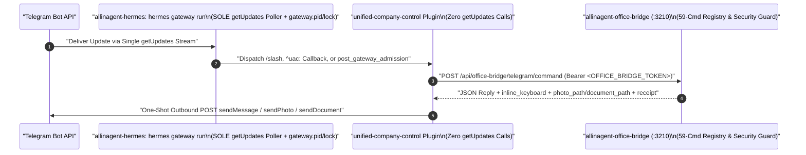

# ALLINAGENT — Telegram Control Center (`CODEXE` / `unified-company-control`)

`ALLINAGENT` includes a full-featured, owner-private **Telegram Remote Control Center** powered by the user-space Hermes Gateway plugin (`integrations/telegram/unified-company-control/` & `agents/hermes-extensions/plugins/unified-company-control/`) and 8 modular controllers in `apps/office-bridge/`. From a single private Telegram DM with your own bot, you can command all **11 corporate AI agents**, navigate **13 interactive inline-keyboard submenus**, invoke **59 deterministic slash commands**, type **17 Bahasa Indonesia natural-language intents**, convene **11-agent 3D/2D meetings**, receive **live 3D & 2D Virtual Office PNG screenshots**, download **PDF/DOCX compliance reports**, and approve high-risk operations via **anti-replay HMAC-signed approval cards**.

Authoritative implementation files:
- [`integrations/telegram/telegram_onboarding.py`](./integrations/telegram/telegram_onboarding.py) — Cross-platform `@BotFather` onboarding wizard, validator & single-poller verifier
- [`integrations/telegram/command_catalog.json`](./integrations/telegram/command_catalog.json) — Machine-readable specification (`59` slash commands, `13` submenus, `52` callback routes, `17` NL intent rules)
- [`integrations/telegram/unified-company-control/__init__.py`](./integrations/telegram/unified-company-control/__init__.py) — User-space Hermes Gateway plugin (`sendMessage`, `sendPhoto`, `sendDocument`, `^uac:` callbacks)

---

## 1. Onboarding Your Own Telegram Bot (`@BotFather` + `telegram_onboarding.py`)

`ALLINAGENT` never uses shared third-party relay bots — you pair **your own private Telegram bot** locked exclusively to your numeric Telegram user ID.

### Step 1: Create Your Bot in `@BotFather` & Get Your Numeric User ID
1. Open Telegram, message **`@BotFather`**, and send `/newbot`.
2. Choose a display name (e.g., `My ALLINAGENT Company`) and a unique username ending in `bot` (e.g., `my_allinagent_bot`). Copy the HTTP API token (`<BOT_ID>:<BOT_SECRET_TOKEN>`).
3. *(Recommended Hardening in `@BotFather`):* Send `/setjoingroups` $\rightarrow$ select your bot $\rightarrow$ choose **`Disable`** so your bot can never be invited into group chats.
4. Open a DM with your newly created bot and press **`Start`** (`/start`) so Telegram allows outbound messages to your account.
5. Obtain your numeric Telegram User ID (a positive integer such as `987654321`, e.g., via `@userinfobot`).

### Step 2: Configure & Verify via `telegram_onboarding.py` (or `./allinagent setup`)

You can configure Telegram during `./allinagent setup` or at any time using `integrations/telegram/telegram_onboarding.py`:

```bash
# Option A: Interactive guided wizard (masks token input, writes 0600 .env & HERMES_HOME config,
# installs the 59-command plugin, clears stale webhooks, and checks single-poller safety)
python3 integrations/telegram/telegram_onboarding.py --configure

# Option B: Non-interactive provisioning via stdin (zero token exposure in process argv / shell history)
printf '%s\n' "<YOUR_BOTFATHER_TOKEN>" | python3 integrations/telegram/telegram_onboarding.py \
  --configure \
  --bot-token-stdin \
  --owner-id "<YOUR_NUMERIC_TELEGRAM_USER_ID>" \
  --clear-webhook \
  --non-interactive

# Verify deployment configuration, 59-command parity, and single-poller status
python3 integrations/telegram/telegram_onboarding.py --check --online

# Offline catalog, token-syntax & Owner-ID self-validation
python3 integrations/telegram/telegram_onboarding.py --offline-validate
python3 integrations/telegram/telegram_onboarding.py --self-check
```

When onboarding completes, `telegram_onboarding.py` locks `.env` (`chmod 0600`) and `<HERMES_HOME>/config.yaml` with:
- `dm_policy: "allowlist"` and `allow_from: ["<OWNER_TELEGRAM_ID>"]`
- `group_policy: "disabled"` and `guest_mode: false`
- `unauthorized_dm_behavior: "decline"`
- `approvals.mode: "smart"`, `destructive_slash_confirm: true`, and `unattended_mode: "deny"`

After configuring `.env`, apply changes to the running container stack with `./allinagent up`.

---

## 2. Fail-Closed DM-Only `OWNER_TELEGRAM_ID` Security Guard

Every inbound slash command, inline callback button press, and natural-language message passes through **dual fail-closed authorization** — first in `unified-company-control/__init__.py` (Hermes Gateway edge) and again in `office-bridge/telegram-control/security-guard.js` (`verifyTelegramRequestSecurity`):

1. **Fail-Closed Placeholder Rejection:** `OWNER_TELEGRAM_ID` must match `^[1-9][0-9]{4,19}$`. Empty strings, `"0"`, non-digits, or synthetic 10-digit zero-padded placeholders are rejected immediately (`entrypoint.sh` refuses to start the Telegram poller and the plugin denies all requests).
2. **Strict Private-DM Scope:** Only `private` / `dm` chats where `caller_id == chat_id == callback_sender_id == session_owner_id == OWNER_TELEGRAM_ID` are accepted. Any `group`, `supergroup`, `channel`, or negative `chat_id` is rejected with HTTP `403 GROUP_OR_CHANNEL_FORBIDDEN`.
3. **Audited Security Error Codes (`command_catalog.json`):**
   - `403 UNAUTHORIZED_USER` — Sender numeric ID does not match `OWNER_TELEGRAM_ID`
   - `403 UNAUTHORIZED_CALLBACK_SENDER` — Inline button pressed by non-owner
   - `403 GROUP_OR_CHANNEL_FORBIDDEN` — Non-private chat rejected
   - `403 CHAT_ID_MISMATCH` / `403 SESSION_OWNERSHIP_MISMATCH` — Envelope mismatch
   - `403 MODIFIED_CALLBACK_PAYLOAD` — Invalid HMAC-SHA256 `|sig=` callback signature
   - `403 CROSS_USER_APPROVAL_FORBIDDEN` — Non-owner approval consumption attempt
   - `409 CALLBACK_REPLAY_DETECTED` — Duplicate `callback_query_id` within 30-minute replay window
   - `409 DUPLICATE_OR_STALE_APPROVAL` — One-time approval request already `APPROVED` or `REJECTED`
   - `410 APPROVAL_EXPIRED` — Approval request exceeded its 15-minute TTL

---

## 3. Single-Poller Architecture (Zero HTTP `409 Conflict`)

Telegram's Bot API allows **at most one active `getUpdates` long-polling connection** per bot token; starting a second poller triggers `HTTP 409 Conflict: terminated by other getUpdates request`. `ALLINAGENT` eliminates `409 Conflict` by design:



- **Sole Poller:** Only `python -m hermes_cli.main --profile default gateway run` inside `allinagent-hermes` calls `getUpdates`, guarded by `gateway.pid` and `gateway.lock` (verifiable via `telegram_onboarding.py --verify-single-poller`).
- **Zero Worker Token Leakage:** The 11 corporate worker profiles (`profiles/pc*`) never receive `TELEGRAM_BOT_TOKEN` in their `.env` files and never start gateway pollers.
- **One-Shot Outbound Delivery:** `unified-company-control` and Office Bridge notifications use stateless outbound HTTPS `POST` requests (`sendMessage`, `sendPhoto`, `sendDocument`, `editMessageText`, `answerCallbackQuery`) — never `getUpdates`.

---

## 4. The 13-Submenu Interactive Command Center (`/kantor`)

Sending `/kantor` (or `/menu`, `/dashboard`, `/home`, `/help-platform`) opens the **`ALLINAGENT — AI COMPANY` (`CODEXE`)** interactive dashboard with a real-time context header (active/locked agent, active target workspace, 3D/2D meeting status, active Kanban tasks, async jobs, and pending approvals) and **13 inline-keyboard submenus**:

| # | Submenu ID | Button Label | Callback Payload | Functional Scope |
| :---: | :--- | :--- | :--- | :--- |
| `01` | `agents` | `👥 AGENTS` | `uac:sub:agents` | List all 11 AI agents, lock/switch active agent (`uac:pick:1..11`), open 3D/2D Inspector, inspect/clear sessions, view role skills |
| `02` | `ceo` | `🧠 CEO / TASKS` | `uac:sub:ceo` | CEO multi-agent delegation, wake all 11 agents (`uac:wake_all`), restore Wave-1 (`uac:wave1`), pause/resume dispatch, emergency stop |
| `03` | `office` | `🏢 OFFICE 3D / 2D` | `uac:sub:office` | 8 department rooms & occupancy, live 11-agent coordinates, 3D/2D render check, live 3D (`uac:shot:3d`) & 2D (`uac:shot:2d`) screenshots |
| `04` | `meeting` | `🗣 MEETING` | `uac:sub:meeting` | Gather all 11 agents in 3D/2D Meeting Room, run Bahasa Indonesia discussion rounds, generate minutes/tasks, conclude meeting |
| `05` | `folders` | `📁 WORKSPACES & FOLDERS` | `uac:sub:folders` | Paginated workspace explorer (`uac:br:<token>:<page>`), stack detection, target workspace selection & deep source analysis |
| `06` | `dev` | `💻 DEVELOPMENT` | `uac:sub:dev` | Isolated Git branch status (`uac:dev:git`), `git diff`, syntax/build check, test suite execution & CTO/QA code review |
| `07` | `paperclip` | `📋 PAPERCLIP` | `uac:sub:paperclip` | Multi-project portfolio progress, paginated Kanban task filters (`all`, `active`, `blocked`, `done`) & quick workspace audit task |
| `08` | `analytics` | `📊 ANALYTICS` | `uac:sub:analytics` | Real SQLite + Paperclip token, cost & run telemetry across `Today`, `Yesterday`, `7d`, `30d`, `Per-Agent`, `Per-Model`, `Runs`, `History` |
| `09` | `budgets` | `💰 BUDGETS` | `uac:sub:budgets` | Company/daily/monthly/per-agent budget utilization, `UNLIMITED` vs capped toggles, paused-agent alerts & governance audit log |
| `10` | `security` | `🛡 SECURITY` | `uac:sub:security` | Isolated `VulnClaw` defensive code scan (`uac:sec:scan_active`), dependency checks, findings summary, triage & remediation task creation |
| `11` | `approvals` | `✅ APPROVALS` | `uac:sub:approvals` | Pending & historical governance approval requests with one-tap anti-replay `Approve` (`uac:app_ok:*`) and `Reject` (`uac:app_no:*`) buttons |
| `12` | `health` | `🩺 HEALTH` | `uac:sub:health` | Live 15-component health diagnostics, sanitized error logs & graceful non-destructive service recovery |
| `13` | `system` | `⚙ SYSTEM` | `uac:sub:system` | Daily `03:00` maintenance & auto-update status, scheduler state, long-running async jobs (`AbortController` cancel) |

All callback payloads strictly enforce Telegram's `<= 64`-byte `callback_data` ceiling, provide immediate loading toast feedback on long-running actions (`⏳ Memproses di AI Company...`), and automatically fall back to sending a fresh card if an older Telegram message can no longer be edited in place.

---

## 5. Complete 59 Registered Slash Commands Reference

All **59 slash commands** registered by `unified-company-control` (hyphenated in Telegram's command menu and normalized interchangeably with underscores — e.g., `/info-agen` and `/info_agen` both work) are listed below. *(Note: Hermes's native `/approvals` command is preserved untouched; corporate governance approvals use `/persetujuan`, `/setujui`, and `/tolak`.)*

| # | Slash Command | Arguments Hint | Canonical ID | Category | Permission | Mode | Description |
| :---: | :--- | :--- | :--- | :--- | :--- | :---: | :--- |
| `01` | `/kantor` | *(none)* | `kantor` | `SYSTEM` | `owner_read` | `sync` | Open main 13-submenu `ALLINAGENT — AI COMPANY` dashboard |
| `02` | `/agen` | *(none)* | `agen` | `AGENTS` | `owner_read` | `sync` | List all 11 corporate AI agents, activation waves, 3D/2D desks & tasks |
| `03` | `/pilih` | `[1..11\|nama]` | `pilih` | `AGENTS` | `owner_mutate` | `sync` | Select/lock active corporate agent in Telegram (`1..11`, `@handle`, slug, or name) |
| `04` | `/lepas` | *(none)* | `lepas` | `AGENTS` | `owner_mutate` | `sync` | Exit Direct-Agent lock back to general Hermes mode |
| `05` | `/info-agen` | `[1..11\|nama]` | `info_agen` | `AGENTS` | `owner_read` | `sync` | View 3D/2D Employee Inspector, model, toolsets, session & queue details |
| `06` | `/daftar-skill` | `[agen]` | `daftar_skill` | `AGENTS` | `owner_read` | `sync` | List specialized skills across all 11 agents or for a specific agent |
| `07` | `/skill-agen` | `[agen]` | `daftar_skill` | `AGENTS` | `owner_read` | `sync` | Alias to list specialized role skills per agent |
| `08` | `/skill-info` | `<agen> [skill]` | `skill_info` | `AGENTS` | `owner_read` | `sync` | Inspect skill GitHub repo, 40-char commit SHA, SPDX license & SHA-256 |
| `09` | `/skill-status` | *(none)* | `skill_status` | `AGENTS` | `owner_read` | `sync` | View global skill registry status, Sentry `skill-scanner` gate & quarantine count |
| `10` | `/chat` | `<pesan>` | `chat` | `AGENTS` | `owner_mutate` | `sync` | Send message/instruction to the currently selected corporate agent |
| `11` | `/ke` | `<agen> \| <pesan>` | `ke` | `AGENTS` | `owner_mutate` | `sync` | Send a one-shot task/question to a specific agent without changing locked agent |
| `12` | `/reset-sesi` | `[agen] [--clear]` | `reset_sesi` | `AGENTS` | `owner_mutate` | `sync` | Inspect or clear an agent's isolated conversation session history |
| `13` | `/bangunkan` | `<agen\|semua>` | `bangunkan` | `CEO_TASKS` | `owner_mutate` | `sync` | Wake a `STANDBY` agent (`1..11`, `@handle`, or `semua`) to `ACTIVE` |
| `14` | `/istirahatkan` | `<agen>` | `istirahatkan` | `CEO_TASKS` | `owner_mutate` | `sync` | Gracefully transition an agent to `STANDBY` (`paused`) |
| `15` | `/delegasi` | `<instruksi>` | `delegasi` | `CEO_TASKS` | `owner_mutate` | `async` | Instruct CEO Agent to decompose & delegate multi-agent parent/child tasks |
| `16` | `/pause-dispatch` | `[pause\|resume]` | `pause_dispatch` | `CEO_TASKS` | `owner_mutate` | `sync` | Hold or resume new task dispatch without killing in-flight runs |
| `17` | `/stop-semua` | *(none)* | `stop_semua` | `CEO_TASKS` | `owner_critical` | `sync` | Controlled Emergency Stop: abort active runs & pause all 11 agents |
| `18` | `/standar-wave1` | *(none)* | `standar_wave1` | `CEO_TASKS` | `owner_mutate` | `sync` | Restore standard Wave-1 (`4 ACTIVE`) + Wave-2 (`7 STANDBY`) formation |
| `19` | `/status-kantor` | `[rooms\|locs]` | `status_kantor` | `OFFICE` | `owner_read` | `sync` | Live 3D & 2D Virtual Office status, 8 rooms, 11 agent coordinates & render state |
| `20` | `/screenshot-kantor` | `[3d\|2d]` | `screenshot_kantor` | `OFFICE` | `owner_read` | `async` | Capture & deliver live `3d` or `2d` Virtual Office PNG screenshot to DM |
| `21` | `/meeting` | `[topik/folder]` | `meeting` | `MEETING` | `owner_mutate` | `sync` | Convene all 11 agents (or selected subset) in the 3D & 2D Meeting Room |
| `22` | `/status-meeting` | *(none)* | `status_meeting` | `MEETING` | `owner_read` | `sync` | View active meeting lifecycle state, 11/11 attendance, turn queue & agenda |
| `23` | `/diskusi-rapat` | `[agen \|] [topik]` | `diskusi_rapat` | `MEETING` | `owner_mutate` | `sync` | Run Bahasa Indonesia multi-agent discussion or question a participant |
| `24` | `/notulen` | `[history\|--tasks]` | `notulen` | `MEETING` | `owner_mutate` | `sync` | Generate meeting minutes, decisions, action items (`--tasks`) or history |
| `25` | `/selesai-meeting` | `[catatan]` | `selesai_meeting` | `MEETING` | `owner_mutate` | `sync` | Conclude meeting & return all 11 avatars to their department workstations |
| `26` | `/folder` | `[path]` | `folder` | `FOLDERS` | `owner_read` | `sync` | Show active target workspace folder & pinned authorized roots |
| `27` | `/jelajah` | `[path]` | `jelajah` | `FOLDERS` | `owner_read` | `sync` | Browse authorized workspace directories with pagination & stack detection |
| `28` | `/cari-folder` | `<kata_kunci>` | `cari_folder` | `FOLDERS` | `owner_read` | `sync` | Search project subfolders & inspect safe file metadata (excludes secrets) |
| `29` | `/pilih-folder` | `<path>` | `pilih_folder` | `FOLDERS` | `owner_mutate` | `sync` | Set active target workspace folder (synced live to 3D/2D Studio UI) |
| `30` | `/analisis` | `[path]` | `analisis` | `FOLDERS` | `owner_mutate` | `async` | Run deep architecture, stack & code analysis and persist sanitized report |
| `31` | `/dev` | `<aksi>` | `dev` | `DEVELOPMENT` | `owner_mutate` | `async` | End-to-end development control (`git_status`, `cek_diff`, `buat_branch`, `jalankan_test`, `build_project`, `review_kode`) |
| `32` | `/projects` | *(none)* | `projects` | `PAPERCLIP` | `owner_mutate` | `sync` | List Paperclip projects, active project binding & completion `%` |
| `33` | `/buat-project` | `<nama>` | `projects` | `PAPERCLIP` | `owner_mutate` | `sync` | Create and activate a new Paperclip project |
| `34` | `/buat-task` | `[agen \|] <judul> \| <desk>` | `buat_task` | `PAPERCLIP` | `owner_mutate` | `sync` | Create Paperclip Kanban task with assignee, priority & read-after-write check |
| `35` | `/daftar-task` | `[status] [hal]` | `daftar_task` | `PAPERCLIP` | `owner_read` | `sync` | List Paperclip Kanban tasks with status filter & pagination |
| `36` | `/cek-task` | `<UNI-XX>` | `cek_task` | `PAPERCLIP` | `owner_read` | `sync` | Inspect Paperclip task details, child subtasks, comments & runs |
| `37` | `/selesai-task` | `<UNI-XX>` | `ubah_task` | `PAPERCLIP` | `owner_mutate` | `sync` | Mark Paperclip task `done` (read-after-write verified) |
| `38` | `/pause-task` | `<UNI-XX>` | `ubah_task` | `PAPERCLIP` | `owner_mutate` | `sync` | Move Paperclip task to `blocked` |
| `39` | `/resume-task` | `<UNI-XX>` | `ubah_task` | `PAPERCLIP` | `owner_mutate` | `sync` | Resume Paperclip task back to `todo` |
| `40` | `/cancel-task` | `<UNI-XX>` | `ubah_task` | `PAPERCLIP` | `owner_mutate` | `sync` | Cancel Paperclip task and abort any active execution run |
| `41` | `/analytics` | `[window/view]` | `analytics` | `ANALYTICS` | `owner_read` | `sync` | View token/cost/run telemetry (`today`, `yesterday`, `7d`, `30d`, `agents`, `models`, `runs`, `history`) |
| `42` | `/budget` | `[agents\|history]` | `budget` | `BUDGETS` | `owner_read` | `sync` | Inspect company, daily, monthly & per-agent budgets, alerts & audit history |
| `43` | `/set-budget` | `<daily\|monthly> <usd>` | `set_budget` | `BUDGETS` | `owner_mutate` | `sync` | Configure governed daily/monthly/per-agent budget caps with audit trail |
| `44` | `/persetujuan` | *(none)* | `persetujuan` | `APPROVALS` | `owner_read` | `sync` | List pending & historical governance approval requests with risk categories |
| `45` | `/setujui` | `<approval_id>` | `setujui` | `APPROVALS` | `owner_mutate` | `sync` | Approve a target-bound one-time approval request (`req_*`) |
| `46` | `/tolak` | `<approval_id>` | `tolak` | `APPROVALS` | `owner_mutate` | `sync` | Reject a target-bound approval request with audit note |
| `47` | `/keamanan` | `[path\|list\|deps]` | `keamanan` | `SECURITY` | `owner_mutate` | `async` | Run isolated `VulnClaw` defensive static scan, dependency audit, or list findings |
| `48` | `/triage-temuan` | `<FND-ID> <STATE>` | `keamanan` | `SECURITY` | `owner_mutate` | `async` | Transition security finding across its defensive triage lifecycle |
| `49` | `/remediasi-temuan` | `[FND-ID]` | `keamanan` | `SECURITY` | `owner_mutate` | `async` | Create linked Paperclip remediation task from a confirmed security finding |
| `50` | `/kesehatan` | *(none)* | `kesehatan` | `HEALTH` | `owner_read` | `sync` | Run live 15-component deep health & resource diagnostics |
| `51` | `/log-error` | *(none)* | `log_error` | `HEALTH` | `owner_mutate` | `sync` | View sanitized recent error logs across services |
| `52` | `/pulihkan-layanan` | `[layanan]` | `log_error` | `HEALTH` | `owner_mutate` | `sync` | Trigger safe non-destructive service recovery with graceful run drain |
| `53` | `/update-status` | *(none)* | `update_status` | `SYSTEM` | `owner_read` | `sync` | Inspect `03:00` coordinated maintenance window & candidate status |
| `54` | `/jobs` | `[cancel <id>]` | `jobs` | `SYSTEM` | `owner_mutate` | `sync` | Monitor background async jobs (`job_*`) or cancel cleanly via `AbortController` |
| `55` | `/platform-status` | *(none)* | `kesehatan` | `HEALTH` | `owner_read` | `sync` | Backward-compatible alias to `/kesehatan` |
| `56` | `/task-status` | `<UNI-XX>` | `cek_task` | `PAPERCLIP` | `owner_read` | `sync` | Backward-compatible alias to `/cek-task` |
| `57` | `/create-task` | `<judul> \| <desk>` | `buat_task` | `PAPERCLIP` | `owner_mutate` | `sync` | Backward-compatible alias to `/buat-task` |
| `58` | `/security-report` | `[path]` | `keamanan` | `SECURITY` | `owner_mutate` | `async` | Backward-compatible alias to `/keamanan` |
| `59` | `/help-platform` | *(none)* | `kantor` | `SYSTEM` | `owner_read` | `sync` | Backward-compatible alias to `/kantor` |

*(In addition to the 59 registered menu commands above, `command-registry.js` resolves extra aliases including `/menu`, `/dashboard`, `/home`, `/submenu`, `/agents`, `/daftar_agen`, `/ganti_agen`, `/inspector`, `/bicara`, `/git_status`, `/buat_branch`, `/jalankan_test`, `/cek_diff`, `/review_kode`, `/build_project`, `/assign_task`, `/prioritas_task`, `/biaya`, `/statistik`, `/diagnosa`, `/cek_job`, and `/batal_job`.)*

---

## 6. `@handle` Routing vs. Direct-Agent Lock Mode

You can address any of the 11 corporate employees in three ways:

1. **Temporary `@handle` Mention (Stateless One-Shot):**
   Prefix any message with `@ceo`, `@cto`, `@backend`, `@frontend`, `@devops`, `@qa`, `@security_lead`, `@security`, `@findings`, `@remediation`, or `@compliance`:
   - `@cto evaluasi arsitektur modul pembayaran` $\rightarrow$ Routes that single turn to `CTO Agent` (`pcctoagent`) **without** altering your permanently selected agent.
   - Sending `@qa` alone (with no trailing message) switches your active locked agent to `QA Engineer`.
2. **Direct-Agent Lock Mode (`/pilih`):**
   - `/pilih 3` or `/pilih @backend` sets `direct_agent_mode: true` (`🎯 Backend Developer (LOCKED ON)`). Every plain-text message you send in DM goes directly to `Backend Developer`'s isolated `pcbackenddeveloper` profile until you send `/lepas` (or `"Lepas mode agen"`).
3. **One-Shot Slash Dispatch (`/ke`):**
   - `/ke Security Reviewer | Periksa validasi input pada endpoint login`

---

## 7. Deterministic 17 Bahasa Indonesia Natural-Language Intents

Plain-text Owner DM messages (via the `post_gateway_admission` hook) are evaluated in deterministic priority order (`1..17`) by `routeIndonesianNaturalIntent` (`office-bridge/telegram-control/jobs-notifications-nl-reliability.js` & `command_catalog.json`):

| Order | Rule ID | Target Action / Command | Sample Bahasa Indonesia Utterance | Deterministic Behavior |
| :---: | :--- | :--- | :--- | :--- |
| `01` | `destructive_ambiguity_guard` | `destructive_blocked` | `"Hapus semua database proyek"` / `"git reset --hard"` | **Blocks immediate execution** (`rm -rf`, `migrate:fresh`, `db:wipe`, mass delete) and requires explicit target-bound `/persetujuan` approval. |
| `02` | `desktop_gui_operational_passthrough` | `passthrough` | `"Buka VS Code"` / `"Screenshot desktop"` | Passes non-company desktop requests through to capability-gated runtime when Connected Device / CUA is authorized. |
| `03` | `virtual_office_screenshot` | `screenshot_kantor` | `"Tolong kirim screenshot kantor 3D"` / `"Foto office 2D"` | Captures and sends live `3d` or `2d` Virtual Office PNG screenshot. |
| `04` | `release_direct_agent_mode` | `lepas` | `"Lepas mode agen"` / `"Kembali ke Hermes umum"` | Releases `direct_agent_mode` lock back to general mode. |
| `05` | `at_handle_mention` | `pilih` / `ask_agent` | `"@cto evaluasi arsitektur layanan API"` | Routes one-shot turn to `@handle` (or locks agent if no message follows). |
| `06` | `agent_selection_switch` | `pilih` | `"Pilih agen Backend Developer"` / `"Bicara dengan QA"` | Switches active corporate agent and enables `direct_agent_mode`. |
| `07` | `ceo_multi_agent_delegation` | `delegasi` | `"CEO, delegasikan audit proyek ke CTO, Backend, dan QA"` | Creates parent CEO issue + specialist child subtasks in Paperclip. |
| `08` | `meeting_lifecycle_routing` | `meeting` / `notulen` / `selesai_meeting` | `"Kumpulkan semua 11 agen di ruang meeting"` / `"Notulen rapat"` | Starts 11-agent 3D/2D meeting, generates minutes, or concludes meeting. |
| `09` | `folder_selection_and_exploration` | `pilih_folder` / `jelajah` | `"Pilih folder /workspaces/sample-project"` / `"Jelajahi /workspaces"` | Selects active target workspace or browses directory pages safely. |
| `10` | `source_code_analysis` | `analisis` | `"Analisis folder /workspaces/sample-project"` / `"Lihat hasil audit terbaru"` | Launches deep code analysis or retrieves `--latest` verified report. |
| `11` | `token_analytics_and_budget_queries` | `analytics` / `budget` | `"Berapa total token hari ini?"` / `"Berapa sisa budget?"` | Opens windowed token/cost analytics (`today`/`yesterday`/`7d`/`30d`) or budget status. |
| `12` | `health_and_service_diagnostics` | `kesehatan` | `"Periksa semua service"` / `"Kenapa Paperclip offline?"` | Runs live 15-component health matrix & failure diagnostics. |
| `13` | `defensive_security_vulnclaw` | `keamanan` | `"Tampilkan temuan keamanan"` / `"Laporan keamanan defensif"` | Opens isolated `VulnClaw` defensive findings & scan summary. |
| `14` | `create_task_for_agent` | `buat_task` | `"Buatkan task untuk QA: Uji regresi endpoint checkout"` | Creates Paperclip Kanban issue assigned to the named agent (read-after-write verified). |
| `15` | `named_agent_instruction` | `ask_agent` | `"Backend Developer, analisis struktur modul autentikasi"` | Dispatches a one-shot turn to the named corporate agent. |
| `16` | `build_or_job_completion_notification` | `dev` (`build --notify`) | `"Beritahu saya ketika build selesai"` | Runs `dev` build/test job and delivers deduplicated completion notification. |
| `17` | `direct_selected_agent_conversation` | `direct_selected_agent` | `"Tolong lanjutkan refactoring controller tadi"` | Routes plain-text DM turns to the currently locked corporate agent when `direct_agent_mode` is active. |

---

## 8. Live 3D/2D Screenshot, PDF/DOCX Delivery & Anti-Replay HMAC Approvals

### 8.1 Live 3D & 2D Virtual Office Screenshot Delivery (`sendPhoto`)
- Invoking `/screenshot-kantor 3d`, `/screenshot-kantor 2d`, `uac:shot:3d`, `uac:shot:2d`, or `"Kirim screenshot kantor 3D"` captures a real PNG snapshot of the `Hermes3D` WebGL scene or `Phaser` 2D Pixel Office (serialized via `HEAVY_WORKER_CONCURRENCY=1`, or using the zero-Chromium floorplan renderer in `Low-Resource Production`).
- `unified-company-control` uploads the PNG directly to the Owner DM via Telegram `sendPhoto` (`multipart/form-data`, supporting both local `photo_path` and cross-container `photo_base64` payloads with captions up to `950` chars and inline navigation buttons).

### 8.2 PDF, DOCX & Compliance Deliverable Delivery (`sendDocument`)
- When `@compliance` (`pccompliancereporter`) or security/analysis workflows produce `.pdf`, `.docx`, `.xlsx`, `.pptx`, `.csv`, `.md`, `.json`, or `.zip` reports inside `REPORTS_DIR`, `unified-company-control` delivers them directly to the Owner DM via Telegram `sendDocument` (`document_path`, `attachments`, or `MEDIA:<path>` with `[[as_document]]`, up to `50 MiB` / `52,428,800` bytes).
- **Outbound File Safety Filter (`_is_safe_outbound_file`):** Any attempt to attach `.env`, `.env.*`, `auth.json`, `office-bridge-auth.json`, `*.local.*`, `id_rsa`, `id_ed25519`, `*.pem`, `*.key`, or `.git-credentials` is blocked fail-closed before reading disk bytes.

### 8.3 Anti-Replay HMAC-SHA256 Approval Cards (`/persetujuan`, `/setujui`, `/tolak`)
Sensitive or destructive operations generate **Target-Bound, Expiring, One-Time Approval Requests** (`req_<12-hex>`) in `office-data/telegram-security-ledger.json`:
1. **Cryptographic Callback Signing:** Signed inline buttons append `|sig=<10-char-HMAC-SHA256>` keyed with a 192-bit CSPRNG `secret_salt`. Any tampered `callback_data` returns `403 MODIFIED_CALLBACK_PAYLOAD`.
2. **30-Minute Callback Replay Ledger:** Every processed `callback_query_id` is recorded in `consumed_callbacks` (`TTL = 30m`); duplicate deliveries return `409 CALLBACK_REPLAY_DETECTED`.
3. **Target & Argument Digest Binding (`15-Minute TTL`):** Each `req_*` approval binds `owner_id`, `action`, `target`, `args_digest` (`SHA-256` over `{action, target, args}`), and `expires_at_ms` (`900,000 ms`). Consuming an approval via `/setujui <req_id>` or `uac:app_ok:<req_id>` succeeds **at most once** and fails closed if expired (`410`), replayed (`409`), or re-targeted with altered arguments (`403 APPROVAL_ARGS_TAMPERED`).
