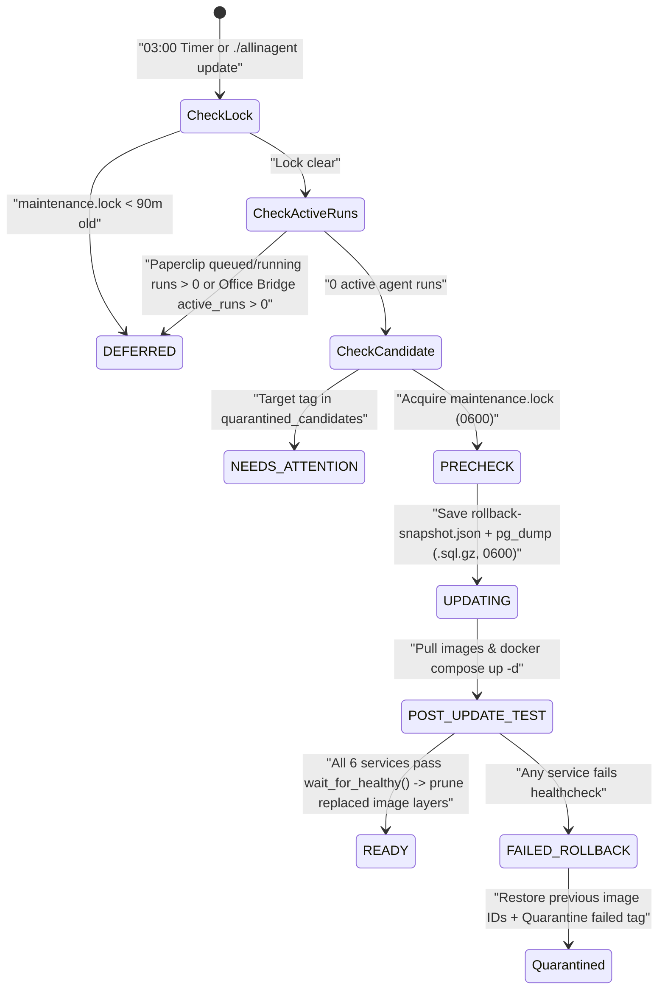

# ALLINAGENT — Coordinated Maintenance, Safe Updates, Rollback & DB Recovery

`ALLINAGENT` provides unattended boot autostart, a resource-capped **`03:00` daily maintenance & release-update window**, active-workload deferral (`maintenance.lock` + live agent run inspection), automatic pre-update PostgreSQL backups, and **automatic container image-digest rollback** with candidate quarantine if any post-update healthcheck fails.

Authoritative implementation files:
- [`scripts/allinagent_cli.py`](./scripts/allinagent_cli.py) — `cmd_update`, `detect_active_agent_work`, `backup_postgres_database`, `snapshot_current_images`, `rollback_to_previous_images`
- [`deploy/linux/install-systemd.sh`](./deploy/linux/install-systemd.sh) — Idempotent installer for `allinagent.service` and `allinagent-maintenance.{service,timer}`
- [`deploy/linux/allinagent-maintenance.timer`](./deploy/linux/allinagent-maintenance.timer) & [`allinagent-maintenance.service`](./deploy/linux/allinagent-maintenance.service)

---

## 1. Linux Boot Autostart & Daily `03:00` Maintenance Window

On Ubuntu/Debian production servers (`/opt/allinagent`), install and enable the `systemd` units once:

```bash
sudo /opt/allinagent/deploy/linux/install-systemd.sh
```

This registers three coordinated units:
1. **`allinagent.service` (`WantedBy=multi-user.target`):** Starts the production Docker Compose v2 stack (`compose.yaml` + `compose.production.yaml`) automatically after `docker.service` and `network-online.target` on host reboot.
2. **`allinagent-maintenance.timer`:** Fires daily at **`03:00:00`** in the `TIMEZONE` configured in `/opt/allinagent/.env` (e.g., `Asia/Jakarta` or `UTC`) with `Persistent=true` (catches up missed windows cleanly after host downtime) and `RandomizedDelaySec=120`.
3. **`allinagent-maintenance.service`:** Executes `/opt/allinagent/allinagent --production update --scheduled-maintenance --yes` under strict host cgroup caps (`Nice=10`, `IOSchedulingClass=best-effort`, `CPUQuota=75%`, `MemoryMax=512M`, `TimeoutStartSec=900`) so nightly maintenance never starves co-located production workloads.

### Immunity Against Host `docker prune` Cron Jobs
Many multi-tenant servers run nightly `docker container/image/volume prune` scripts (e.g., at `04:00 UTC`). `ALLINAGENT` is immune by design:
- All 6 services declare `restart: unless-stopped` (staying running so `container/image prune` never deletes active layers).
- All stateful directories use **host bind mounts** under `/opt/allinagent/data/` rather than anonymous Docker volumes.

---

## 2. Coordinated Update State Machine & Active-Work Deferral



### Active-Workload & `maintenance.lock` Deferral Rules
Unless `--force` is explicitly passed by the operator, `./allinagent update` **never interrupts running AI employees**:
1. **Singleton `maintenance.lock` Guard (`data/maintenance/maintenance.lock`):** If a lock file `< 5,400` seconds (`90` minutes) old exists, the run exits `0` with `state: "DEFERRED"`. Stale locks `>= 90` minutes old from an unexpected power loss are automatically reclaimed.
2. **Live Agent Turn Detection (`detect_active_agent_work`):** Queries both Office Bridge (`GET http://127.0.0.1:8202/health` $\rightarrow$ `active_runs`) and Paperclip (`GET http://127.0.0.1:8201/api/companies/<id>/heartbeat-runs` $\rightarrow$ `status in ("queued", "running")`). If any turn or subtask is active, the update defers cleanly without touching containers.
3. **Quarantine Memory (`data/maintenance/state.json`):** Any release tag that previously failed post-update verification is stored in `quarantined_candidates` and skipped automatically on subsequent `03:00` runs until cleared or overridden.

---

## 3. Automatic Container Image-Digest Rollback

Before pulling a new release tag, `snapshot_current_images()` inspects every running `ALLINAGENT` service (`vulnclaw`, `hermes`, `paperclip`, `office-bridge`, `office`), records its exact immutable local Docker image ID (`sha256:...`) in `data/maintenance/rollback-snapshot.json` (`0600`), and tags a local fallback alias `allinagent-rollback/<service>:previous`.

If `docker compose pull`, `docker compose up -d`, or the 6-service `wait_for_healthy()` probe (`postgres` `pg_isready`, `hermes:8650/health`, `vulnclaw:8660/health`, `paperclip:8201/api/health`, `office-bridge:8202/health`, `office:8200/api/health`) fails:
1. `rollback_to_previous_images()` immediately rewrites `ALLINAGENT_VERSION` in `.env` back to `previous_version`.
2. Re-tags the preserved local `sha256:...` image digests onto `${REGISTRY}/${NAMESPACE}/allinagent-<svc>:${previous_version}` (requiring **zero network access** to roll back).
3. Runs `docker compose up -d --remove-orphans` and re-verifies all 6 healthchecks within `60s`.
4. Records `target_version` inside `quarantined_candidates` in `data/maintenance/state.json`.

### Manual Operator Update & Rollback Commands
```bash
# Check if a newer release is available without modifying anything
./allinagent --production update --check-only

# Run a safe interactive/CLI update (respects active runs & creates pre-update DB backup)
./allinagent --production update

# Pin or roll back manually to a specific known-good release tag
./allinagent --production update --target-tag 1.0.0
```

---

## 4. Honest Database Backup & Restore Boundaries

Operators must understand the exact boundary between **automated container rollback** and **stateful database recovery**:

| What IS Automated by `./allinagent update` | What IS NOT Automatically Overwritten (By Design) |
| :--- | :--- |
| 1. **Pre-Update PostgreSQL Logical Dump:** Runs `pg_dump -U paperclip -d paperclip` inside `allinagent-postgres` before pulling new images, writing a gzip-compressed `0600` archive to `${ALLINAGENT_DATA_DIR}/backups/paperclip-pre-update-<YYYYMMDDTHHMMSSZ>.sql.gz` and retaining the **7 most recent** dumps.<br>2. **Automatic Container Image Rollback:** Reverts all 5 custom service containers to their exact prior `sha256:...` image digests if post-update healthchecks fail. | 1. **No Automatic Destructive `DROP DATABASE` / Volume Wipe on Rollback:** When container images auto-roll back, `./allinagent update` **intentionally does NOT auto-drop or overwrite** `data/postgres/` or SQLite `state.db` / `findings.db` files. Automatically wiping a live database on a transient port/network healthcheck timeout could destroy newly committed tasks, audit logs, or agent memories.<br>2. **Incompatible Downward Schema Migrations Require Explicit Operator Restore:** If a failed candidate already applied a backward-incompatible PostgreSQL DDL migration before failing healthchecks, the operator restores the pre-update `.sql.gz` dump explicitly using the verified commands below. |

### Verified PostgreSQL Manual Backup & Restore Procedure

```bash
# 1. Create an on-demand compressed PostgreSQL backup at any time
STAMP="$(date -u +%Y%m%dT%H%M%SZ)"
docker compose -f compose.yaml -f compose.production.yaml exec -T postgres \
  pg_dump -U paperclip -d paperclip | gzip -9 > "/opt/allinagent/data/backups/manual-${STAMP}.sql.gz"
chmod 600 "/opt/allinagent/data/backups/manual-${STAMP}.sql.gz"

# 2. Restore PostgreSQL from a pre-update or manual .sql.gz backup:
#    a) Stop dependent application services so zero open connections hold locks
docker compose -f compose.yaml -f compose.production.yaml stop office office-bridge paperclip hermes

#    b) Recreate a clean schema and stream the backup into PostgreSQL
docker compose -f compose.yaml -f compose.production.yaml exec -T postgres \
  psql -U paperclip -d postgres -v ON_ERROR_STOP=1 \
  -c "DROP DATABASE IF EXISTS paperclip;" \
  -c "CREATE DATABASE paperclip OWNER paperclip;"

gunzip -c /opt/allinagent/data/backups/paperclip-pre-update-<TIMESTAMP>.sql.gz | \
  docker compose -f compose.yaml -f compose.production.yaml exec -T postgres \
  psql -U paperclip -d paperclip -v ON_ERROR_STOP=1

#    c) Restart all services and verify 6/6 healthchecks
./allinagent --production up
./allinagent --production health
```

### Full Multi-Store Encrypted Snapshot (PostgreSQL + All SQLite DBs + `office-data`)
Because `pg_dump` covers Paperclip's PostgreSQL database while agent conversation memories (`state.db`), security findings (`findings.db`), and meeting/budget ledgers (`office-data/*.json`) live on host bind mounts, use `scripts/migration/export_private_state.py` whenever you want a single WAL-safe, `AES-256-GCM` encrypted disaster-recovery archive of **all** stateful stores combined (see [`DATABASE-MIGRATION.md`](./DATABASE-MIGRATION.md)).
