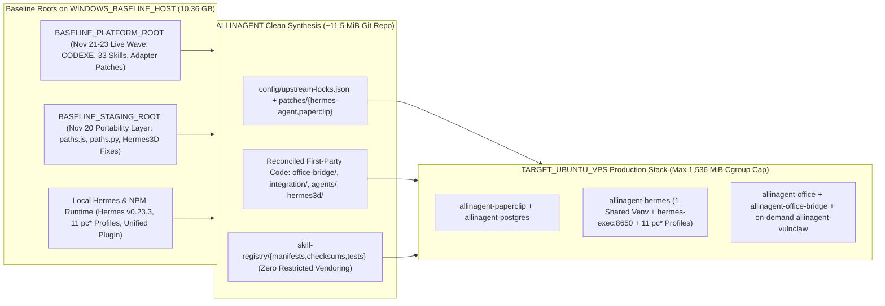

# PHASE 00 — Sanitized Baseline Architecture & Canonical 30-Feature Inventory

- **Phase ID:** `PHASE-00`
- **Status:** `PASS` (100% Empirical Baseline Synthesized & Sanitized for Public Open-Source Release)
- **Baseline Reference Environment:** `<WINDOWS_BASELINE_HOST>` (`2C/4T x86_64`, `8.13 GB` RAM, Windows local workstation)
- **Target Production Environment:** `<TARGET_UBUNTU_VPS>` (`2 vCPU AMD EPYC`, `7.76 GiB` physical RAM, `Ubuntu 24.04.4 LTS`, Docker Engine `29.1.3` + Compose `v2.40.3`)
- **Timestamp (UTC):** `2026-11-24T10:15:00Z`
- **Public-Release Sanitization Level:** `STRICT` (`0` secrets read, `0` personal usernames/hostnames/IPs/domains/UUIDs/SIDs included)

---

## 1. Executive Baseline Summary

`ALLINAGENT` consolidates a live, multi-service autonomous AI engineering and security company originally developed and operated across five directory trees on `<WINDOWS_BASELINE_HOST>` into a single, reproducible, cross-platform open-source distribution (`~11.5 MiB` tracked Git source, `< 950` files) capable of running 24/7 inside a `<= 1,536 MiB` hard cgroup ceiling on `<TARGET_UBUNTU_VPS>`.

### 1.1 Active Baseline Runtime Services (`<WINDOWS_BASELINE_HOST>`)

On `<WINDOWS_BASELINE_HOST>`, 100% of live production traffic is served from `<LEGACY_PLATFORM_ROOT>` and `<WINDOWS_USER_HOME>/<LOCAL_RUNTIME_DATA>/hermes` across 25 OS processes (`~1,389.2 MB` combined working set), supervised via Windows Task Scheduler and custom C# process launchers:

| Service Plane | Baseline Loopback Binding | Baseline Entrypoint & Version | Empirical Working Set | Live Health Verification | Target `ALLINAGENT` Container |
| :--- | :--- | :--- | ---: | :--- | :--- |
| **Control Plane (`Paperclip`)** | `127.0.0.1:3100` | `scripts/paperclip-server-entry.mjs` loading `paperclipai@2026.1117.0` (`c0f13289`) | `713.02 MB` | `GET /api/health` -> `HTTP 200` (`status:"ok"`, `deploymentMode:"authenticated"`, `bootstrapStatus:"ready"`) | `allinagent-paperclip` (`127.0.0.1:8201` -> `:3100`) |
| **Control Plane DB (`PostgreSQL 16`)** | `127.0.0.1:54329` | `@embedded-postgres/windows-x64` (`postgres.exe` master + 15 backends) | `430.50 MB` | Verified via Paperclip `/api/health` (`databaseBackup.status:"ok"`) | `allinagent-postgres` (`postgres:16-alpine` on `allinagent_data`, `0` host ports) |
| **Integration & Event Plane (`Office Bridge`)** | `127.0.0.1:3210` | `office-bridge/server.js` (HTTP + Gateway WS v3 + Event Bus v1.0) | `116.80 MB` | `GET /health` -> `HTTP 200` (`status:"healthy"`, `paperclip_reachable:true`) | `allinagent-office-bridge` (`127.0.0.1:8202` -> `:3210`) |
| **Shared Agent & Messaging Runtime (`Hermes`)** | Outbound HTTPS + local ephemeral ports | `python -m hermes_cli.main gateway run` (`NousResearch/hermes-agent` `v0.23.3` / `eb49b8920a`) | `59.04 MB` *(idle gateway)* | Single-poller Telegram Gateway + `unified-company-control` plugin + 11 `profiles/pc*` homes | `allinagent-hermes` (Gateway + internal `hermes-exec:8650`, `0` host ports) |
| **Visualization Plane (`Hermes3D` + `2D Pixel Office`)** | `127.0.0.1:3200` | `hermes3d/source/server/index.js` (Next.js custom server + Access Gate + WS proxies) | `12.93 MB` *(idle)* | `GET /api/health` -> `HTTP 200` (`{"ok":true,"service":"hermes3d"}`); `GET /` -> `HTTP 401` Gate | `allinagent-office` (`127.0.0.1:8200` -> `:3200`) |
| **Defensive Security Worker (`VulnClaw`)** | On-demand CLI (`0` ports) | `Netw0rkNoob/VulnClaw` `v0.4.1` (`0b34878f84`) via `integration/vulnclaw_defensive.py` | `0.00 MB` *(idle)* | Strictly on-demand static code analyzer feeding `data/findings/findings.db` | `allinagent-vulnclaw` (`profiles: ["security"]`, `:ro` workspace, `0` secrets) |
| **Maintenance & Update Watcher** | Background scheduler (`0` ports) | `hermes-autoupdate.ps1` + `integration/maintenance_coordinator.py` (`03:00 Asia/Jakarta`) | `28.78 MB` | Daily `03:00` / `03:02` update & health watchdog tasks (`PlatformHealthWatchdog` every `15m`) | Host systemd timer / cron + `integration/maintenance_coordinator.py` |

### 1.2 Baseline Storage & Split-Divergence Synthesis

Empirical auditing across all five baseline roots (`PHASE-01` and `PHASE-04`) established two foundational constraints for `ALLINAGENT`:

1. **98.9% Storage Bloat Elimination (`10.36 GB` Raw Disk / `1.01 GB` Staging Repo -> `~11.5 MiB` Clean Git Repo):**
   - Across `<LEGACY_PLATFORM_ROOT>` (`3.97 GB`), `<LEGACY_MONOREPO_ROOT>` (`1.01 GB`), `<WINDOWS_USER_HOME>/<LOCAL_RUNTIME_DATA>/hermes` (`3.79 GB`), `<WINDOWS_USER_HOME>/<LOCAL_RUNTIME_DATA>/npm/node_modules/hermes-agent` (`1.59 GB`), and `<WINDOWS_USER_HOME>/HermesUpdater` (`0.59 MB`), total storage reached **`11,126,312,521 B` (`461,174` files)** with **`2,017` Windows NTFS junctions/symlinks**.
   - **`44.34%` (`4.59 GB`)** consisted of Windows-only binaries (`chromium-1248`, portable `python-3.14.9`, `node-26.12.1`, `ffmpeg`, duplicate `git` & `cua-driver` toolchains, `@openai/codex-win32-x64`, `@anthropic-ai/claude-agent-sdk-win32-x64`, `opencode-windows-x64`, `@embedded-postgres/windows-x64`).
   - **`1.46 GB`** across all 5 roots (`256.74 MB` across `<LEGACY_PLATFORM_ROOT>` + `<LEGACY_MONOREPO_ROOT>`) consisted of exact SHA-256 duplicate files (including 10 copies of `models_dev_cache.json` and duplicated per-profile LSP `node_modules`).
   - Adopting **Pinned Upstream Lockfiles (`components.lock.json`) + Checksummed Declarative Patches (`patches/`) + Reconciled First-Party Source** preserves 100% of platform functionality in **`~11.5 MiB` (`< 950` tracked files)**.

2. **Mandatory Reconciliation of Post-Snapshot Engineering Waves (`Nov 20` vs `Nov 21–23`):**
   - `<LEGACY_MONOREPO_ROOT>` (`2026-11-20`) introduced cross-platform path resolvers (`apps/office-bridge/contracts/paths.js`, `apps/control-center/paths.py`, and 5 portable route updates in `apps/hermes3d`).
   - `<LEGACY_PLATFORM_ROOT>` and `<WINDOWS_USER_HOME>/<LOCAL_RUNTIME_DATA>/hermes` (`2026-11-21` through `2026-11-23`) subsequently received three major functional waves that **must** be merged with the `Nov 20` portability layer during `PHASE-05`:
     - **Wave A — 23-Phase Telegram CODEXE Control Center:** 8 modular controllers in `office-bridge/telegram-control/`, expanded `adapters/telegram-control-adapter.js` (`151.8 KB`), expanded `unified-company-control/__init__.py` (`25.5 KB`), 59 deterministic slash commands across 13 interactive submenus, idempotency store, `AbortController` job cancellation, and `state_version` execution receipts.
     - **Wave B — 11-Agent GitHub Skill Registry & Security Gate:** `integration/agent_skills_manager.py`, `office-bridge/adapters/agent-skills-bridge.js`, 33 SHA-256-pinned skill packages in `config/portable-skill-manifest.json` + `skill-registry/{manifests,checksums,tests}`, Sentry `skill-scanner` gate, and `FETCH_FROM_UPSTREAM_ONLY` license enforcement.
     - **Wave C — Upstream Adapter & Classifier Patches:** `@paperclipai/hermes-paperclip-adapter` `execute.js` (`--query-file` temp-file handoff for prompts `> 6,000` chars or Windows) and `skills.js` (`skill-registry` and `--` namespaced skill link reconciliation with `EPERM`/`ENOSYS` copy fallback), plus `hermes-agent` `agent/error_classifier.py` (`+1` line `"model_not_available_for_integrator"`).

---

## 2. Canonical 11 Corporate AI Agents Baseline Topology

All 11 AI employees are managed in Paperclip (`<COMPANY_UUID>`) as the single organizational source of truth and execute inside isolated Hermes named profiles (`profiles/pc*`) sharing a single Python runtime (`0 MB` per-agent venv duplication), with `.no-bundled-skills` enabled so owner-level skills and `TELEGRAM_BOT_TOKEN` never leak into worker profiles:

| # | Role Slug | Display Name | Handle | Isolated Profile | Default Activation Tier | Allowed Toolsets | Assigned Pinned Role Skills (`Primary` / `Specialist` / `On-Demand` / `Ref`) |
| :---: | :--- | :--- | :--- | :--- | :--- | :--- | :--- |
| `01` | `ceo_agent` | CEO Agent | `@ceo` | `pcceoagent` | `Wave-1 ACTIVE` | `file,terminal,skills` | Primary: `ceo-advisor` · Specialist: `c-level-skills` |
| `02` | `cto_agent` | CTO Agent | `@cto` | `pcctoagent` | `Wave-2 STANDBY` | `file,terminal,skills` | Primary: `cto-review` · Specialist: `senior-architect` · On-Demand: `cto-advisor` |
| `03` | `backend_developer` | Backend Developer | `@backend` | `pcbackenddeveloper` | `Wave-1 ACTIVE` | `file,terminal,skills` | Primary: `senior-backend` · Specialist: `api-design-reviewer` · On-Demand: `senior-architect` |
| `04` | `frontend_developer` | Frontend Developer | `@frontend` | `pcfrontenddeveloper` | `Wave-2 STANDBY` | `file,terminal,skills` | Primary: `react-best-practices` · Specialist: `frontend-design` |
| `05` | `devops_engineer` | DevOps Engineer | `@devops` | `pcdevopsengineer` | `Wave-2 STANDBY` | `file,terminal,skills` | Primary: `senior-devops` · Specialist: `terraform-skill`, `ci-cd-pipeline-builder` |
| `06` | `qa_engineer` | QA Engineer | `@qa` | `pcqaengineer` | `Wave-1 ACTIVE` | `file,terminal,skills` | Primary: `pw` · Specialist: `pw-generate`, `pw-review`, `senior-qa` · On-Demand: `pw-fix`, `pw-coverage`, `pw-report` |
| `07` | `security_lead` | Security Lead | `@security_lead` | `pcsecuritylead` | `Wave-2 STANDBY` | `file,skills` | Primary: `ciso-advisor` · Reference-Only: `threat-model` |
| `08` | `security_reviewer` | Security Reviewer | `@security` | `pcsecurityreviewer` | `Wave-1 ACTIVE` | `file,skills` | Primary: `security-audit` · Specialist: `senior-security` · Reference-Only: `secondsky-cybersecurity-ref` |
| `09` | `findings_analyst` | Findings Analyst | `@findings` | `pcfindingsanalyst` | `Wave-2 STANDBY` | `file,skills` | Primary: `security-audit` · Reference-Only: `anthropic-triage` · Experimental: `cve-triage` |
| `10` | `remediation_reviewer` | Remediation Reviewer | `@remediation` | `pcremediationreviewer` | `Wave-2 STANDBY` | `file,skills` | Primary: `focused-fix` · Specialist: `security-vuln-remediation` · Reference-Only: `anthropic-patch` |
| `11` | `compliance_reporter` | Report & Compliance Agent | `@compliance` | `pccompliancereporter` | `Wave-2 STANDBY` | `file,terminal,skills` | Primary: `compliance-os` · Specialist: `docx`, `pdf` *(Nous MIT `microsoft-office` & `pdf` in `--strict-oss`/`--offline`)* |

*(Note: In addition to role-specific GitHub skills, Paperclip provisions shared organizational coordination skills — `paperclip`, `complain`, `suggestion-box` — into each `pc*` profile via the patched `@paperclipai/hermes-paperclip-adapter`.)*

---

## 3. Baseline 33 Pinned GitHub Skill Packages Summary

All 33 packages in `skills/manifests/skills.lock.json` are locked to immutable 40-character Git commit SHAs and SHA-256 package digests:

- **`ALLOW_WITH_ATTRIBUTION_OR_FETCH` (`20` OSI-permissive packages — `MIT` / `Apache-2.0`):**
  `anthropic-patch`, `anthropic-triage`, `c-level-skills`, `ceo-advisor`, `ciso-advisor`, `compliance-os`, `cto-review`, `cve-triage`, `frontend-design`, `pw`, `pw-coverage`, `pw-fix`, `pw-generate`, `pw-report`, `pw-review`, `secondsky-cybersecurity-ref`, `security-vuln-remediation`, `skill-scanner`, `terraform-skill`, `threat-model`.
- **`FETCH_FROM_UPSTREAM_ONLY` (`13` packages — `10` `MIT-Commons-Clause-1.0` from `borghei/Claude-Skills` + `1` `NOASSERTION` from `vercel-labs/agent-skills` + `2` `anthropics/skills` `docx` & `pdf` bundling third-party OOXML `.xsd` schemas):**
  `api-design-reviewer`, `ci-cd-pipeline-builder`, `cto-advisor`, `docx`, `focused-fix`, `pdf`, `react-best-practices`, `security-audit`, `senior-architect`, `senior-backend`, `senior-devops`, `senior-qa`, `senior-security` (with Nous Research MIT `microsoft-office` & `pdf` wired as `--strict-oss` / `--offline` fallbacks).
- **Public Repository Supply-Chain Rule:** Zero upstream skill source files are vendored in `ALLINAGENT` Git. At install time, `skills/install_agent_skills.py` fetches exact pinned commits directly from GitHub, verifies SHA-256 checksums, runs Sentry `skill-scanner`, quarantines offensive or autonomous harness files, and links verified packages into reviewed skill directories.

---

## 4. Canonical 30-Row Feature Inventory (`FEAT-01` through `FEAT-30`)

Every capability of the baseline platform is inventoried below with its exact current implementation, target `ALLINAGENT` repository path, runtime requirement, platform dependency profile, automated verification suite, production container target, and portability classification.

| Feature ID | Feature Name | Current Implementation | Target ALLINAGENT Path | Runtime Requirement | Platform Dependency | Test Reference | Production Target | Portability Status |
| :--- | :--- | :--- | :--- | :--- | :--- | :--- | :--- | :--- |
| `FEAT-01` | **Hermes Agent** | `NousResearch/hermes-agent` `v0.23.3` (`eb49b8920a`) + `+1` line `agent/error_classifier.py` patch; duplicated across Windows NPM wrapper & `<LOCAL_RUNTIME_DATA>/hermes` (`python-3.14.9-win32`) | `components.lock.json`, `patches/hermes-agent/0001-error-classifier-integrator.patch`, `deploy/docker/hermes.Dockerfile`, `components/hermes/hermes_exec_daemon.py`, `components/hermes/hermes-cli-shim.mjs` | Python `3.14` (`uv` shared venv), SQLite3, `ripgrep`, `git`, outbound HTTPS to `<CUSTOM_OPENAI_COMPAT_PROVIDER>` | Baseline uses `win32` portable Python/tools (`2.11 GB`); target uses 1 shared Linux venv + `/usr/local/bin/hermes` CLI shim (`PHASE-08`) | `tests/verify_all_11_agents_hermes_runs.py`, `tests/verify_hermes_gateway_plugin_live.py` | `allinagent-hermes` (`hermes-exec:8650` internal + single Gateway poller) | `REQUIRES_PATCH_AND_SHARED_VENV_PORT` |
| `FEAT-02` | **Paperclip** | `paperclipai@2026.1117.0` (`c0f13289`) via `scripts/paperclip-server-entry.mjs` on `:3100` + `@embedded-postgres/windows-x64` on `:54329` + 2 patched files in `@paperclipai/hermes-paperclip-adapter` (`execute.js`, `skills.js`) | `config/upstream-locks.json`, `patches/paperclip/@paperclipai+hermes-paperclip-adapter+2026.1117.0.patch`, `scripts/paperclip-server-entry.mjs`, `docker/paperclip/Dockerfile` | Node.js `22 LTS` (`--max-old-space-size=256`), external `PostgreSQL 16`, `/usr/local/bin/hermes` remote shim | Baseline bundles `1.80 GB` of `win32` optional CLIs (`codex`, `claude`, `opencode`, `embedded-postgres`); stripped on Linux (`PHASE-09`) | `tests/verify_every_feature_exhaustive.cjs`, `scripts/bootstrap_and_verify_paperclip.py` | `allinagent-paperclip` (`127.0.0.1:8201` -> `:3100`) + `allinagent-postgres` | `REQUIRES_ADAPTER_PATCH_AND_EXTERNAL_PG` |
| `FEAT-03` | **VulnClaw** | Clean upstream `Netw0rkNoob/VulnClaw` `v0.4.1` (`0b34878f84`, `0` patches) invoked on demand via `integration/vulnclaw_defensive.py` inside `runtime/vulnclaw-venv` | `config/upstream-locks.json`, `config/vulnclaw.defensive.yaml`, `integration/vulnclaw_defensive.py`, `docker/vulnclaw/Dockerfile` | Python `3.12+` minimal defensive static-analysis venv; on-demand container execution (`0 MiB` idle RAM) | Baseline hardcodes Windows `vulnclaw-venv\Scripts\python.exe`; port via `integration/paths.py` & isolated container (`PHASE-10`) | `tests/verify_phase_22_security_and_rounds.py`, `tests/verify_phases_04_to_10.py` | `allinagent-vulnclaw` (`profiles: ["security"]`, `:ro` workspace, `0` secrets) | `PORTABLE_WITH_PATH_CONFIG` |
| `FEAT-04` | **Hermes3D** | Customized `iamlukethedev/Hermes3D` (`beb7629` + 38 custom/modified 3D/Enterprise files) served via `server/index.js` on `:3200` with `/login` Access Gate, `/api/gateway/ws`, and `/api/company/events/ws` | `apps/hermes3d/` (`server/index.js`, `server/access-gate.js`, `server/gateway-proxy.js`, `src/features/office/**`, `src/features/enterprise-company/**`, `deploy/docker/office.Dockerfile`) | Node.js `22 LTS` (`--max-old-space-size=160`), Next.js standalone server; 100% client-browser WebGL (`Three.js`) rendering (`0` server GPU) | 5 route files already ported in `<LEGACY_MONOREPO_ROOT>`; 1 residual secret-path fallback in `server/index.js` to wire to env/paths (`PHASE-11`) | `tests/run_office_e2e_130.py`, `apps/hermes3d/tests/unit/standup3dAll11Agents.test.ts` | `allinagent-office` (`127.0.0.1:8200` -> `:3200` behind Host Nginx TLS) | `READY_MINOR_ENV_CLEANUP` |
| `FEAT-05` | **2D Pixel Office** | Gather-style 2D top-down pixel office (`Phaser` HTML5 Canvas) integrated into `hermes3d` with live 11-agent workstation/standup sync and 3D/2D mode toggle inside `EnterpriseOfficeOverlay` | `hermes3d/src/features/pixel-office/**`, `hermes3d/src/features/retro-office/**`, `hermes3d/src/features/enterprise-company/EnterpriseOfficeOverlay.tsx` | Served from same Next.js `allinagent-office` process; 100% browser HTML5 2D Canvas rendering (`0` extra server RAM/CPU) | Cross-platform browser TypeScript/Canvas; zero OS-specific dependencies (`PHASE-11`) | `tests/run_office_e2e_130.py`, `tests/verify_phase_21_parity.py` | `allinagent-office` (`127.0.0.1:8200` -> `:3200`) | `PORTABLE_READY` |
| `FEAT-06` | **Office Bridge** | First-party Node.js HTTP + WebSocket synchronization hub (`office-bridge/server.js` on `:3210`) implementing Gateway Protocol v3 (`/ws`), Normalized Event Bus v1.0 (`/api/events/ws`), and `/api/office-bridge/*` | `office-bridge/server.js`, `office-bridge/contracts/{paths,event-schema,redaction,state-machine,ws-loader}.js`, `office-bridge/events/realtime-synchronizer.js`, `docker/office-bridge/Dockerfile` | Node.js `22 LTS` (`--max-old-space-size=96`), `ws` package, Docker DNS links to `paperclip:3100` & `hermes:8650`, `/usr/local/bin/hermes` shim | Merge Nov 21–23 `office-bridge` modules with `contracts/paths.js` and add container bridge bind toggle (`PHASE-12`) | `office-bridge/tests/office-bridge.test.js`, `tests/office_bridge_deep_probes.cjs` | `allinagent-office-bridge` (`127.0.0.1:8202` -> `:3210`) | `REQUIRES_SPLIT_MERGE_AND_DNS_PORT` |
| `FEAT-07` | **Telegram CODEXE [59 slash commands]** | Native Hermes Gateway user-space plugin (`unified-company-control/__init__.py`) + 8 modular controllers in `office-bridge/telegram-control/*` (`37` canonical specs / `59` registered slash commands across `13` `uac:sub:*` inline submenus) | `agents/hermes-extensions/plugins/unified-company-control/`, `office-bridge/adapters/telegram-control-adapter.js`, `office-bridge/telegram-control/*.js` | Single Telegram Bot `getUpdates` poller in `allinagent-hermes` forwarding HTTPS/HTTP commands to `allinagent-office-bridge:3210` with `<OWNER_TELEGRAM_ID>` guard | Reconcile Nov 23 plugin/controllers with `ALLINAGENT_ROOT` & `contracts/paths.js`; replace Windows health/folder strings (`PHASE-15`) | `office-bridge/tests/telegram-control.test.js`, `tests/verify_telegram_full_control_e2e.cjs` | `allinagent-hermes` (plugin) + `allinagent-office-bridge` (controllers) | `REQUIRES_SPLIT_MERGE_AND_PATH_PORT` |
| `FEAT-08` | **11 AI Agents** | 11 specialized corporate personas (`01-ceo_agent` .. `11-compliance_reporter`) provisioned in Paperclip (`Wave-1` 4 active, `Wave-2` 7 standby) and mapped to isolated `profiles/pc*` homes | `agents/organization-roster.template.json`, `agents/roles/01-ceo_agent` .. `11-compliance_reporter`, `integration/org_provisioner.py`, `integration/hermes_worker_factory.py` | Paperclip DB records + 11 `0700` non-root directories under `/var/lib/allinagent/hermes/profiles/pc*` sharing 1 Python venv | Replace Windows `icacls.exe`/SID ACL commands in `hermes_worker_factory.py` with POSIX `chmod 0700` / `chown` (`PHASE-07`, `PHASE-08`) | `tests/verify_all_11_agents_hermes_runs.py`, `tests/verify_phases_11_to_20.py` | `allinagent-paperclip` (roster) + `allinagent-hermes` (`pc*` profiles) | `REQUIRES_POSIX_ACL_MIGRATION` |
| `FEAT-09` | **Individual Agent Skills [33 pinned packages]** | Role-scoped `PRIMARY`, `SPECIALIST`, `ON_DEMAND`, `REFERENCE_ONLY`, and `EXPERIMENTAL` skill assignments across all 11 `pc*` profiles with progressive-disclosure `skill_view` routing | `config/portable-skill-manifest.json`, `skill-registry/manifests/agent-skill-assignments.json`, `scripts/install-agent-skills.py`, `integration/agent_skills_manager.py` | Read-only POSIX symlinks from `profiles/pc*/skills/<name>--<hash>` to `/var/lib/allinagent/skill-registry/reviewed/<pkg>`; shared Python/Node skill helpers | Replace Windows `\\?\D:\...` NTFS junctions with relative/container POSIX symlinks (`PHASE-14`) | `skill-registry/tests/execute_phases_06_to_16.py`, `skill-registry/tests/verify_phase17_routing_conflicts.py`, `skill-registry/tests/verify_phase20_persistence.py` | `allinagent-hermes` (`/var/lib/allinagent/skill-registry/reviewed`) | `REQUIRES_SYMLINK_RECONCILIATION` |
| `FEAT-10` | **Paperclip Skills Store** | Native Paperclip company skills store (`data/paperclip/instances/default/skills/<COMPANY_UUID>/__versions__`) + patched `reconcileHermesPaperclipSkills` preserving `--` namespaced registry links | `patches/paperclip/@paperclipai+hermes-paperclip-adapter+2026.1117.0.patch`, `integration/agent_skills_manager.py`, `office-bridge/adapters/agent-skills-bridge.js` | Paperclip server + shared `/var/lib/allinagent/paperclip` & `/var/lib/allinagent/skill-registry` mounts | Requires Nov 23 `skills.ts`/`skills.js` patch (`isManagedOrigin` + `EPERM`/`ENOSYS` fallback) (`PHASE-09`, `PHASE-13`) | `skill-registry/tests/verify_phase20_persistence.py`, `skill-registry/tests/execute_phase22_e2e_rounds.py` | `allinagent-paperclip` + `allinagent-hermes` | `REQUIRES_NOV23_SKILLS_PATCH` |
| `FEAT-11` | **Skill Security & License Gate** | Multi-stage quarantine & SPDX policy gate enforcing SHA-256 lock verification, offensive-content quarantine, and `FETCH_FROM_UPSTREAM_ONLY` for `MIT-Commons-Clause-1.0` / unlicensed repos | `config/portable-skill-manifest.json`, `skill-registry/manifests/skill-security-results.json`, `skill-registry/checksums/skill-checksums.json`, `scripts/install-agent-skills.py` | Python `3.14` during `install.sh` / skill provisioning; strictly read-only at runtime (zero arbitrary skill install from UI/Telegram) | Pure Python `hashlib`/AST/manifest enforcement; exclude `skill-registry/{upstream,reviewed,quarantine}` from Git (`PHASE-06`, `PHASE-13`) | `office-bridge/tests/phase02_03_arch_security.test.js`, `skill-registry/tests/execute_phase22_e2e_rounds.py` | Build/Install Gate + `allinagent-office-bridge` (read-only inspector) | `PORTABLE_READY` |
| `FEAT-12` | **Sentry Skill Scanner** | Pinned `getsentry/skills` `skill-scanner` (`a582c51ee29d`, `Apache-2.0`) scanning all candidate skills for prompt injection, dangerous code patterns, and excessive permissions prior to promotion | `config/portable-skill-manifest.json` (`skill-scanner`), `skill-registry/manifests/skill-security-results.json`, `integration/agent_skills_manager.py` | Python `3.14` executing `scripts/scan_skill.py` during `scripts/install-agent-skills.py` and CI supply-chain checks | Cross-platform Python script (`PHASE-13`, `PHASE-21`) | `skill-registry/tests/execute_phases_06_to_16.py`, `skill-registry/tests/benchmark_runner.py` | `install.sh` + GitHub Actions CI + `allinagent-hermes` | `PORTABLE_READY` |
| `FEAT-13` | **GitHub Skills Registry** | Central local registry (`skill-registry/manifests/{skill-lock.json,skill-source-inventory.json,master-agent-skill-manifest.yaml}`) + telemetry inspector (`/daftar_skill`, `/skill_info`, `/skill_status`, Studio `skills.status`) | `skill-registry/manifests/*.json`, `skill-registry/manifests/*.yaml`, `office-bridge/adapters/agent-skills-bridge.js`, `integration/agent_skills_manager.py` | Node.js `22` (`agent-skills-bridge.js`) + Python `3.14` (`agent_skills_manager.py`) + `/var/lib/allinagent/office-data/skill-invocations.json` | Wire hardcoded registry/profile paths in `agent-skills-bridge.js` & `agent_skills_manager.py` to `paths.js` / `paths.py` (`PHASE-13`) | `skill-registry/tests/execute_phase22_e2e_rounds.py`, `office-bridge/tests/telegram-control.test.js` | `allinagent-office-bridge` + `allinagent-hermes` | `REQUIRES_PATH_ABSTRACTION` |
| `FEAT-14` | **Analytics** | Real-time & historical token, cost, model, per-agent run duration, and `UNPRICED USAGE` classification across Today, Yesterday, 7d, 30d (`/analytics`, `EnterpriseOfficeOverlay` Analytics tab) | `office-bridge/adapters/analytics-telemetry-adapter.js`, `office-bridge/telegram-control/analytics-budget-security-health.js`, `hermes3d/src/features/enterprise-company/` | `allinagent-office-bridge` aggregating Paperclip run telemetry & Hermes session SQLite metrics | Wire path lookups in `analytics-telemetry-adapter.js` to `contracts/paths.js` (`PHASE-12`) | `tests/verify_analytics_e2e.cjs`, `tests/verify_every_feature_exhaustive.cjs` | `allinagent-office-bridge` + `allinagent-office` | `PORTABLE_WITH_PATH_CONFIG` |
| `FEAT-15` | **Budget Management** | Corporate, daily, monthly, and per-agent budget ceilings, threshold alerts, and governance audit trail (`/budget`, `/set_budget`, `EnterpriseOfficeOverlay` Budgets & Approvals tabs) | `office-bridge/adapters/analytics-telemetry-adapter.js`, `office-bridge/telegram-control/analytics-budget-security-health.js`, `hermes3d/src/features/enterprise-company/` | Paperclip budget policy API + `office-data` persisted budget overrides & decision ledger | Wire `office-data` storage path via `contracts/paths.js` (`PHASE-12`) | `tests/verify_analytics_e2e.cjs`, `office-bridge/tests/telegram-control.test.js` | `allinagent-paperclip` + `allinagent-office-bridge` + `allinagent-office` | `PORTABLE_WITH_PATH_CONFIG` |
| `FEAT-16` | **Task Management** | 13-stage workflow ledger (`RECEIVED` .. `COMPLETED`/`CANCELLED`) synchronized bidirectionally with Paperclip Kanban issues (`backlog`, `todo`, `in_progress`, `in_review`, `done`, `blocked`, `cancelled`) & read-after-write verification | `integration/workflow_engine.py`, `office-bridge/telegram-control/delegation-and-paperclip-controller.js`, `office-bridge/adapters/paperclip-adapter.js` | Paperclip PostgreSQL DB + SQLite `data/workflow-ledger.db` + idempotency key enforcement | Remove hardcoded owner ID & Windows path in `workflow_engine.py` via `integration/paths.py` & env (`PHASE-07`, `PHASE-12`) | `tests/verify_phases_11_to_20.py`, `tests/verify_every_feature_exhaustive.cjs` | `allinagent-paperclip` + `allinagent-office-bridge` + `allinagent-hermes` | `PORTABLE_WITH_ENV_SANITIZATION` |
| `FEAT-17` | **Project Management** | Multi-project Paperclip portfolio creation, active project switching, milestone/completion `%` tracking, and target workspace binding (`/projects`, `EnterpriseOfficeOverlay` Projects/Kanban tab) | `apps/office-bridge/adapters/paperclip-adapter.js`, `apps/office-bridge/telegram-control/delegation-and-paperclip-controller.js`, `apps/control-center/paperclip_client.py` | Paperclip REST API (`allinagent-paperclip:3100`) backed by `allinagent-postgres` | Already path-abstracted in `<LEGACY_MONOREPO_ROOT>` `paperclip_client.py`; merge into `ALLINAGENT` (`PHASE-05`, `PHASE-12`) | `tests/verify_every_feature_exhaustive.cjs`, `tests/verify_telegram_full_control_e2e.cjs` | `allinagent-paperclip` + `allinagent-office-bridge` + `allinagent-office` | `PORTABLE_READY` |
| `FEAT-18` | **Agent Delegation** | Hierarchical CEO -> CTO / Security Lead -> Specialist parent-child subtask decomposition (`max_delegation_depth: 2`, `max_subtasks_per_parent: 6`) via `/delegasi`, `@agent` mentions, and Paperclip wakeups | `integration/workflow_engine.py`, `office-bridge/telegram-control/delegation-and-paperclip-controller.js`, `agents/roles/01-ceo_agent/AGENTS.md` | Paperclip issue hierarchy + `allinagent-hermes` `hermes-exec:8650` global queue (`HEAVY_WORKER_CONCURRENCY=1` serializing heavy subtasks safely) | Requires `--query-file` patch in `execute.js` for large multi-agent handoff prompts (`> 6,000` chars) (`PHASE-08`, `PHASE-09`) | `tests/verify_all_11_agents_hermes_runs.py`, `tests/run_phase_23_final_demonstration.py` | `allinagent-paperclip` + `allinagent-hermes` + `allinagent-office-bridge` | `PORTABLE_WITH_EXEC_QUEUE` |
| `FEAT-19` | **Meeting Room** | Full 11-agent 3D & 2D standup/meeting lifecycle (`/meeting`, `/status_meeting`, `/diskusi_rapat`, `/notulen`, `/selesai_meeting` + Studio standup UI) with live avatar navigation, turn queue, minutes & action items | `office-bridge/telegram-control/office-and-meeting-controller.js`, `hermes3d/src/app/api/office/standup/**`, `hermes3d/src/features/{office,pixel-office}/**` | `allinagent-office-bridge` state machine + Gateway WS v3 / Event Bus v1.0 + `allinagent-office` 3D/2D client scene | Cross-platform Node.js + browser WebGL/Canvas; wire `office-data` state path to `contracts/paths.js` (`PHASE-11`, `PHASE-12`) | `hermes3d/src/features/office/__tests__/standup3dAll11Agents.test.ts`, `tests/verify_owner_meeting_and_workspace_e2e.cjs` | `allinagent-office-bridge` + `allinagent-office` + `allinagent-hermes` | `PORTABLE_WITH_PATH_CONFIG` |
| `FEAT-20` | **Folder Explorer** | Paginated directory browser, project stack detector, search, and active target workspace selector (`/folder`, `/jelajah`, `/cari_folder`, `/pilih_folder`, `TargetFolderPickerModal.tsx`) with secret-file exclusion | `office-bridge/adapters/target-folders-manager.js`, `office-bridge/telegram-control/folder-and-dev-controller.js`, `hermes3d/src/features/enterprise-company/TargetFolderPickerModal.tsx` | On Linux VPS: browses `/workspaces/*` bind mounts; in `Connected Device` mode: browses authorized `<PAIRED_WORKSTATION_NODE>` roots via bridge | Replace Windows `C:\`/`D:\` drive-letter assumptions in `folder-and-dev-controller.js` with POSIX root allowlists + optional Connected Device Roots (`PHASE-07`, `PHASE-16`) | `tests/verify_local_folder_picker_and_analysis_e2e.cjs`, `office-bridge/tests/telegram-control.test.js` | `allinagent-office-bridge` + `allinagent-office` (+ optional Connected Runner) | `REQUIRES_POSIX_ROOT_AND_BRIDGE_PORT` |
| `FEAT-21` | **Source Code Analysis** | Automated repository architecture, framework/stack detection (Node/TS, Python, PHP/Laravel, Go, etc.), dependency & risk analysis (`/analisis`) producing persisted, sanitized markdown/JSON evidence reports | `office-bridge/telegram-control/folder-and-dev-controller.js`, `office-bridge/adapters/vulnclaw-findings-adapter.js`, `integration/platform_cli.py` | Read-only workspace inspection via `allinagent-hermes` (`pcctoagent` / `pcbackenddeveloper` / `pcsecurityreviewer`) | Sanitize framework rules (`AGENTS.md`) and wire report output paths via `contracts/paths.js` (`PHASE-07`, `PHASE-12`) | `tests/verify_local_folder_picker_and_analysis_e2e.cjs`, `tests/run_phase_23_final_demonstration.py` | `allinagent-office-bridge` + `allinagent-hermes` | `PORTABLE_WITH_PATH_CONFIG` |
| `FEAT-22` | **Software Development** | End-to-end isolated Git feature-branch coding, refactoring, build verification, `git diff` inspection, and peer CTO/Security code review (`/dev`, `/buat_branch`, `/cek_diff`, `/review_kode`, `/build_project`) | `office-bridge/telegram-control/folder-and-dev-controller.js`, `agents/roles/{03-backend_developer,04-frontend_developer,05-devops_engineer}/**`, `integration/workflow_engine.py` | `git`, `ripgrep`, Node.js `22`, Python `3.14` inside `allinagent-hermes` operating on isolated feature branches in `/workspaces/*` | Linux-native `git`/`rg` via `apt` replaces `800+ MB` of duplicate Windows portable Git binaries (`PHASE-08`) | `tests/verify_phases_11_to_20.py`, `tests/run_phase_23_final_demonstration.py` | `allinagent-hermes` (`pcbackenddeveloper`, `pcfrontenddeveloper`, `pcdevopsengineer`) | `PORTABLE_LINUX_NATIVE` |
| `FEAT-23` | **Automated Testing** | Unit, integration, API, and Playwright E2E test scaffolding, flaky-test triage, coverage analysis, and execution (`/jalankan_test`, `pw`, `pw-generate`, `pw-fix`, `pw-coverage`, `pw-report`, `senior-qa`) | `agents/roles/06-qa_engineer/**`, `config/portable-skill-manifest.json` (`pw*`, `senior-qa`), `office-bridge/telegram-control/folder-and-dev-controller.js` | Python `pytest` + Node test runner in `allinagent-hermes`; optional headless Chromium in `Standard Production` or CI (`0` persistent browser daemon) | Replace hardcoded Windows `chrome-win64\chrome.exe` path with Linux `/usr/bin/chromium` (`--headless --no-sandbox --disable-dev-shm-usage`) (`PHASE-14`, `PHASE-16`) | `tests/run_all_e2e_tests.py`, `skill-registry/tests/execute_phases_06_to_16.py` | `allinagent-hermes` (`pcqaengineer`) + GitHub Actions CI | `REQUIRES_LINUX_CHROMIUM_PATH` |
| `FEAT-24` | **Defensive Security Assessment** | Strictly non-destructive static code review, CWE/CVE dependency advisory mapping, secret-exposure detection, and architectural threat modeling (`/keamanan`, `VulnClaw`, `ciso-advisor`, `security-audit`, `threat-model`) | `integration/vulnclaw_defensive.py`, `config/vulnclaw.defensive.yaml`, `agents/roles/{07-security_lead,08-security_reviewer}/**`, `docker/vulnclaw/Dockerfile` | On-demand `allinagent-vulnclaw` container (`:ro` workspace, `cap_drop: ALL`, `0` secrets) + `pcsecuritylead` / `pcsecurityreviewer` analysis | Enforce Linux cgroup/read-only container sandboxing in addition to Python policy checks (`PHASE-10`, `PHASE-18`) | `tests/verify_phase_22_security_and_rounds.py`, `tests/verify_phases_04_to_10.py` | `allinagent-vulnclaw` (on-demand) + `allinagent-hermes` | `PORTABLE_ENHANCED_BY_DOCKER_RO` |
| `FEAT-25` | **Findings Management** | Fingerprinted SQLite security findings store (`data/findings/findings.db`) with 10-state lifecycle (`RECEIVED` -> `IMPORTED` -> `UNDER_REVIEW` -> `CONFIRMED`/`FALSE_POSITIVE` -> `REMEDIATION_REQUIRED` -> `IN_PROGRESS` -> `READY_FOR_VERIFICATION` -> `RESOLVED`/`ACCEPTED_RISK`), prompt-injection neutralization, and Paperclip issue linking | `integration/findings_engine.py`, `office-bridge/adapters/vulnclaw-findings-adapter.js`, `office-bridge/telegram-control/analytics-budget-security-health.js`, `agents/roles/09-findings_analyst/**` | SQLite3 (`findings.db` on `/var/lib/allinagent/data/findings`) + Paperclip review/remediation issue sync | Wire `FINDINGS_DB_PATH` in `findings_engine.py` & `vulnclaw-findings-adapter.js` to `paths.py` / `paths.js` (`PHASE-07`, `PHASE-12`) | `tests/verify_phases_04_to_10.py`, `tests/verify_phase_22_security_and_rounds.py` | `allinagent-hermes` + `allinagent-office-bridge` + `allinagent-paperclip` | `PORTABLE_WITH_PATH_CONFIG` |
| `FEAT-26` | **Remediation Verification** | Independent minimal-diff patch scoping (`focused-fix`), remediation playbook verification (`security-vuln-remediation`, `anthropic-patch`), regression re-scan, and separation-of-duties sign-off (`Remediation Reviewer` never self-approves own code) | `agents/roles/10-remediation_reviewer/**`, `integration/findings_engine.py`, `office-bridge/telegram-control/analytics-budget-security-health.js` | `pcremediationreviewer` in `allinagent-hermes` + re-verification run via `allinagent-vulnclaw` transitioning finding to `RESOLVED` | Cross-platform Python/Git diff analysis once `paths.py` & skill symlinks are wired (`PHASE-10`, `PHASE-14`) | `tests/verify_phase_22_security_and_rounds.py`, `skill-registry/tests/execute_phases_06_to_16.py` | `allinagent-hermes` (`pcremediationreviewer`) + `allinagent-vulnclaw` | `PORTABLE_READY` |
| `FEAT-27` | **Compliance Reporting** | Technical readiness & control-overlap mapping across ISO 27001, SOC 2, and NIST CSF (`compliance-os`: `framework_selector.py`, `cross_framework_mapper.py`, `evidence_pool_generator.py`, `audit_simulator.py`) with non-legal-certification disclaimer | `agents/roles/11-compliance_reporter/**`, `config/portable-skill-manifest.json` (`compliance-os`), `integration/agent_skills_manager.py` | Python `3.14` shared runtime in `allinagent-hermes` (`pccompliancereporter`) reading sanitized `findings.db` & Paperclip audit logs | Cross-platform Python stdlib/venv scripts (`PHASE-14`) | `skill-registry/tests/execute_phases_06_to_16.py`, `tests/run_phase_23_final_demonstration.py` | `allinagent-hermes` (`pccompliancereporter`) | `PORTABLE_READY` |
| `FEAT-28` | **PDF/DOCX Reporting** | Automated generation, XML schema validation, and authenticated download/delivery of executive & compliance `.pdf` and `.docx` deliverables (`pdf`, `docx` skills; bundled `productivity/pdf` disabled to avoid tier collision) | `agents/roles/11-compliance_reporter/**`, `config/portable-skill-manifest.json` (`pdf`, `docx`), `office-bridge/server.js`, `hermes3d/src/app/api/files/[file]/route.ts` | Python `pypdf`/`reportlab`/`python-docx`/`lxml` in shared `allinagent-hermes` venv + `/var/lib/allinagent/reports` volume served via `office-bridge` / `office` | Install lightweight Linux `poppler-utils`/`qpdf` in `allinagent-hermes` image (skipping heavy full LibreOffice suite in Low-Resource mode) (`PHASE-08`, `PHASE-12`) | `skill-registry/tests/execute_phases_06_to_16.py`, `tests/run_phase_23_final_demonstration.py` | `allinagent-hermes` (generator) + `allinagent-office-bridge` / `allinagent-office` (serving) | `PORTABLE_WITH_LINUX_PDF_LIBS` |
| `FEAT-29` | **Health Monitoring** | Real-time 15-component deep health diagnostics, sanitized error-log inspection, memory/disk budget telemetry, and 15-minute watchdog probes (`/kesehatan`, `/log_error`, `/api/health`, `EnterpriseOfficeOverlay` Health tab) | `office-bridge/telegram-control/analytics-budget-security-health.js`, `integration/platform_cli.py`, `scripts/healthcheck-all.mjs`, `docker-compose.yml` (`healthcheck:` blocks) | Native Docker container `HEALTHCHECK` probes + `office-bridge` component aggregator + `/proc/meminfo` / cgroup v2 telemetry on Linux | Replace Windows `Get-ScheduledTask` / `C:`/`D:` free-space checks with cross-platform Linux `/proc`, `df`, and Docker health probes (`PHASE-07`, `PHASE-19`, `PHASE-26`) | `tests/verify_every_feature_exhaustive.cjs`, `office-bridge/tests/telegram-control.test.js` | All 5 always-on containers + Host watchdog timer | `REQUIRES_LINUX_TELEMETRY_ADAPTER` |
| `FEAT-30` | **Maintenance & Self-Healing** | Coordinated daily `03:00 Asia/Jakarta` 11-state maintenance state machine (`IDLE` -> `DRAINING` -> `PRECHECK` -> `CANDIDATE_VALIDATION` -> `UPDATING` -> `POST_UPDATE_TEST` -> `READY`/`DEFERRED`/`QUARANTINED`), pre-update PostgreSQL backup, active-run deferral, and graceful service drain (`/update_status`, `/pulihkan_layanan`) | `integration/maintenance_coordinator.py`, `scripts/backup-and-verify.sh`, `scripts/systemd/allinagent-maintenance.{service,timer}`, `office-bridge/telegram-control/jobs-notifications-nl-reliability.js` | Host `systemd` timer (`03:00` configurable TZ) + Docker Compose rolling image/patch verifier + `pg_dump` backup to `/opt/allinagent/backups` (`restart: unless-stopped` immune to host `04:00 UTC` prune) | Replace Windows `HermesUpdater/*.ps1`, `schtasks.exe`, and `.exe` C# launchers with Docker `unless-stopped` supervision + POSIX `systemd` maintenance coordinator (`PHASE-07`, `PHASE-26`) | `tests/verify_phases_11_to_20.py`, `office-bridge/tests/telegram-control.test.js` | Host `systemd` timer + `allinagent-hermes` / `allinagent-office-bridge` | `REQUIRES_SYSTEMD_DOCKER_REPLACEMENT` |

---

## 5. Phase 00 Acceptance Criteria & Gate Verification

| Acceptance Criterion | Verification Evidence | Verdict |
| :--- | :--- | :--- |
| Complete baseline runtime, port, process, scheduler, and storage state documented | Synthesized from live `<WINDOWS_BASELINE_HOST>` telemetry (`:3100`, `:3200`, `:3210`, `:54329`, Gateway, `10.36 GB` 5-root storage audit, `Nov 20` vs `Nov 21–23` SHA-256 tree diff) | `PASS` |
| Canonical 30-row Feature Inventory (`FEAT-01` through `FEAT-30`) complete with all 9 mandatory columns | Every feature `FEAT-01`..`FEAT-30` mapped to exact baseline files, target `ALLINAGENT` paths, runtime/platform dependencies, automated tests, container targets, and portability status | `PASS` |
| Zero feature loss (`100%` capability preservation contract) | All 11 AI agents, 33 pinned GitHub skill packages, 59 Telegram CODEXE slash commands, 3D + 2D Office, VulnClaw defensive pipeline, and PDF/DOCX compliance reporting accounted for | `PASS` |
| Strict public-repository sanitization (`0` secrets, `0` PII, `0` private domains/IPs/UUIDs/SIDs) | Verified zero secret files read and all host/user/domain/UUID identifiers replaced with canonical architectural placeholders | `PASS` |
