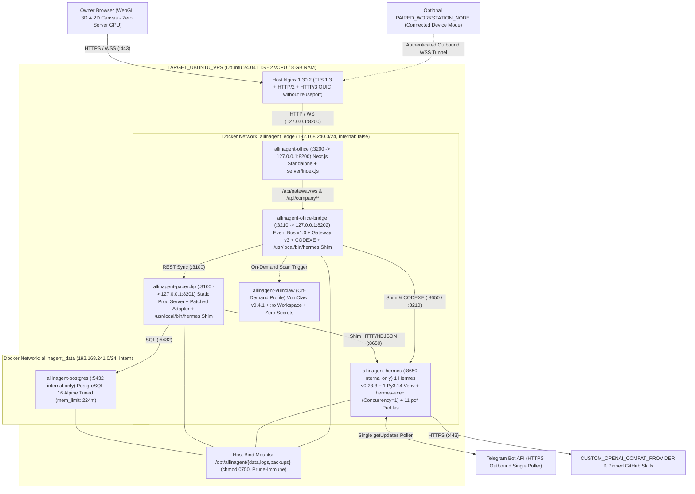
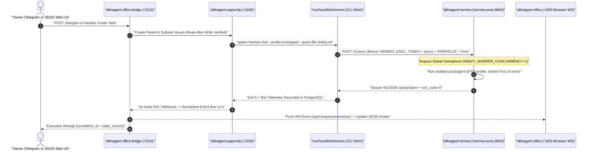
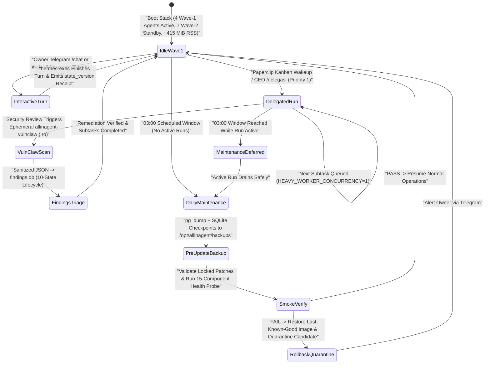

# PHASE 03 — Architecture Decision Record (ADR) & Production System Design

- **Phase ID:** `PHASE-03`
- **Status:** `APPROVED` (`Principal Architecture Baseline for PHASE-05 through PHASE-29`)
- **Prerequisites Verified:** `PHASE-00` (30-Feature Inventory), `PHASE-01` (10.36 GB Storage Audit), `PHASE-02` (2 vCPU / 8 GB RAM VPS Capacity Audit), `PHASE-04` (Upstream & Patch Preservation Audit)
- **Target Host Envelope:** `<TARGET_UBUNTU_VPS>` (`Ubuntu 24.04.4 LTS`, `2 vCPU`, `7.76 GiB` physical RAM, `3,407 MiB` live `MemAvailable`, `cgroup v2`, Docker `29.1.3` + Compose `v2.40.3`)
- **Hard Cgroup Memory Ceiling:** **`<= 1,536 MiB` (`1.50 GiB`)** across the entire `ALLINAGENT` stack (`1,408 MiB` always-on + `128 MiB` on-demand security burst, matching `compose.production.yaml`), preserving **`>= 1,871 MiB`** untouched host burst buffer
- **Public-Release Sanitization Level:** `STRICT` (`100%` sanitized for public open-source GitHub release)

---

## 1. Architectural Context & Design Forces

`ALLINAGENT` transforms a multi-root local Windows autonomous AI company (`10.36 GB` across 5 directories, `~1,389.2 MB` working set across 25 processes) into a clean, Linux-first, open-source platform that anyone can self-host via a single installer (`install.sh` + `docker compose`) while simultaneously running 24/7 in production on `<TARGET_UBUNTU_VPS>`.

Five empirical constraints from `PHASE-00`–`PHASE-04` govern every decision in this document:

1. **Zero Feature Regression (`FEAT-01`..`FEAT-30`):** All 11 AI corporate agents, 33 SHA-pinned GitHub role skills, 59 Telegram CODEXE slash commands across 13 inline submenus, 3D WebGL + 2D Pixel Office visualization, Paperclip Kanban/budgets/approvals, defensive `VulnClaw` findings pipeline, and PDF/DOCX compliance reporting must operate at 100% parity.
2. **Strict Physical RAM Ceiling (`<= 1,536 MiB` Cgroup Max / `<= 1,280 MiB` Active Working Set):** `<TARGET_UBUNTU_VPS>` has `3,407 MiB` `MemAvailable` and `2.63 GiB` swap already populated by existing multi-tenant services (`41` systemd units + `34` Docker containers). `ALLINAGENT` must never push the host into swap thrashing or OOM kills.
3. **2-vCPU Contention & Off-Host Build Rule:** Because `<TARGET_UBUNTU_VPS>` has 2 vCPUs (`35.5%–46.0%` baseline load, `4–8%` hypervisor steal) and Docker builds previously spiked `docker.service` to `1,485 MiB`, heavy Next.js/TypeScript image builds must run in GitHub Actions CI (`PHASE-21`/`PHASE-22`) and publish to GHCR, with per-container `cpus <= 1.00` enforced at runtime.
4. **Elimination of Multi-Runtime Duplication:** Duplicating Python `3.14` + `hermes-agent` + skill dependencies inside `paperclip`, `office-bridge`, and `hermes` containers would consume `> 2.5 GB` disk and `> 1.8 GB` RAM. Execution must be centralized into a single shared Hermes runtime accessed via a lightweight CLI shim.
5. **Host Firewall, Subnet & Nightly Prune Coexistence:** Existing Docker bridges occupy `172.17.0.0/16`, `172.18.0.0/16`, and `172.20.0.0/24`–`172.20.8.0/24`; host ports `3306`, `5432`, and `6379` are occupied; `DOCKER-USER` drops direct `eth0` container ingress; Host Nginx `default.conf` already owns `listen 443 quic reuseport`; and nightly `04:00 UTC` cron scripts prune stopped containers and dangling volumes.

---

## 2. Core Architecture Topology

---

## 3. Architecture Decision Records (`ADR-001` – `ADR-009`)

### ADR-001 — Control Plane (`allinagent-paperclip` + Tuned `PostgreSQL 16`)

- **Context:** On `<WINDOWS_BASELINE_HOST>`, Paperclip (`paperclipai@2026.1117.0`) consumes `713.02 MB` RAM and spawns `@embedded-postgres/windows-x64` (`430.50 MB` across 16 processes) while bundling `1.80 GB` of unused `win32` CLI vendor packages (`@openai/codex-win32-x64`, `@anthropic-ai/claude-agent-sdk-win32-x64`, `opencode-windows-x64`). Building the 17,360-file Paperclip Turborepo from raw TypeScript on a 2-vCPU VPS risks OOM termination.
- **Alternatives Rejected:**
  1. *Embedded PostgreSQL inside the Paperclip container:* Couples DB lifecycle to Node restarts, complicates `pg_dump` backups, and bloats container memory.
  2. *Sharing the host's existing PostgreSQL (`:5432`) or MySQL (`:3306`):* Violates tenant isolation and risks schema/credential coupling with unrelated host workloads.
- **Decision:**
  - Run **`allinagent-paperclip`** as a slim Node.js 22 LTS production server installing locked `paperclipai@2026.1117.0` (`npm ci --omit=optional`), stripping non-Hermes optional CLI vendor binaries (`codex`, `claude`, `opencode`, `embedded-postgres`, non-`linux-x64` `paperclip-runnerd` binaries -> saves `~1.80 GB`), applying `patches/paperclip/patch-manifest.json` (`0001..0004` patches for `execute.js` `--query-file`, `skills.js` `--` skill-registry reconciliation, internal host allowlisting, and low-memory DB pooling), and capping V8 heap via `NODE_OPTIONS="--max-old-space-size=288"` (`mem_limit: 416m`).
  - Run **`allinagent-postgres`** using official `postgres:16-alpine` strictly inside `allinagent_data` (`internal: true`, `0` host ports, `mem_limit: 224m`) tuned specifically for `2 vCPU / 8 GB RAM`:
    - `shared_buffers = 56MB`
    - `effective_cache_size = 160MB`
    - `work_mem = 4MB`
    - `maintenance_work_mem = 32MB`
    - `wal_buffers = 2MB`
    - `max_connections = 35`
    - `checkpoint_completion_target = 0.9`
    - `random_page_cost = 1.1`
  - **Impact:** Control plane + database steady-state RSS drops from `~1,143.5 MB` on Windows to **`~215–410 MiB`** under a combined `640 MiB` (`416m + 224m`) hard cgroup cap.

---

### ADR-002 — Shared Execution Runtime (`allinagent-hermes`) & `hermes-exec` Concurrency Daemon

- **Context:** All 11 AI corporate agents (`pcceoagent` .. `pccompliancereporter`), the Telegram Bot Gateway (`unified-company-control`), and 33 role skill packages run on `NousResearch/hermes-agent` `v0.23.3` (`eb49b8920a`). Spawning unrestricted parallel `hermes chat` processes during a 6-subtask CEO delegation would multiply Python/LLM/tool memory and saturate 2 vCPUs.
- **Alternatives Rejected:**
  1. *11 separate agent containers:* `11 x ~150 MiB = 1,650 MiB` idle RAM before executing a single task — immediately exceeds the `1,536 MiB` VPS ceiling.
  2. *Per-profile Python virtual environments or per-profile LSP copies:* Wastes hundreds of megabytes of duplicate site-packages and `models_dev_cache.json` files (`59.4 MB` wasted on baseline alone).
- **Decision:**
  - Consolidate 100% of agent and gateway Python execution into **`allinagent-hermes`** (`mem_limit: 384m`, `cpus: "0.85"`):
    1. **1 Hermes `v0.23.3` Codebase (`/opt/hermes/src`):** Shallow-fetched at locked commit `eb49b8920a25ffa7bb2fadf548fe819221ca79d7`, stripped of non-runtime subtrees (`apps/desktop`, `website`, `tests`, `evals`, `nix` -> `< 75 MiB`), with `patches/hermes-agent/0001-error-classifier-integrator.patch` (`+1` line `"model_not_available_for_integrator"`) verified at build time.
    2. **1 Shared Python 3.14 `uv` Virtual Environment (`/opt/hermes/venv`):** Includes Hermes runtime dependencies plus shared PDF/DOCX/compliance libraries (`pypdf`, `reportlab`, `python-docx`, `lxml`, `pyyaml`) with `--no-cache` (`0 B` build cache retained).
    3. **Internal `hermes-exec` Worker Daemon (`0.0.0.0:8650` inside `allinagent_edge`, `0` host ports):** Lightweight async Python daemon enforcing global **`HEAVY_WORKER_CONCURRENCY=1`** via a priority semaphore:
       - **Priority 0 (Interactive Lane):** Owner direct `/chat`, `/ke`, and active `/diskusi_rapat` turns preempt queued background tasks after current turn completion (`timeout <= 85s`).
       - **Priority 1 (Autonomous Kanban & Security Lane):** Paperclip delegated subtasks and `VulnClaw` scans execute sequentially (`max_parallel_engineering_tasks = 1`), guaranteeing predictable memory (`<= 380 MiB` peak inside `allinagent-hermes`).
    4. **Single Telegram Gateway Poller:** Supervised inside `allinagent-hermes` (`python -m hermes_cli.main gateway run`) loading `/var/lib/allinagent/hermes/plugins/unified-company-control/`. Enforces a strict PID/lockfile invariant so only **one** `getUpdates` poller ever touches `TELEGRAM_BOT_TOKEN`.
    5. **11 Isolated Non-Root `pc*` Profiles (`/var/lib/allinagent/hermes/profiles/pc*`):**
       - Owned by unprivileged `allinagent` user (`UID 10001:10001`), directory mode `0700` (files `0600`).
       - Contains `.no-bundled-skills` (`1`) so owner skills never sync into worker homes, and **omits `TELEGRAM_BOT_TOKEN`** from worker `.env` files.
       - Shares read-only `/var/lib/allinagent/hermes/shared/models_dev_cache.json` and POSIX symlinks into `/var/lib/allinagent/skill-registry/reviewed/<pkg>`, while isolating per-agent `SOUL.md`, `config.yaml`, `state.db`, `memories/`, and `sessions/`.

---

### ADR-003 — Lightweight Remote CLI Shim (`/usr/local/bin/hermes`)

- **Context:** Both Paperclip's `@paperclipai/hermes-paperclip-adapter` (`allinagent-paperclip`) and Office Bridge's `agent-chat-engine.js` (`allinagent-office-bridge`) invoke the `hermes` CLI binary (`hermes chat --profile pc* --query-file <file>`) as a child process and parse its streamed stdout/stderr and exit code.
- **Decision:**
  - Install a `< 8 KB` POSIX/Node **Remote CLI Shim** at **`/usr/local/bin/hermes`** inside `allinagent-paperclip` and `allinagent-office-bridge` (with zero Python or Hermes installation in either Node image).
  - When invoked, `/usr/local/bin/hermes`:
    1. Parses CLI arguments, reads any `--query-file <path>` payload into memory before submission, and captures whitelisted `PAPERCLIP_*` and `ALLINAGENT_*` environment variables (`PAPERCLIP_API_URL`, `PAPERCLIP_RUN_ID`, `PAPERCLIP_TASK_ID`, `PAPERCLIP_AGENT_ID`, `PAPERCLIP_COMPANY_ID`, `PAPERCLIP_WAKE_REASON`, `PAPERCLIP_WAKE_COMMENT_ID`).
    2. Sends an authenticated `POST http://allinagent-hermes:8650/v1/exec` request (`Authorization: Bearer ${HERMES_EXEC_TOKEN}`) over `allinagent_edge` and streams back chunked NDJSON (`stdout`, `stderr`, `exit_code`).
    3. Propagates `SIGTERM`/`SIGINT` (`AbortController` cancellation from `/batal_job` or `/stop_semua`) to `DELETE http://allinagent-hermes:8650/v1/exec/<exec_id>` for clean remote worker termination.
  - **Impact:** Zero adapter rewrite required beyond the preserved 2-file `execute.js`/`skills.js` patch, while saving **`> 1.5 GB`** of duplicated container layers and **`> 400 MiB`** RAM.

---

### ADR-004 — Isolated On-Demand Defensive Security Worker (`allinagent-vulnclaw`)

- **Context:** `VulnClaw` (`v0.4.1`, `0b34878f84`) performs defensive static source-code and dependency security scanning. Keeping a dedicated security environment resident 24/7 wastes memory, and running static analyzers over untrusted repositories inside a privileged container creates unnecessary risk.
- **Decision:**
  - Package clean upstream `VulnClaw` `v0.4.1` (`0` upstream patches) + minimal defensive static-analysis Python dependencies into **`allinagent-vulnclaw`** (`mem_limit: 128m`, `cpus: "0.50"`), governed by `config/vulnclaw.defensive.yaml` and `components/vulnclaw/`.
  - Configure as an **on-demand ephemeral worker** (`profiles: ["security"]`, `0 MiB` idle RAM when inactive) coordinated through the global `HEAVY_WORKER_CONCURRENCY=1` broker.
  - Enforce strict defense-in-depth isolation:
    - Target project directory mounted **read-only (`:ro`)**.
    - Root filesystem **`read_only: true`** with bounded `tmpfs: /tmp:size=64m,noexec,nosuid`.
    - **`cap_drop: ["ALL"]`** and **`security_opt: ["no-new-privileges:true"]`**.
    - **Zero secrets injected** (`0` `TELEGRAM_BOT_TOKEN`, `0` `CUSTOM_API_KEY`, `0` `PAPERCLIP_API_KEY`).
    - **Zero Docker socket (`/var/run/docker.sock` is NEVER mounted into any `ALLINAGENT` container).**
    - Emits sanitized candidate JSON reports to `/var/lib/allinagent/data/findings/inbox`, where `integration/findings_engine.py` strips any prompt-injection directives (`DIRECTIVE_MARKER_RE`) and records fingerprinted findings in `findings.db` across its 10-state defensive lifecycle (`RECEIVED` .. `RESOLVED`/`ACCEPTED_RISK`).

---

### ADR-005 — Browser-Rendered Visualization Plane (`allinagent-office`)

- **Context:** `Hermes3D` + `2D Pixel Office` + `EnterpriseOfficeOverlay` uses `Three.js` (WebGL) and `Phaser` (HTML5 2D Canvas) alongside a custom Node.js HTTP/WS server (`server/index.js`) enforcing `/login` token authentication and two custom WebSocket upgrade routes. `<TARGET_UBUNTU_VPS>` has **no GPU** and only 2 vCPUs.
- **Alternatives Rejected:**
  1. *Server-side 3D rendering / pixel streaming:* Impossible without a GPU and catastrophic for CPU/RAM on a 2-vCPU VPS.
  2. *Replacing `server/index.js` with plain `next start`:* Would break `/login` `studio_access` cookie enforcement and drop custom WebSocket upgrade routing for `/api/gateway/ws` and `/api/company/events/ws`.
- **Decision:**
  - Build `apps/hermes3d` in CI using Next.js `output: "standalone"` (`productionBrowserSourceMaps: false`) while preserving **`server/index.js`** (`access-gate.js` + `gateway-proxy.js` + `/api/company/events/ws` upstream WS bridge) as the container entrypoint (`mem_limit: 224m`, `NODE_OPTIONS="--max-old-space-size=160"`, `cpus: "0.50"`).
  - **100% Client-Side Rendering:** `allinagent-office` serves compressed static `.glb`/`.hdr`/sprite bundles and proxies authenticated JSON/WebSocket frames; 100% of 3D WebGL and 2D Canvas rendering executes on the **viewer's browser device (`0%` VPS GPU usage)**.
  - For Telegram `/screenshot_kantor`: `Standard Production` invokes ephemeral headless Chromium (`--headless=new --disable-gpu --no-sandbox --disable-dev-shm-usage`) on demand inside `allinagent-hermes` (serialized by `HEAVY_WORKER_CONCURRENCY=1`) and immediately exits (`0 MiB` idle browser footprint); `Low-Resource Production` renders a zero-Chromium deterministic 2D SVG/PNG office floorplan snapshot (`< 15 MiB` transient RSS).

---

### ADR-006 — Integration Layer (`allinagent-office-bridge`)

- **Context:** `office-bridge` is the first-party nervous system connecting Paperclip, Hermes, `Hermes3D`/`2D Pixel Office`, `VulnClaw` findings, Skill Telemetry, and the 59-command Telegram CODEXE Control Center. On baseline Windows, `server.js` enforced `host === "127.0.0.1"` and hardcoded Windows `D:\...` paths across Nov 21–23 modules.
- **Decision:**
  - Reconcile all 26 Nov 21–23 `office-bridge` files with `contracts/paths.js` into **`allinagent-office-bridge`** (`mem_limit: 160m`, `NODE_OPTIONS="--max-old-space-size=112"`, `cpus: "0.40"`).
  - Update bind validation in `office-bridge/server.js`: default to `127.0.0.1` on bare-metal hosts, and permit `0.0.0.0:3210` **only** when `ALLINAGENT_CONTAINER_MODE=true` inside the isolated `allinagent_edge` bridge (with host port publishing restricted to `127.0.0.1:8202:3210`).
  - Wire service discovery via Docker DNS environment variables:
    - `PAPERCLIP_API_URL=http://allinagent-paperclip:3100`
    - `HERMES_EXEC_URL=http://allinagent-hermes:8650`
    - `OFFICE_INTERNAL_URL=http://allinagent-office:3200`
  - Preserve all five core integration capabilities:
    1. **Normalized Event Bus v1.0 (`/api/events/ws`):** 500-event ring buffer + JSONL history (`office-data/event-history/recent-events.jsonl`) driven by 3s Paperclip state delta polling.
    2. **Gateway Protocol v3 (`/ws`):** Bidirectional RPC for 11-agent 3D/2D standups, live avatar workstations, direct employee chat, and office layout persistence.
    3. **59-Command Telegram CODEXE Suite (`/api/office-bridge/telegram/command`):** `37` canonical commands + registered aliases (`59` deterministic slash commands) across `13` interactive `uac:sub:*` submenus, with `<OWNER_TELEGRAM_ID>` caller verification, idempotency cache, `AbortController` job cancellation, and `state_version` execution receipts.
    4. **Read-Only Skill Telemetry (`adapters/agent-skills-bridge.js`):** Exposes verified `skill-lock.json`, Sentry scan status, and `.usage.json` invocation history to UI and Telegram while strictly blocking arbitrary remote skill installation.
    5. **Authenticated PDF/DOCX Report Serving:** Streams compliance and security deliverables from `/var/lib/allinagent/reports/` through `redaction.js` header/path guards without exposing host filesystem paths.

---

### ADR-007 — Four Canonical Deployment Modes

To support cloud VPS production, constrained 4 GB droplets, local contributor workflows, and hybrid desktop workspaces from a single codebase, `ALLINAGENT` defines four first-class deployment modes:

| Mode | Compose / Entrypoint | Target Hardware | Key Architectural Behavior |
| :--- | :--- | :--- | :--- |
| **1. `Standard Production`** *(Default)* | `docker compose -f compose.yaml -f compose.production.yaml up -d` | `>= 2 vCPU / 8 GB RAM` Ubuntu/Debian VPS (`<TARGET_UBUNTU_VPS>`) | Full 5 always-on containers (`1,408 MiB` cgroup sum) + on-demand `vulnclaw` (`128 MiB`, `1,536 MiB` max ceiling); `HEAVY_WORKER_CONCURRENCY=1`; Wave-1 warm profiles (`ceo`, `backend`, `qa`, `security-reviewer`); 3D + 2D Office enabled; prebuilt GHCR images behind Host Nginx TLS. |
| **2. `Low-Resource Production`** | `docker compose -f docker-compose.yml -f docker-compose.lowmem.yml up -d` | `2 vCPU / 4 GB RAM` VPS or high-density shared host | Tightened `<= 1,024 MiB` cgroup ceiling; defaults UI to `2D Pixel Office` (3D optional toggle); disables headless Chromium in favor of SVG floorplan snapshots; strict Wave-1 4-agent active roster with lazy wake + rapid idle cooldown. |
| **3. `Development`** | `docker compose -f docker-compose.dev.yml up` *(or native `node start-all.mjs`)* | Contributor Linux / macOS / Windows workstation (`>= 8 GB RAM`) | Bind-mounts live `office-bridge/`, `integration/`, `hermes3d/`, and `agents/` source trees with hot reload, mounts synthetic test repositories under `/workspaces/sandbox`, and enables debug test harnesses. |
| **4. `Connected Device`** *(Optional Hybrid)* | `Standard Production` on VPS + `scripts/connected-runner.mjs` on `<PAIRED_WORKSTATION_NODE>` | Cloud VPS + Paired Windows / macOS / Linux PC | Paired workstation initiates an outbound-only authenticated WSS / WireGuard / Tailscale tunnel to `allinagent-office-bridge`. Allows `/jelajah` / `/analisis` on explicitly allowlisted local PC folders and optional desktop/browser CUA tasks **strictly gated by Owner `/persetujuan` -> `/setujui` approval**. |

---

### ADR-008 — Network Isolation, Loopback Ports, Nginx QUIC & Cgroup Memory Budgets

#### 8.1 Two-Tier Docker Network Topology (Collision-Free Subnets)
Because `172.17.0.0/16`, `172.18.0.0/16`, and `172.20.0.0/24`–`172.20.8.0/24` are occupied on `<TARGET_UBUNTU_VPS>` (and host UFW rules grant `172.16.0.0/12` access to internal tunnel ports), `ALLINAGENT` uses RFC1918 `192.168.240.0/23` space:
- **`allinagent_edge` (`driver: bridge`, `internal: false`, subnet `192.168.240.0/24`):** Connects `allinagent-office`, `allinagent-office-bridge`, `allinagent-paperclip`, `allinagent-hermes`, and on-demand `allinagent-vulnclaw`. Permits controlled loopback ingress (`127.0.0.1:8200–8202`) and outbound HTTPS (`:443`) to LLM APIs, `api.telegram.org`, and GitHub.
- **`allinagent_data` (`driver: bridge`, `internal: true`, subnet `192.168.241.0/24`):** Air-gapped internal network attaching **only** `allinagent-postgres` and `allinagent-paperclip`. Zero host port bindings, zero internet egress, and zero cross-bridge visibility to other host containers.

#### 8.2 Safe Host Loopback Ports & Host Nginx HTTP/3 Coexistence
All public traffic enters exclusively through **Host Nginx (`:80` / `:443`)**, satisfying host `UFW` and `DOCKER-USER` (`eth0` drop) policies:
- **`127.0.0.1:8200` -> `allinagent-office:3200`:** Primary reverse-proxy upstream for `https://<PUBLIC_OFFICE_DOMAIN>` (HTTP + `/api/gateway/ws` + `/api/company/events/ws` WebSocket `Upgrade` headers).
  - *Nginx HTTP/3 Rule (`PHASE-02` Verified):* Because `/etc/nginx/sites-enabled/default.conf` already declares `listen 443 quic reuseport default_server;`, the `ALLINAGENT` Nginx vhost **must** specify `listen 443 ssl;` and `listen 443 quic;` **without `reuseport`**.
- **`127.0.0.1:8201` -> `allinagent-paperclip:3100`:** Localhost-only Control Plane health/admin probe endpoint (never exposed publicly).
- **`127.0.0.1:8202` -> `allinagent-office-bridge:3210`:** Localhost-only Bridge health/diagnostics and optional authenticated Connected Device tunnel upstream.
- **`allinagent-hermes:8650` & `allinagent-postgres:5432`:** **`0` host ports published** (avoids any collision with host `:5432`, `:3306`, or `:6379`).

#### 8.3 Host Bind Mounts & Prune-Cron Immunity
To survive nightly `04:00 UTC` automated `docker image/container/volume prune` jobs on `<TARGET_UBUNTU_VPS>`:
1. Every always-on service sets **`restart: unless-stopped`** and a container **`healthcheck`**.
2. All persistent state lives in root-owned (`0750`, container UID `10001` subdirs) **host bind mounts** under **`/opt/allinagent/`** (`/opt/allinagent/data/{postgres,paperclip,hermes,office-data,findings,reports,skill-registry}`, `/opt/allinagent/logs`, `/opt/allinagent/backups`) — never anonymous or prune-vulnerable Docker volumes.
3. Every container enforces `logging: { driver: "json-file", options: { "max-size": "10m", "max-file": "3" } }` (capping total container logs `< 180 MiB`).

#### 8.4 Per-Container Cgroup v2 Memory & CPU Budget (`<= 1,536 MiB` Hard Ceiling — `compose.production.yaml`)

| Container Name | Plane | Networks | Host Loopback Port | Idle RSS Est. | Active RSS Est. | Hard `mem_limit` | CPU Cap (`cpus`) | Key Memory Tuning |
| :--- | :--- | :--- | :--- | ---: | ---: | ---: | ---: | :--- |
| `allinagent-postgres` | Control DB | `allinagent_data` | *None (`internal`)* | `60 MiB` | `130 MiB` | **`224m`** | `0.45` | `postgres:16-alpine`, `shared_buffers=56MB`, `max_connections=35` |
| `allinagent-paperclip` | Control Plane | `allinagent_edge`, `allinagent_data` | `127.0.0.1:8201` | `155 MiB` | `280 MiB` | **`416m`** | `0.75` | `NODE_OPTIONS="--max-old-space-size=288"`, `/usr/local/bin/hermes` shim |
| `allinagent-hermes` | Shared Runtime | `allinagent_edge` | *None (`:8650` internal)* | `95 MiB` | `310 MiB` | **`384m`** | `0.85` | 1 Py3.14 venv, `HEAVY_WORKER_CONCURRENCY=1`, 11 `pc*` profiles (`Wave-1`: `ceo`, `backend`, `qa`, `security-reviewer`) |
| `allinagent-office-bridge` | Integration | `allinagent_edge` | `127.0.0.1:8202` | `55 MiB` | `110 MiB` | **`160m`** | `0.40` | `NODE_OPTIONS="--max-old-space-size=112"`, 500-event ring cap |
| `allinagent-office` | Visualization | `allinagent_edge` | `127.0.0.1:8200` | `65 MiB` | `145 MiB` | **`224m`** | `0.50` | Next.js `standalone`, `NODE_OPTIONS="--max-old-space-size=160"`, browser WebGL/Canvas |
| **Always-On Subtotal (5 Services)** | — | — | — | **`~430 MiB`** | **`~975 MiB`** | **`1,408 MiB`** | *Shared 2 vCPU* | Fits cleanly inside `350–768 MiB` idle & `<= 1,280 MiB` active targets |
| `allinagent-vulnclaw` *(On-Demand)* | Security Worker | `allinagent_edge` | *None (ephemeral)* | **`0 MiB`** | `105 MiB` *(burst)* | **`128m`** | `0.50` | `profiles: ["security"]`, `:ro` mount, serialized via `HEAVY_WORKER_CONCURRENCY=1` |
| **WORST-CASE GRAND TOTAL** | — | — | — | **`~430 MiB`** | **`<= 1,080 MiB`** | **`1,536 MiB`** | `<= 0.85`/ctr | **Leaves `>= 1,871 MiB` (`1.83 GiB`) untouched host burst buffer** |

---

### ADR-009 — Reproducible Source & License-Safe Skill Supply Chain

- **Decision:**
  - Keep the `ALLINAGENT` Git repository at **`~11.5 MiB` (`< 950` tracked files)** by committing reconciled first-party services (`apps/office-bridge/`, `apps/control-center/`, `apps/hermes3d/`, `components/`, `integrations/`, `agents/`, `scripts/`, `deploy/`, `docs/`, `tests/`), exact 40-char upstream commit pins (`components.lock.json`), and auditable patch files (`patches/hermes-agent/` and `patches/paperclip/`), while permanently excluding `src/lib/avatars/vendor/multiavatar.js` (`MULTIAVATAR LICENSE v1.0`).
  - Commit `skills/manifests/skills.lock.json` (`20` OSI-permissive redistributable skills + `13` `FETCH_FROM_UPSTREAM_ONLY` skills: `10` `borghei/Claude-Skills` `MIT-Commons-Clause-1.0` + `1` `vercel-labs/agent-skills` `NOASSERTION` + `2` `anthropics/skills` `docx` & `pdf` bundling third-party OOXML `.xsd` schemas, with Nous Research MIT `microsoft-office` & `pdf` as `--strict-oss` / `--offline` fallbacks), while **excluding** `skills/{upstream,staging,reviewed,quarantine}` from Git so restricted packages are fetched directly from their upstream GitHub commits by `skills/install_agent_skills.py`, verified by SHA-256 + Sentry `skill-scanner`, and never redistributed in the public repo.

---

## 4. Phase 03 Gate Verification & Downstream Implementation Contract

| Downstream Phase(s) | Architectural Contract Locked by `PHASE-03` | Status |
| :--- | :--- | :--- |
| `PHASE-05` & `PHASE-06` | `~11.5 MiB` monorepo layout, `components.lock.json`, `patches/*`, and `FETCH_FROM_UPSTREAM_ONLY` (`13` restricted / `20` permissive) license compliance | `LOCKED` |
| `PHASE-07` & `PHASE-08` | `allinagent-hermes` single shared Python 3.14 venv (`384m`), `hermes-exec:8650` (`HEAVY_WORKER_CONCURRENCY=1`), `/usr/local/bin/hermes` CLI shim, 11 `0700` `pc*` profiles | `LOCKED` |
| `PHASE-09` & `PHASE-10` | `allinagent-paperclip` (`paperclipai@2026.1117.0` + `patch-manifest.json`, `416m`) + `allinagent-postgres` (`224m`) + ephemeral `:ro` `allinagent-vulnclaw` (`128m`) | `LOCKED` |
| `PHASE-11`, `PHASE-12` & `PHASE-15` | `allinagent-office` (`server/index.js` + client WebGL/Canvas) + `allinagent-office-bridge` (Docker DNS, Event Bus v1.0, Gateway v3, 59-command CODEXE) | `LOCKED` |
| `PHASE-16` | `Connected Device` outbound authenticated tunnel with `/persetujuan` Owner approval gate | `LOCKED` |
| `PHASE-18`, `PHASE-19`, `PHASE-24` & `PHASE-25` | `allinagent_edge` (`192.168.240.0/24`) + `allinagent_data` (`192.168.241.0/24` `internal: true`), `127.0.0.1:8200–8202`, Nginx QUIC without `reuseport`, `/opt/allinagent` bind mounts, `<= 1,536 MiB` total cgroup cap | `LOCKED` |
