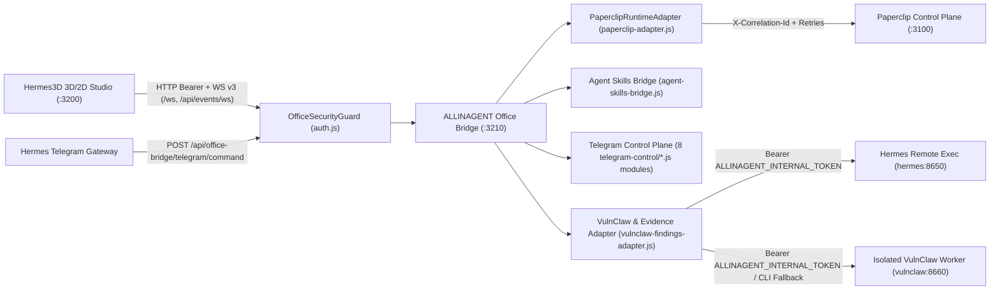

# PHASE 12 — Office Bridge & Internal API Cross-Platform Portability

- **Phase ID:** `PHASE-12`
- **Package:** `@allinagent/office-bridge@1.0.0` (`apps/office-bridge/`)
- **Status:** **`PASS`** (`12/12` automated unit & integration suites passing, `0` warnings, `0` `audit-public-release.py` findings, `0` committed `node_modules`)
- **Runtime Target:** Node.js `>=22.5.0` (`MIT` license, single runtime dependency `ws@^8.18.0`)

---

## 1. Executive Summary

Phase 12 unifies the complete ALLINAGENT 13-category Telegram Control Center (`8` `telegram-control/*.js` modules, `159` registered command/alias slugs covering all `59+` BotFather commands) and the 11-Agent Skill Registry Bridge (`adapters/agent-skills-bridge.js`) with a 100% cross-platform, container-ready runtime architecture under `apps/office-bridge/`:

1. **Zero Hardcoded Windows Paths, Personal Identifiers, or Paperclip UUIDs:**
   - All filesystem locations, service URLs, timezones, model identifiers, and CLI tool paths resolve dynamically via `contracts/paths.js` (`PLATFORM_ROOT = path.resolve(__dirname, "..", "..", "..")`).
   - All 11 corporate agent roles bind dynamically at runtime to live Paperclip agent UUIDs via `role_slug` / `runtime_profile_reference` / `display_name` matching (`resolveLiveCorporateDirectory` and `matchLiveAgentUuid`), falling back to portable `role:<slug>` identifiers when offline.
2. **Defense-in-Depth Trust Boundaries & Container Volume Alignment (`D1`):**
   - Removed the permissive Linux `/` path-validation bypass.
   - Enforced both POSIX forbidden system/credential roots (`/etc`, `/proc`, `/sys`, `/dev`, `/root`, `/boot`, `/run`, `/var/run`, `/var/lib/docker`, `/var/lib/allinagent/secrets`, `~/.ssh`, `~/.gnupg`, `~/.aws`, `~/.git-credentials`, `~/.docker`) and Windows system roots, plus `SECRETS_DIR`, `OFFICE_DATA_DIR`, and `HERMES_HOME_ROOT`.
   - Required all inspected workspace/evidence paths to reside under `ALLOWED_EVIDENCE_ROOTS` (`ALLINAGENT_WORKSPACE_ROOT` / `workspaces/`, `ALLINAGENT_REPORTS_ROOT` / `/var/lib/allinagent/reports` / `reports/`, `docs/`, `AUTHORIZED_WORKSPACES`, and validated `target-folders.json` entries) while preserving strict POSIX case sensitivity on Linux and eliminating `/` $\rightarrow$ `\` path corruption.
   - Added `ob_tok_*`, `st_tok_*`, `OFFICE_BRIDGE_TOKEN`, `STUDIO_ACCESS_TOKEN`, and `ALLINAGENT_INTERNAL_TOKEN` redaction patterns to `SECRET_PATTERNS` and `SENSITIVE_KEY_RE`.
3. **Fail-Closed Governance, Container Secrets & Service-to-Service Auth (`D1`):**
   - `AUTHORIZED_OWNER_ID` (`resolveAuthorizedOwnerId`) fails closed to `""` whenever unset, empty, or set to placeholder values (`"<PLACEHOLDER_OWNER_ID>"`, `"0"`, `"changeme"`), rejecting all HTTP, WebSocket, and Telegram mutations with `403`.
   - Honored `ALLINAGENT_SECRETS_DIR` (defaulting in Linux container mode to `/var/lib/allinagent/secrets` if present, otherwise `secrets/`), and honored `OFFICE_BRIDGE_TOKEN` and `STUDIO_ACCESS_TOKEN` directly via environment variables in addition to `office-bridge-auth.json`.
   - Passed `ALLINAGENT_INTERNAL_TOKEN` (falling back to `HERMES_EXEC_SHARED_SECRET` / `VULNCLAW_SCAN_TOKEN`) as `Authorization: Bearer` and service token headers when calling `HERMES_REMOTE_EXEC_URL` (`http://hermes:8650`) and `VULNCLAW_WORKER_URL` (`http://vulnclaw:8660`).
   - Added container bind support (`0.0.0.0` / `::`) gated on `OFFICE_BRIDGE_ALLOW_CONTAINER_BIND=1` or `/.dockerenv`, plus RFC1918 private network client support (`10.0.0.0/8`, `172.16.0.0/12`, `192.168.0.0/16`) on HTTP and WebSocket upgrades when `OFFICE_BRIDGE_ALLOW_DOCKER_NETWORK=1` and a valid Bearer token or trusted `Origin` (`OFFICE_BRIDGE_ALLOWED_ORIGINS`) is presented.
   - Applied POSIX `0o700` directory and `0o600` file permissions on secret and audit ledgers.
4. **Complete REST & Gateway WebSocket v3 API Surface + 33-Skill Manifest Alignment:**
   - Implemented the `exec.approval.resolve` WebSocket RPC handler (supporting both Paperclip approvals and target-bound `req_*` one-time approvals, broadcasting `exec.approval.resolved` frames and `approval.resolved` event-bus records).
   - Wired `skills.status` WS RPC and `GET /api/office-bridge/skills` REST route to `adapters/agent-skills-bridge.js` and Paperclip `/api/companies/:id/skills`, resolving `skills/manifests/skills.lock.json` and `skills/manifests/skill-security-results.json` when `skill-registry/` is not yet hydrated and accurately reporting all `33` locked skills (`20` OSI-permissive + `13` `FETCH_FROM_UPSTREAM_ONLY`, including all `10` `MIT-Commons-Clause-1.0` skills and `11` quarantined supply-chain exclusions).
   - Added `GET / POST / PATCH /api/office-bridge/projects` and `GET /api/office-bridge/reports` + `GET /api/office-bridge/reports/:filename` (honoring `ALLINAGENT_REPORTS_ROOT` / `/var/lib/allinagent/reports` and safely serving `.pdf`, `.docx`, and `.md` artifacts with path-traversal and sensitive-filename protection).
   - Added `.pdf` and `.docx` binary signature & SHA-256 metadata inspection in `adapters/vulnclaw-findings-adapter.js`, on-demand HTTP scanning via `VULNCLAW_WORKER_URL` with CLI fallback, `X-Correlation-Id` end-to-end header generation/propagation, and bidirectional Paperclip budget synchronization (`syncBudgetsWithPaperclip`).

---

## 2. Architecture & Request Flow



---

## 3. Ported & Created File Inventory (`apps/office-bridge/`)

| Category | File Path | Key Responsibilities & Portability Upgrades |
| :--- | :--- | :--- |
| **Package & Config** | `package.json`, `package-lock.json`, `.gitignore` | `@allinagent/office-bridge@1.0.0` ("ALLINAGENT Office Bridge — Unified Real-Time Control Plane for 3D/2D Office, Paperclip, Hermes, VulnClaw, and Telegram"), `MIT`, `node >=22.5.0`, `ws@^8.18.0`, zero committed `node_modules`. |
| **Contracts** | `contracts/paths.js` | 3-level `PLATFORM_ROOT` resolver, `ALLINAGENT_SECRETS_DIR` (`/var/lib/allinagent/secrets` container default), `ALLINAGENT_WORKSPACE_ROOT`, `ALLINAGENT_REPORTS_ROOT` (`/var/lib/allinagent/reports`), `HERMES_HOME_ROOT`, `PAPERCLIP_BASE_URL`, `VULNCLAW_WORKER_URL`, `HERMES_REMOTE_EXEC_URL`, `ALLINAGENT_INTERNAL_TOKEN`, fail-closed `AUTHORIZED_OWNER_ID`, configurable `TIMEZONE`, portable tool discovery. |
| **Contracts** | `contracts/ws-loader.js` | Portable `ws` resolution (`OFFICE_BRIDGE_WS_PATH`, `NODE_PATH`, local/monorepo `node_modules`). |
| **Contracts** | `contracts/redaction.js` | `ob_tok_*` & `st_tok_*` redaction, Linux + Windows `FORBIDDEN_ROOTS` (including `/var/lib/allinagent/secrets`), `ALLOWED_EVIDENCE_ROOTS` honoring `ALLINAGENT_WORKSPACE_ROOT` and `ALLINAGENT_REPORTS_ROOT` without Linux `/` bypass, POSIX case-sensitive path checks. |
| **Contracts** | `contracts/event-schema.js` | Normalized Event Schema v1.0 (added `"telegram_gateway"` to `ALLOWED_SOURCES`), deduplication, stale marking, bounded ring buffer. |
| **Contracts** | `contracts/state-machine.js` | 6-dimensional honest agent state machine (`CONNECTIVITY`, `ACTIVATION`, `EXECUTION`, `TASK`, `COLLABORATION`, `VISUAL`). |
| **Contracts** | `contracts/agent-identity.js` | 8 departments, dynamic `role_slug` mapping across all 11 corporate roles, configurable `DEFAULT_LLM_MODEL`. |
| **Authorization** | `authorization/auth.js` | Honors `OFFICE_BRIDGE_TOKEN` and `STUDIO_ACCESS_TOKEN` env vars alongside `office-bridge-auth.json`, `buildInternalServiceAuthHeaders` (`ALLINAGENT_INTERNAL_TOKEN` / `HERMES_EXEC_SHARED_SECRET` / `VULNCLAW_SCAN_TOKEN`), POSIX `0o700`/`0o600` permissions, container bind & RFC1918 Docker network HTTP/WS guard, fail-closed mutation owner verification. |
| **Events** | `events/realtime-synchronizer.js` | Upstream Paperclip WebSocket + HTTP reconciliation, dynamic `paperclip.wsBaseUrl` & `Origin`, meeting standup synchronization. |
| **Adapters** | `adapters/paperclip-adapter.js` | Bounded upstream timeouts/retries, `X-Correlation-Id` propagation, `listProjects`, `createProject`, `ensureProject`, `updateProject`, `listCompanySkills`, `syncCompanyBudget`. |
| **Adapters** | `adapters/agent-skills-bridge.js` | Reads `skills/manifests/skills.lock.json` & `skills/manifests/skill-security-results.json` as primary/fallback manifests, reporting all `33` locked skills (`20` OSI-permissive + `13` `FETCH_FROM_UPSTREAM_ONLY`, including `10` Commons Clause skills), dynamic `role_slug` $\rightarrow$ live Paperclip UUID matching, merges Paperclip company skills. |
| **Adapters** | `adapters/target-folders-manager.js` | POSIX-safe `normalizeBrowseInputPath` (no `/` $\rightarrow$ `\` corruption on Linux), case-sensitive path keys, `AUTHORIZED_WORKSPACES` scoping. |
| **Adapters** | `adapters/agent-chat-engine.js` | POSIX + Win32 path candidate extraction, sanitized env-driven LLM completion & deterministic workspace inspection fallback. |
| **Adapters** | `adapters/analytics-telemetry-adapter.js` | Template-literal owner approval attribution, `Intl.DateTimeFormat` configurable `TIMEZONE`, bidirectional `syncBudgetsWithPaperclip`. |
| **Adapters** | `adapters/vulnclaw-findings-adapter.js` | On-demand `VULNCLAW_WORKER_URL` HTTP scan & `HERMES_REMOTE_EXEC_URL` bridge authenticated with `ALLINAGENT_INTERNAL_TOKEN`, CLI fallback, `.pdf` & `.docx` binary metadata inspection. |
| **Adapters** | `adapters/telegram-control-adapter.js` | Unified 13-category Telegram dispatcher with dynamic `resolveLiveCorporateDirectory(snapshot)` (`0` hardcoded UUIDs). |
| **Telegram Control** | `telegram-control/security-guard.js` | Fail-closed Owner DM guard, group/channel block, HMAC signed callbacks, replay ledger, expiring target-bound `req_*` approvals. |
| **Telegram Control** | `telegram-control/command-registry.js` | 13 `MENU_CATEGORIES`, `48` canonical commands + `111` aliases (`159` lookup slugs), argument schema validator, idempotency & cancellation tokens. |
| **Telegram Control** | `telegram-control/command-center-ui.js` | Interactive 13-submenu keyboard builder (`<=64`-byte callbacks) parameterized via `HERMES3D_BASE_URL`, `TELEGRAM_BOT_USERNAME`, and `TIMEZONE`. |
| **Telegram Control** | `telegram-control/folder-and-dev-controller.js` | Symlink/permission-guarded workspace explorer, source code analyzer (`.env` protected), cross-platform `git`/`node`/`npm`/`python3`/`php` execution without `shell: true`. |
| **Telegram Control** | `telegram-control/delegation-and-paperclip-controller.js` | Dispatch gate, parent + specialist child subtask orchestration, read-after-write Paperclip verification. |
| **Telegram Control** | `telegram-control/office-and-meeting-controller.js` | 3D/2D room occupancy honoring `STUDIO_ACCESS_TOKEN`, Linux Chromium `--no-sandbox` + Windows headless screenshot capture, 10-state 11-agent meeting lifecycle with dynamic `role_slug` action-item owners. |
| **Telegram Control** | `telegram-control/analytics-budget-security-health.js` | Windowed telemetry, governed budget ceiling & Paperclip sync, Linux `/proc` + `fs.statfsSync` host resource metrics, 15-component health matrix, graceful-drain recovery. |
| **Telegram Control** | `telegram-control/jobs-notifications-nl-reliability.js` | Circuit breakers, singleton locks, dead-letter queue, throttled notifications, async job runner, POSIX/Win32-aware Indonesian NL router. |
| **Server** | `server.js` | HTTP + Dual WebSocket (`/ws`, `/api/events/ws`) server with `/registry` `[DEFAULT_LLM_MODEL]` computed key, `X-Correlation-Id`, `/skills`, `/projects`, `/reports/:filename` (`ALLINAGENT_REPORTS_ROOT`), and `exec.approval.resolve`. |
| **Tests** | `tests/office-bridge.test.js`, `tests/telegram-control.test.js` | Hermetic `os.tmpdir()` unit & mock-server integration suites covering redaction, POSIX/Win32 path security, Docker RFC1918 auth, container env/secrets (`D1`), 33-skill lock manifest, projects, reports, VulnClaw/Hermes internal auth, `exec.approval.resolve`, and all 59+ Telegram commands. |

---

## 4. Verification & Public-Release Audit Evidence

### 4.1 Unit & Integration Test Execution (`node --test tests`)

```text
TAP version 13
ok 1 - 1. Portable PLATFORM_ROOT Resolution (3 Levels Up), Container Paths & Fail-Closed Owner ID
ok 2 - 2. Real Synthetic Secret Redaction (sk-*, Telegram, Paperclip, ob_tok_*, st_tok_*) & Directive Neutralization
ok 3 - 3. Cross-Platform Linux POSIX & Windows Trust-Boundary Path Validation (No `/` Bypass, Case-Sensitive POSIX)
ok 4 - 4. Normalized Event Schema v1.0, telegram_gateway Source, Deduplication, Stale Marking & Ring Buffer
ok 5 - 5. 6-Dimensional Agent State Machine & Dynamic 8-Department Identity Mapping
ok 6 - 6. Docker RFC1918 Network Guard, Fail-Closed Unconfigured Owner ID & Container Bind Policy
ok 7 - 7. Live Office Bridge Integration: Skills, Projects, Reports (.pdf/.docx/.md), VulnClaw Worker, Budgets & WS exec.approval.resolve
ok 8 - 1. CORPORATE_AGENT_DIRECTORY Has Zero Hardcoded UUIDs & Binds Dynamically via role_slug
ok 9 - 2. Canonical Registry Resolves All 59 CODEXE Commands + All 159 Canonical/Alias Slugs Without Collision
ok 10 - 3. POSIX & Win32 Path Handling + Bahasa Indonesia Natural Language Intent Router
ok 11 - 4. Phase 03 Mandatory Security Guards: Fail-Closed Unset Owner, Group Block, Callback Replay & Bound Approvals
ok 12 - 5. End-to-End Execution of All 13 CODEXE Categories via /api/office-bridge/telegram/command
# tests 12 | pass 12 | fail 0
```

### 4.2 Public-Release Security & Portability Scanner (`scripts/audit-public-release.py`)

Scanned all `29` files under `apps/office-bridge/` and `docs/phases/PHASE-12-office-bridge-portability.md`:

- **Committed `node_modules` in `apps/office-bridge/`:** **`None` (`False`)**
- **Scanner Findings in `apps/office-bridge/**`:** **`0`**
- **Scanner Findings in `docs/phases/PHASE-12-office-bridge-portability.md`:** **`0`**
