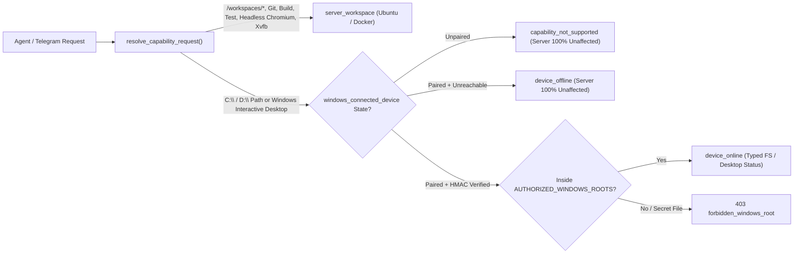

# PHASE 16 — Computer Use, Headless Browser & Connected Workspace Architecture

- **Phase ID:** `PHASE-16`
- **Status:** `PASS`
- **Scope:** `integrations/connected-device/**`
- **Python Verification Runtime:** `<LEGACY_PLATFORM_ROOT>/runtime/skill-tools-venv/Scripts/python.exe` (`Python 3.14.9`)

---

## 1. Executive Summary

`PHASE-16` replaces Windows-coupled local drive (`C:\` / `D:\`) and desktop assumptions with an honest, security-hardened **two-plane workspace & capability architecture**:

1. **`server_workspace` (Primary Autonomous Plane — Always Available):**
   - Runs natively inside Ubuntu 24.04 LTS / POSIX / Docker with Linux terminal, Git, coding, build/test toolchains, source code analysis, headless Chromium (`playwright` / `/usr/bin/chromium`), and optional virtual Xvfb desktop (`DISPLAY`), strictly jailed to `AUTHORIZED_WORKSPACES` (`/workspaces`).
   - Operates **100% independently** when no Windows PC is paired or when a paired PC is powered off.
2. **`windows_connected_device` (Optional Paired Remote Runner Plane):**
   - Enables a Windows user who explicitly wants remote access to selected local Windows project folders or interactive desktop status to run `windows_runner_agent.py` bound strictly to loopback (`127.0.0.1:8670`, tunneled via SSH `-R` or private WireGuard/Tailscale), authenticated via **HMAC-SHA256 + 60s timestamp skew + nonce replay protection** and jailed to explicit `AUTHORIZED_WINDOWS_ROOTS`.
   - Eliminates false capability claims: an Ubuntu server **never** claims it can directly inspect a remote PC's `C:\` or `D:\` drive unless a paired runner is authenticated and `device_online == true`.

---

## 2. Deliverables Created

| File Path | Purpose & Key Capabilities |
| :--- | :--- |
| `integrations/connected-device/__init__.py` | Package entrypoint exporting `PACKAGE_DIR`. |
| `integrations/connected-device/capability_discovery.py` | Runtime capability matrix detector (`detect_capability_matrix`), strict `/workspaces` realpath & secret jail (`validate_server_workspace_path`), HMAC client (`invoke_connected_windows_runner`), and honest request router (`resolve_capability_request`). |
| `integrations/connected-device/windows_runner_agent.py` | Optional zero-dependency stdlib Windows runner (`127.0.0.1:8670`), enforcing non-wildcard bind validation, non-admin privilege checks, HMAC-SHA256 + timestamp + nonce replay guard, `AUTHORIZED_WINDOWS_ROOTS` realpath jail, and zero arbitrary RCE endpoints. |
| `integrations/connected-device/test_connected_device.py` | Automated `unittest` suite (`7` test cases + `25` sub-assertions, including live ephemeral loopback HTTP server E2E tests) verifying server independence, symlink/traversal blocking, HMAC authentication, replay rejection, and `AUTHORIZED_WINDOWS_ROOTS` enforcement. |

---

## 3. Execution Plane & Honest State Matrix



| Scenario | `paired` | `device_online` | `device_offline` | `capability_not_supported` | `server_workspace` Status | Request to `C:\Projects\App` on Linux Server |
| :--- | :---: | :---: | :---: | :---: | :---: | :--- |
| **1. Fresh Ubuntu Server (Default)** | `false` | `false` | `true` | `true` | **`available: true` (100%)** | Rejected honestly with `capability_not_supported` |
| **2. Paired Windows PC Powered Off** | `true` | `false` | `true` | `false` | **`available: true` (100%)** | Rejected honestly with `device_offline` (3.0s bounded probe) |
| **3. Paired Windows PC Online (Root Allowed)** | `true` | `true` | `false` | `false` | **`available: true` (100%)** | Routed via HMAC-SHA256 over private tunnel (`device_online`) |
| **4. Paired Windows PC Online (Outside Root / `.env`)** | `true` | `true` | `false` | `false` | **`available: true` (100%)** | Rejected with `403 forbidden_windows_root` / `SENSITIVE_SECRET_FILE_BLOCKED` |

---

## 4. Security Architecture of `windows_runner_agent.py`

1. **Zero Public Exposure (`validate_private_bind_host`):**
   - Defaults to `127.0.0.1:8670` for SSH reverse port forwarding (`ssh -N -R 127.0.0.1:8670:127.0.0.1:8670`).
   - Permits direct binding to private RFC1918 (`10/8`, `172.16/12`, `192.168/16`) or WireGuard/Tailscale CGNAT (`100.64/10`) IPs **only** when `--allow-private-tunnel-ip` is explicitly passed.
   - **Hard-refuses** `0.0.0.0`, `::`, `*`, link-local, multicast, and all public/documentation IPv4/IPv6 addresses (`PUBLIC_WILDCARD_BIND_FORBIDDEN`).
   - Client-side `validate_connected_device_url` simultaneously refuses plain `http://` to any non-loopback/non-tunnel IP (`PUBLIC_HTTP_FORBIDDEN`).
2. **Never Permanent Admin (`enforce_least_privilege`):**
   - Inspects `IsUserAnAdmin()` on Windows and `os.geteuid() == 0` on POSIX at startup, refusing execution under elevated Administrator/root privileges (`PERMANENT_ADMIN_FORBIDDEN`).
3. **HMAC-SHA256 + Timestamp Skew + Replay Cache (`HmacReplayGuard`):**
   - Requires `CONNECTED_DEVICE_SHARED_SECRET` of `>= 32` non-placeholder characters.
   - Computes `HMAC-SHA256(secret, "{timestamp}.{nonce}.{METHOD}.{path}.{sha256(body)}")` verified via constant-time `hmac.compare_digest`.
   - Rejects clock skew `> 60s` (`401 TIMESTAMP_SKEW_EXCEEDED`), invalid signatures (`401 INVALID_HMAC_SIGNATURE`), and replayed nonces within the TTL window (`409 REPLAY_DETECTED`).
4. **No Arbitrary RCE & Strict `AUTHORIZED_WINDOWS_ROOTS` Jail (`AuthorizedWindowsRootsJail`):**
   - Exposes **only** typed, bounded read/status endpoints (`/v1/capabilities`, `/v1/fs/list`, `/v1/fs/stat`, `/v1/fs/read` capped at `256 KiB`, `/v1/desktop/status`). Requests to `/v1/exec`, `/v1/shell`, `/v1/cmd`, or `/v1/powershell` are deterministically rejected with `403 RCE_ENDPOINT_FORBIDDEN`.
   - Rejects bare drive roots (`C:\`, `D:\`, `/`), resolves canonical `os.path.realpath` to defeat `..` traversal and NTFS junctions/symlinks, blocks OS/credential directories (`Windows`, `System32`, `Program Files`, `<LOCAL_RUNTIME_DATA>`, `.ssh`, `secrets`), and hides/blocks all secret files (`.env*`, `auth.json`, `office-bridge-auth.json`, `*.local.*`, `*.pem`, `*.key`, `id_rsa`).

---

## 5. Pairing & CLI Reference

```bash
# 1. Inspect runtime capability matrix on Ubuntu server / container
python3 integrations/connected-device/capability_discovery.py --detect --json

# 2. Check routing verdict for a specific action & path
python3 integrations/connected-device/capability_discovery.py \
  --check-action source_analysis \
  --target-path /workspaces/sample-app \
  --json

# 3. Generate fresh 64-hex HMAC secret & SSH reverse-tunnel pairing template
python3 integrations/connected-device/windows_runner_agent.py --generate-pairing-config

# 4. Run optional paired Windows runner on Windows workstation (non-admin user)
#    Set CONNECTED_DEVICE_SHARED_SECRET in user environment first:
python integrations/connected-device/windows_runner_agent.py \
  --serve \
  --bind 127.0.0.1 \
  --port 8670 \
  --root "D:\Projects"
```

---

## 6. Verification Evidence

- **Bytecode Compilation (`py_compile`):** `EXIT_CODE=0` across all Phase 16 modules.
- **`capability_discovery.py --self-check`:** `8 / 8` assertions passed (`[PASS] capability_discovery self-checks passed (8/8)`).
- **`windows_runner_agent.py --self-check`:** `17 / 17` assertions passed (`[PASS] windows_runner_agent self-checks passed (17/17)`), including live loopback HTTP server authentication, replay defense (`409`), bad-HMAC rejection (`401`), stale-timestamp rejection (`401`), `.env` blocking (`403`), outside-root blocking (`403`), and `/v1/exec` RCE rejection (`403`).
- **Unit Test Suite (`unittest -v` with `-W default`):** `7 / 7` test cases passed (`0` errors, `0` warnings).
- **Privacy & Secret Scan:** `0` personal/private identifiers and `0` real secrets anywhere in `integrations/connected-device/**` or this document.
